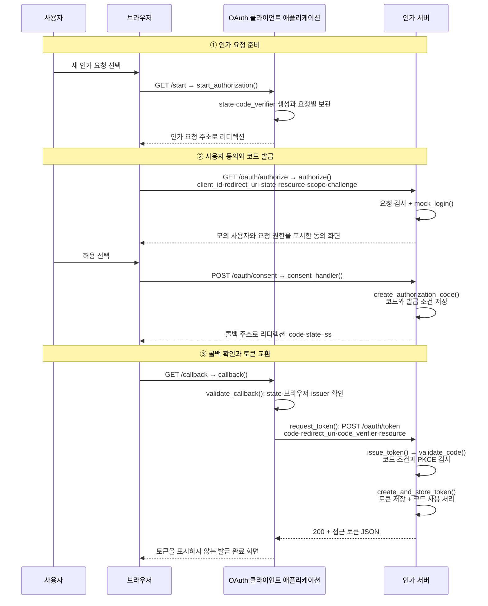
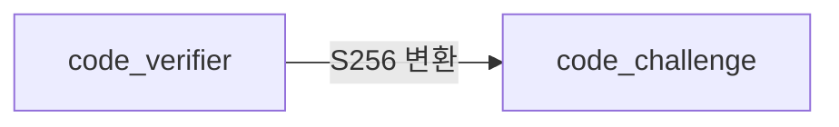
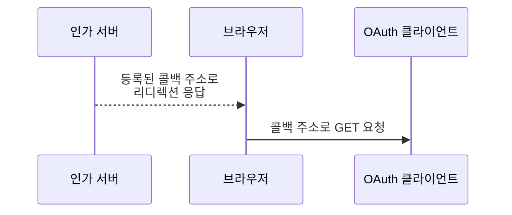
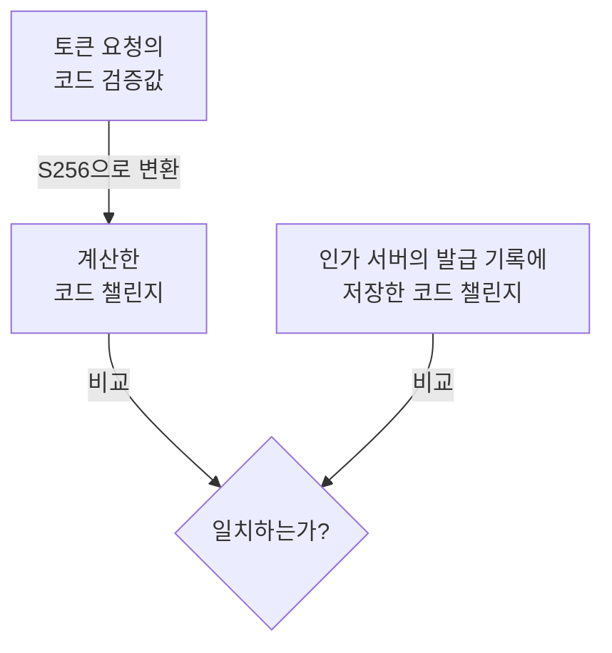

# Authorization Code + PKCE 방식의 토큰 발급

이 노트는 사용자가 접근 권한을 허용한 뒤, 애플리케이션이 인가 코드를 받아 접근 토큰으로 교환하는 과정을 설명한다. 애플리케이션은 **OAuth 클라이언트**(OAuth Client) 역할을 맡는다. MCP의 **호스트**(Host)는 애플리케이션 전체이고, 그 안의 **MCP 클라이언트**(MCP Client)는 MCP 서버와 통신하는 구성요소다. 여기서는 토큰 발급을 위한 독립적인 Python 애플리케이션을 사용한다.

전체 코드는 [인가 서버](examples/authorization_code_pkce_server.py)와 [클라이언트](examples/authorization_code_pkce_client.py)에 나누어 두었다. 본문의 코드는 해당 파일에서 필요한 부분만 발췌한다. 인가 서버 발견과 발급 이후의 MCP 요청은 [MCP OAuth2의 전체 구조와 접근 흐름](mcp-oauth2-flow.md)을 참고한다.

## 1. 토큰 발급의 전체 흐름

**인가 서버**(Authorization Server)는 사용자 동의와 요청 정보를 확인해 코드를 발급하고, 이후 코드 교환 요청을 검사해 토큰을 발급한다. **리소스 소유자**(Resource Owner)인 사용자는 브라우저에서 애플리케이션에 허용할 권한을 선택한다.

**인가 코드**(Authorization Code)는 토큰으로 교환할 때 사용하는 짧은 수명의 일회용 값이다. **접근 토큰**(Access Token)은 MCP 서버에 접근할 때 사용하는 값이다. 브라우저에는 인가 코드를 보내고, 접근 토큰은 클라이언트의 HTTP 요청에 응답하여 전달한다.



그림의 함수 이름은 두 예제 파일의 HTTP 처리 함수와 연결된다. 인가 서버는 실제 로그인 시스템 대신 `mock_login()`으로 고정된 `demo-user`를 반환한다. 브라우저의 허용·거부 선택은 실제로 처리한다. PKCE는 사용자 로그인을 대신하지 않는다.

| 발급 방식 | 토큰을 발급하는 근거 |
|---|---|
| **클라이언트 자격 증명**(Client Credentials) | 애플리케이션의 자격과 사전에 허용된 권한 |
| Authorization Code + PKCE | 사용자 동의에 연결된 인가 코드와, 해당 인가 요청의 검증값을 가진 클라이언트의 코드 교환 요청 |

예제는 비밀값을 안전하게 보관한다고 가정하지 않는 **공개 클라이언트**(Public Client)다. `client_secret` 없이 PKCE의 `S256` 방식을 사용한다. `client_id`를 보내는 것은 등록된 애플리케이션을 식별하는 것이며, 비밀 자격으로 애플리케이션을 인증하는 동작은 아니다. [RFC 6749 §4.1](https://www.rfc-editor.org/rfc/rfc6749.html#section-4.1), [RFC 9700 §2.1.1](https://www.rfc-editor.org/rfc/rfc9700.html#section-2.1.1)

## 2. 클라이언트가 인가 요청을 준비하기

이 단계에서 클라이언트는 **어떤 애플리케이션이, 어떤 MCP 서버의 어떤 권한을 요청하는지** 정하고, 브라우저가 인가 서버로 보낼 요청을 만든다. 아직 사용자 동의를 받거나 인가 코드를 발급하는 단계는 아니다.

### 요청 목적과 주소 정하기

예제의 애플리케이션은 `report-reader`다. 이 애플리케이션이 `https://reports.example.com/mcp`의 보고서 읽기 권한을 요청한다고 가정한다.

**인가 엔드포인트**(Authorization Endpoint)는 브라우저가 인가 요청을 보낼 주소다. **리디렉션 URI**(Redirect URI)는 인가 서버가 처리 결과를 브라우저를 통해 클라이언트로 돌려보낼 주소다. 요청을 보내는 주소와 결과를 받는 주소를 구분한다.

[클라이언트 예제](examples/authorization_code_pkce_client.py)는 다음 정보를 미리 설정한다.

| 코드의 설정 | 예제 값 | 인가 요청에서의 의미 |
|---|---|---|
| `CLIENT_ID` | `"report-reader"` | 등록된 애플리케이션의 식별자 |
| `AUTHORIZATION_ENDPOINT` | `"http://127.0.0.1:9001/oauth/authorize"` | 브라우저가 요청을 보낼 인가 엔드포인트 |
| `REDIRECT_URI` | `"http://127.0.0.1:9002/callback"` | 인가 응답을 받을 리디렉션 URI |
| `RESOURCE` | `"https://reports.example.com/mcp"` | 토큰을 사용할 MCP 서버의 리소스 식별자 |
| `SCOPE` | `"reports:read"` | 요청할 권한 범위 |

**리소스 식별자**(Resource Identifier)는 여기서 토큰을 사용할 MCP 서버를 가리키는 URI다. MCP의 Resource 항목을 조회하는 주소가 아니다. **권한 범위**(Scope)는 요청하는 접근 권한이며, `reports:read`는 이 예제에서 정한 보고서 읽기 권한이다.

`REDIRECT_URI`는 인가 서버에 등록된 주소와 일치해야 한다. MCP에서는 `resource`를 인가 요청과 이후 토큰 요청 모두에 포함한다. [MCP의 Resource Parameter](https://modelcontextprotocol.io/specification/2026-07-28/basic/authorization#resource-parameter-implementation)

후속 단계에 필요한 다음 두 값도 미리 설정한다. **발급자 식별자**(Issuer Identifier)는 선택한 인가 서버를 식별하고, **토큰 엔드포인트**(Token Endpoint)는 코드를 토큰으로 교환할 요청 주소다.

| 코드의 설정 | 예제 값 | 이후 사용 |
|---|---|---|
| `ISSUER` | `"http://127.0.0.1:9001"` | 돌아온 인가 응답의 `iss`와 비교 |
| `TOKEN_ENDPOINT` | `"http://127.0.0.1:9001/oauth/token"` | 인가 코드를 받은 뒤 토큰 요청 |

> 예제의 인가 서버와 클라이언트는 로컬 loopback HTTP 주소를 사용한다. 표준의 인가 서버 식별자는 HTTPS URL이며, 여기서는 학습용으로 단순화했다. 주소는 미리 설정하므로 발견 절차를 구현하지 않는다. [RFC 9207 §2](https://www.rfc-editor.org/rfc/rfc9207.html#section-2)

### 이번 요청에 사용할 state와 PKCE 값 만들기

앞의 설정은 여러 요청에서 재사용한다. 반면 `state`와 PKCE의 비밀 문자열은 **인가 요청을 시작할 때마다 새로 만든다.**

`state`는 인가 응답이 돌아왔을 때, 어느 요청에 대한 응답인지 확인하는 무작위 값이다. 클라이언트가 보관한 값과 돌아온 값을 비교하는 데 사용한다.

**코드 교환 증명**(Proof Key for Code Exchange, PKCE)은 인가 코드만 가로챈 쪽이 토큰을 발급받지 못하도록 하는 방식이다. 클라이언트가 만든 비밀 문자열과 그 문자열을 변환한 값을 사용한다.

- **코드 검증값**(Code Verifier, `code_verifier`): 요청마다 생성하는 무작위 비밀 문자열이다.
- **코드 챌린지**(Code Challenge, `code_challenge`): 코드 검증값을 변환한 결과다.

예제에서는 `S256` 방식으로 코드 챌린지를 계산한다. `S256`은 SHA-256으로 해시한 뒤 패딩 없는 Base64url로 인코딩하는 변환 방식의 이름이다. 아래 그림은 두 값의 생성 관계만 보여준다. [RFC 7636 §4.2](https://www.rfc-editor.org/rfc/rfc7636.html#section-4.2)



이 단계에서는 생성한 값을 다음과 같이 나누어 처리한다.

| 값 | 인가 요청에 전송 | 보관·이후 사용 |
|---|---|---|
| `state` | 전송 | 보관했다가 돌아온 응답과 비교 |
| `code_verifier` | **전송하지 않음** | 비밀로 보관했다가 토큰 요청 때 전송 |
| `code_challenge` | 전송 | 인가 서버가 이후 PKCE 검사에 사용 |

`state`는 응답을 요청과 연결하는 값이고, `code_verifier`는 PKCE 검사에 사용하는 비밀 문자열이다. 서로 다른 역할을 맡는다.

Python 예제의 `start_authorization()`은 두 무작위 값을 생성한다.

```python
state = secrets.token_urlsafe(32)
code_verifier = secrets.token_urlsafe(32)
```

코드 검증값은 43~128자의 허용된 문자로 구성해야 한다. 이 예제는 32바이트의 무작위 값을 43자의 문자열로 만든다. 생성한 값은 `pending_requests[state]`에 이후 콜백·토큰 요청에 필요한 정보와 함께 보관한다. [RFC 7636 §4.1](https://www.rfc-editor.org/rfc/rfc7636.html#section-4.1)

코드 챌린지는 다음 `s256()` 함수로 계산한다.

```python
def s256(code_verifier: str) -> str:
    """검증값을 SHA-256과 패딩 없는 Base64url로 변환한다."""
    return base64.urlsafe_b64encode(
        hashlib.sha256(code_verifier.encode("ascii")).digest(),
    ).rstrip(b"=").decode("ascii")
```

### 준비한 값으로 인가 요청 구성하기

`start_authorization()`은 설정값과 이번 요청에서 생성한 값을 모아 인가 요청의 파라미터를 구성한다.

```python
parameters = {
    "response_type": "code", "client_id": CLIENT_ID,
    "redirect_uri": REDIRECT_URI, "state": state,
    "resource": RESOURCE, "scope": SCOPE,
    "code_challenge": s256(code_verifier), "code_challenge_method": "S256",
}
```

- `response_type=code`: 인가 코드를 받으려는 요청임을 표시한다.
- `code_challenge`: `s256(code_verifier)`가 반환한 **계산 결과**다.
- `code_challenge_method=S256`: 그 결과를 계산한 **변환 방식의 이름**이다.

챌린지 값과 변환 방식은 서로 다른 필드로 전송한다. `code_verifier`는 이 요청에 포함하지 않는다. [RFC 7636 §4.3](https://www.rfc-editor.org/rfc/rfc7636.html#section-4.3)

예제는 이 파라미터를 `AUTHORIZATION_ENDPOINT` 주소의 쿼리 문자열로 붙이고, `RedirectResponse`로 브라우저를 그 주소로 보낸다. 브라우저가 인가 서버에 요청을 보내면 다음 단계인 사용자 확인과 동의가 시작된다.

## 3. 사용자 동의를 받고 인가 코드를 발급하기

### 인가 요청 검사하기

인가 서버의 `authorize()`는 브라우저가 보낸 **인가 요청**(Authorization Request)을 검사한다. 등록된 애플리케이션을 찾고, 응답을 돌려보낼 **리디렉션 URI**(Redirect URI)가 등록 주소와 일치하는지 먼저 확인한다.

| 검사할 필드 | 검사 목적 |
|---|---|
| `client_id` | 등록된 애플리케이션인지 확인 |
| `redirect_uri` | 등록된 콜백 주소로만 응답을 전달 |
| `response_type` | 인가 코드를 요청하는 `code` 방식인지 확인 |
| `resource` | 애플리케이션에 허용된 MCP 서버 식별자인지 확인 |
| `scope` | 요청한 권한이 애플리케이션의 허용 범위에 속하는지 확인 |
| `code_challenge`, `code_challenge_method` | 코드 챌린지의 형식과 지원하는 변환 방식 `S256` 확인 |
| `state` | 콜백에 그대로 돌려줄 요청 연결값이 있는지 확인 |

다음은 [서버 예제](examples/authorization_code_pkce_server.py)의 등록 정보·주소 검사 부분이다.

```python
# authorize()의 클라이언트·콜백 주소 검사
client = clients.get(parameters.get("client_id", ""))
redirect_uri = parameters.get("redirect_uri", "")
if client is None or redirect_uri != client.redirect_uri:
    return error_response(OAuthError("invalid_request"))
```

등록되지 않은 주소로 리디렉션하면 코드나 오류를 의도하지 않은 곳에 보낼 수 있다. 따라서 클라이언트나 주소 검사에 실패하면 해당 주소로 리디렉션하지 않고, 현재 HTTP 요청에 오류를 반환한다. 주소의 정확한 비교는 [RFC 9700 §4.1.3](https://www.rfc-editor.org/rfc/rfc9700.html#section-4.1.3)을 따른다.

### 사용자 확인과 동의 처리하기

요청 검사를 통과하면 인가 서버는 사용자를 확인하고 동의 화면을 보여준다. 예제의 `mock_login()`은 실제 로그인 대신 고정된 사용자 `demo-user`를 반환한다. 비밀번호나 계정 정보를 검사하는 로그인 시스템은 구현하지 않는다.

사용자는 동의 화면에서 다음 내용을 확인하고 허용 또는 거부를 선택한다.

- 애플리케이션: `report-reader`
- 접근하려는 MCP 서버의 식별자: `https://reports.example.com/mcp`
- 요청하는 권한 범위: `reports:read`

`consent_handler()`는 저장된 동의 요청이 존재하고 만료되지 않았는지, 같은 브라우저에서 유효한 허용·거부 선택을 보냈는지 확인한다. 다음은 검사를 통과한 뒤의 분기다.

```python
if form["decision"] == "deny":
    return authorization_response(
        consent.redirect_uri, consent.state, error="access_denied",
    )
code = create_authorization_code(consent)
return authorization_response(consent.redirect_uri, consent.state, code=code)
```

### 인가 코드와 발급 기록 만들기

사용자가 허용하면 `create_authorization_code()`가 **인가 코드**(Authorization Code)를 만든다. 클라이언트에 보낼 `code`는 무작위 문자열이고, 인가 서버의 `code_records[code]`는 그 코드에 연결된 발급 기록이다.

코드 문자열에 사용자와 권한 정보를 직접 담는 것이 아니다. 인가 서버는 나중에 코드 교환 요청을 받았을 때 발급 조건을 확인할 수 있도록 다음 정보를 보관한다.

| 기록의 의미 | 저장 필드 | 보관하는 내용 |
|---|---|---|
| 누구에게 발급했는가 | `client_id`, `user_id` | 동의 요청의 애플리케이션 `report-reader`와 사용자 `demo-user` |
| 어느 MCP 서버의 어떤 권한인가 | `resource`, `scopes` | 사용자가 허용한 MCP 서버 식별자와 권한 범위 |
| 이후 코드 교환의 조건 | `redirect_uri`, `code_challenge`, `code_challenge_method` | 등록된 콜백 주소, 인가 요청의 코드 챌린지와 변환 방식 |
| 수명과 사용 상태 | `expires_at`, `used` | 만료 시각과 사용 여부; 발급 직후 `used=False` |

예제의 인가 코드 유효 시간은 120초다. 코드와 코드 챌린지의 연결은 [RFC 7636 §4.4](https://www.rfc-editor.org/rfc/rfc7636.html#section-4.4), 코드의 짧은 수명과 일회 사용은 [RFC 6749 §4.1.2](https://www.rfc-editor.org/rfc/rfc6749.html#section-4.1.2)를 참고한다.

### 브라우저를 통해 인가 코드 전달하기

인가 서버의 `authorization_response()`는 등록된 콜백 주소로 리디렉션 응답을 반환한다. 브라우저는 응답의 `Location` 헤더에 있는 주소로 GET 요청을 보내, **인가 응답**(Authorization Response)을 OAuth 클라이언트 애플리케이션에 전달한다.



콜백 주소의 쿼리 문자열에는 다음 값을 붙인다.

| 필드 | 의미 |
|---|---|
| `code` | 발급한 인가 코드; 클라이언트가 토큰으로 교환할 값 |
| `state` | 인가 요청에서 받은 값을 그대로 반환; 클라이언트가 시작한 요청과 응답을 연결 |
| `iss` | 응답을 보낸 인가 서버의 **발급자 식별자**(Issuer Identifier); 예제에서는 `http://127.0.0.1:9001` |

리디렉션 응답은 다음 형태다. `<code>`와 `<state>`는 실제 값을 대신한 자리 표시자다.

```http
HTTP/1.1 303 See Other
Location: http://127.0.0.1:9002/callback?code=<code>&state=<state>&iss=http%3A%2F%2F127.0.0.1%3A9001
```

사용자가 거부하면 인가 코드를 만들지 않고, `code` 대신 `error=access_denied`를 보낸다. 이때도 `state`와 `iss`를 함께 보낸다.

## 4. 콜백을 받고 토큰을 요청하기

브라우저가 `/callback`으로 **인가 응답**(Authorization Response)을 전달하면, 클라이언트는 응답을 확인한 뒤 코드 교환 여부를 결정한다. 이 **콜백**(Callback)을 처리하는 함수가 `callback()`이다.

### 시작한 인가 요청과 응답 연결하기

`callback()`은 `callback_parameters()`로 쿼리 문자열을 읽고, `validate_callback()`으로 응답을 확인한다. `validate_callback()`은 돌아온 `state`로 `pending_requests`에서 해당 요청의 보관 기록을 찾는다.

이 기록에는 콜백 확인에 필요한 정보와 토큰 요청에 쓸 코드 검증값·주소가 들어 있다. 검사를 통과하면 그 기록을 `pending`으로 반환한다.

| 확인할 값 | 확인하는 이유 |
|---|---|
| `state` | 클라이언트가 시작하고 보관한 인가 요청의 응답인지 확인 |
| 브라우저 쿠키 | 해당 인가 요청을 시작한 브라우저에서 돌아온 응답인지 확인 |
| `pending.expires_at` | 보관한 인가 요청의 유효 시간이 지나지 않았는지 확인 |
| `iss`와 `pending.issuer` | 처음 선택한 인가 서버가 보낸 응답인지 확인 |

`iss`는 저장한 **발급자 식별자**(Issuer Identifier)와 문자열 그대로 비교한다. 예제는 인가 서버가 `iss`를 지원한다고 미리 알고 있으므로 누락도 거부한다.

MCP에서는 `iss`가 있으면 항상 비교하고, 없으면 `authorization_response_iss_parameter_supported=true`일 때 거부한다. [MCP의 Authorization Response Validation](https://modelcontextprotocol.io/specification/2026-07-28/basic/authorization#authorization-response-validation), [RFC 9207 §2.4](https://www.rfc-editor.org/rfc/rfc9207.html#section-2.4)

다음은 [클라이언트 예제](examples/authorization_code_pkce_client.py)에서 응답 검사를 호출하는 부분이다. 이 검사는 `error`나 `code`를 처리하기 전에 끝나야 한다.

```python
# callback()의 응답 확인 부분
parameters = callback_parameters(request)
pending = validate_callback(request, parameters)
# 위 검사가 성공한 뒤에만 error 또는 code를 처리한다.
```

발급자 비교는 `validate_callback()` 안에서 수행한다.

```python
# validate_callback()의 발급자 검사 부분
if parameters.get("iss") != pending.issuer:
    raise CallbackError("인가 응답의 발급자 식별자가 일치하지 않습니다.")
```

### 오류이면 중단하고, 코드가 있으면 교환하기

응답 검사가 끝나면 `callback()`은 오류 응답과 코드 응답을 구분해 처리한다.

- `error`가 있으면 거부 결과를 표시하고 토큰 요청을 보내지 않는다. 사용자 거부는 `access_denied`로 전달된다.
- 오류 없이 `code`가 있으면 `request_token(code, pending)`을 호출한다.

오류 응답이 아닌데 코드가 없거나, `error`와 `code`가 함께 있는 등 형식이 잘못된 응답은 거부한다. 코드 교환 후 토큰 응답이 유효하면 토큰을 보관하고 결과 화면으로 이동한다.

### 토큰 요청 보내기

요청 주소는 처음 선택해서 보관한 `pending.token_endpoint`다. 콜백의 `iss`를 따라 주소를 바꾸지 않는다. `request_token()`은 `httpx2`를 `httpx`라는 별칭으로 가져와 다음 POST 요청을 보낸다.

```python
# request_token()의 HTTP 요청 부분
# 전체 파일은 import httpx2 as httpx로 HTTP 클라이언트를 가져온다.
async with httpx.AsyncClient(timeout=10, trust_env=False) as http_client:
    response = await http_client.post(
        pending.token_endpoint,
        data={
            "grant_type": "authorization_code", "client_id": CLIENT_ID,
            "code": code, "redirect_uri": pending.redirect_uri,
            "code_verifier": pending.code_verifier, "resource": pending.resource,
        },
    )
```

| 토큰 요청 값 | 보내는 의미 |
|---|---|
| `grant_type=authorization_code` | 인가 코드 교환 요청임을 표시 |
| `client_id` | 코드를 받은 애플리케이션의 식별자 |
| `code` | 인가 서버가 발급하고 콜백으로 받은 인가 코드 |
| `redirect_uri` | 인가 요청에 사용한 콜백 주소 |
| `code_verifier` | 해당 인가 요청 때 생성하고 보관한 **코드 검증값**(Code Verifier) |
| `resource` | 토큰을 사용할 MCP 서버의 **리소스 식별자**(Resource Identifier) |

예제는 **공개 클라이언트**(Public Client)이므로 `client_secret`을 보내지 않는다. 권한은 이미 허용한 코드 발급 기록에서 가져오며, 토큰 요청에 새 `scope`를 넣어 늘리지 않는다. 인가 요청과 토큰 요청의 연결은 [RFC 6749 §4.1.3](https://www.rfc-editor.org/rfc/rfc6749.html#section-4.1.3), `resource` 연결은 [RFC 8707 §2.1·2.2](https://www.rfc-editor.org/rfc/rfc8707.html#section-2.1)을 참고한다.

## 5. 인가 서버가 코드를 검증하고 토큰을 발급하기

인가 서버는 토큰 요청의 인가 코드로 발급 기록을 찾고, 요청이 그 기록의 조건을 충족하는지 검사한다. 검사를 통과한 경우에만 접근 토큰을 생성하고 코드를 사용한 상태로 바꾼다.

### 인가 코드의 발급 조건 검사하기

`issue_token()`은 본문을 읽고 `validate_code()`를 호출한다. 이 예제는 비밀값을 쓰지 않는 공개 클라이언트의 코드 교환만 처리하므로, `Authorization` 헤더나 `client_secret`이 있으면 `invalid_request`로 거부한다.

```python
# issue_token()의 검사·발급 부분
form = await read_form(request)
if request.headers.get("authorization") or "client_secret" in form:
    raise OAuthError("invalid_request")
async with issuance_lock:
    record = validate_code(form)
    token, token_record = create_and_store_token(record)
```

`validate_code()`는 `code_records.get(form["code"])`로 코드 발급 기록을 찾아 `record`에 담는다. 다음 값들을 대조한다.

| 검사할 값 | 확인하는 조건 |
|---|---|
| 발급 방식·필수 입력 | `authorization_code` 방식이며 필요한 값이 있음 |
| `client_id` | 등록된 애플리케이션이고 코드를 발급한 애플리케이션과 같음 |
| 코드 기록의 `expires_at`, `used` | 기록이 존재하고 만료되지 않았으며 사용한 적이 없음 |
| `redirect_uri` | 코드를 발급할 때 저장한 콜백 주소와 같음 |
| `resource` | 동의받은 MCP 서버 식별자와 같음 |
| `code_verifier`와 PKCE 기록 | 코드 검증값의 형식이 유효하고, 변환 결과가 저장한 코드 챌린지와 같음 |

예제에서 코드의 유효 시간은 120초다. 만료되었거나 이미 사용한 코드는 교환을 거부한다.

### 코드 검증값과 코드 챌린지 비교하기

인가 서버는 받은 **코드 검증값**(Code Verifier)을 코드 발급 때 저장한 방식으로 변환하고, 저장한 **코드 챌린지**(Code Challenge)와 비교한다. 토큰 요청에서 새 변환 방식을 정하는 것이 아니다. 예제의 기록에는 `code_challenge_method="S256"`이 저장되어 있다.



`validate_code()`의 `verifier`는 요청의 `form["code_verifier"]`에서 가져온 코드 검증값이다. `record.code_challenge`는 코드 발급 기록에 저장한 코드 챌린지다. 형식 검사를 통과한 뒤 다음과 같이 계산하고 비교한다.

```python
calculated = base64.urlsafe_b64encode(
    hashlib.sha256(verifier.encode("ascii")).digest(),
).rstrip(b"=").decode("ascii")
if record.code_challenge_method != "S256" or not hmac.compare_digest(
    calculated, record.code_challenge,
):
    raise OAuthError("invalid_grant")
```

이 검사는 코드를 제시한 클라이언트가 처음 인가 요청의 코드 검증값도 가지고 있는지 확인한다. 코드만 가로채서 토큰을 발급받는 것을 막기 위한 검사다. [RFC 7636 §4.6](https://www.rfc-editor.org/rfc/rfc7636.html#section-4.6)

### 접근 토큰과 발급 기록 만들기

`create_and_store_token()`은 **불투명 토큰**(Opaque Token)을 만든다. 클라이언트에 보낼 `token`은 무작위 문자열이고, `token_records[token]`은 그 문자열에 연결된 서버의 발급 기록이다. 사용자·권한 정보를 토큰 문자열에서 읽는 방식이 아니다.

| 발급 기록의 필드 | 저장하는 정보 |
|---|---|
| `client_id`, `user_id` | 코드를 발급받은 애플리케이션과 동의한 사용자 |
| `resource` | 토큰을 사용할 MCP 서버의 식별자 |
| `scopes` | 인가 코드에 허용된 권한 범위 |
| `issuer` | 토큰을 발급한 인가 서버의 식별자 |
| `issued_at`, `expires_at` | 발급 시각과 만료 시각 |

다음은 [서버 예제](examples/authorization_code_pkce_server.py)의 토큰 생성·기록 저장 부분이다. 코드 기록의 정보를 토큰 발급 기록으로 옮기고, `used=True`로 코드를 사용 처리한다.

```python
# create_and_store_token()의 생성·저장과 사용 처리 부분
token = secrets.token_urlsafe(32)
issued_at = int(time.time())
token_record = IssuedToken(
    client_id=record.client_id, user_id=record.user_id, issuer=ISSUER,
    resource=record.resource, scopes=record.scopes, issued_at=issued_at,
    expires_at=issued_at + TOKEN_LIFETIME,
)
token_records[token] = token_record
record.used = True
record.access_token = token
return token, token_record
```

코드 검사와 토큰 생성은 하나의 잠금 구간에서 처리한다. 동시에 온 두 요청이 같은 코드를 사용해 각각 토큰을 발급받지 못하게 하기 위해서다. 기록은 메모리에 보관하며, 예제 토큰의 유효 시간은 300초다.

## 6. 성공 응답과 실패 응답

인가 응답은 브라우저를 통해 콜백으로 전달되고, 토큰 응답은 클라이언트의 POST 요청에 직접 반환된다. 클라이언트 자체의 콜백 검사 실패는 인가 서버가 보낸 토큰 오류 응답과 구분한다.

### 성공한 토큰 응답 받기

인가 서버의 `issue_token()`은 토큰 발급을 허용하면 `JSONResponse`로 다음 응답을 반환한다. `300`은 발급 직후의 남은 유효 시간을 나타내는 예시다.

```http
HTTP/1.1 200 OK
Content-Type: application/json
Cache-Control: no-store
Pragma: no-cache

{
  "access_token": "<발급된 불투명 토큰>",
  "token_type": "Bearer",
  "expires_in": 300,
  "scope": "reports:read"
}
```

`request_token()`은 HTTP 상태가 `200`이고 본문이 JSON 객체인지 확인한 뒤, 필드를 검사한다.

| 응답 필드 | 의미 | 예제 클라이언트의 확인 |
|---|---|---|
| `access_token` | 발급한 접근 토큰 문자열 | 비어 있지 않은 문자열인가 |
| `token_type` | 토큰 사용 방식; 예제는 `Bearer` | 대소문자를 구분하지 않고 `bearer`와 같은가 |
| `expires_in` | 남은 유효 시간, 단위는 초 | 양의 정수인가 |
| `scope` | 실제 허용한 권한 범위 | 예제에서 요청한 `reports:read`와 같은가 |

`callback()`은 검사한 토큰을 `saved_tokens[pending.browser_session]`에 보관하고 `/result`로 이동한다. 브라우저에는 발급 완료 여부와 권한만 표시하며 토큰 문자열은 표시하지 않는다. 코드·코드 검증값·`state`·토큰은 콘솔에도 출력하지 않는다. 성공 응답의 필드와 캐시 방지 헤더는 [RFC 6749 §5.1](https://www.rfc-editor.org/rfc/rfc6749.html#section-5.1)을 따른다.

### 인가 요청·사용자 동의 단계의 오류 전달

인가 서버는 콜백 주소가 유효한지에 따라 오류 전달 경로를 정한다.

| 실패 원인 | 오류 전달 |
|---|---|
| 미등록 클라이언트 또는 등록 주소와 다른 `redirect_uri` | 현재 요청에 `400 invalid_request`; 그 주소로 리디렉션하지 않음 |
| 허용되지 않은 권한 범위 | 검증한 콜백 주소에 `error=invalid_scope` 전달 |
| 허용되지 않은 MCP 서버 식별자 | 검증한 콜백 주소에 `error=invalid_target` 전달 |
| 코드 챌린지의 형식 오류 또는 지원하지 않는 변환 방식 | 검증한 콜백 주소에 `error=invalid_request` 전달 |
| 사용자 동의 거부 | 검증한 콜백 주소에 `error=access_denied` 전달 |

리디렉션하는 오류 응답에는 `state`와 `iss`도 붙이고 인가 코드는 발급하지 않는다. 클라이언트는 이 응답에서도 콜백 검사를 먼저 끝낸 뒤 오류를 처리한다. [RFC 6749 §4.1.2.1](https://www.rfc-editor.org/rfc/rfc6749.html#section-4.1.2.1)

### 클라이언트가 콜백을 거부하기

다음 경우에는 클라이언트가 결과 화면에 실패 이유를 표시하고 토큰 요청을 보내지 않는다.

- 저장한 `state`나 브라우저와 연결되지 않는 응답, 만료된 인가 요청
- 저장한 발급자 식별자와 다른 `iss`, 또는 예제에서 필요한 `iss`가 없는 응답
- 오류 응답이 아닌데 코드가 없거나, `error`와 `code`가 함께 있는 등 형식이 잘못된 응답

이는 `validate_callback()` 또는 `callback()`의 검사 실패다. 인가 서버가 토큰 발급을 거부한 JSON 응답은 아니다.

### 인가 서버가 토큰 교환을 거부하기

`issue_token()`이 `OAuthError`를 받으면 `error_response()`로 HTTP `400`과 오류 JSON을 반환한다. 다음은 코드 만료·재사용이나 PKCE 불일치에서 반환하는 응답이다.

```http
HTTP/1.1 400 Bad Request
Content-Type: application/json
Cache-Control: no-store
Pragma: no-cache

{"error": "invalid_grant"}
```

| 토큰 요청의 실패 원인 | `error` 값 |
|---|---|
| 필수 입력 누락·본문 형식 오류·예제에서 받지 않는 클라이언트 자격 사용 | `invalid_request` |
| 지원하지 않는 발급 방식 | `unsupported_grant_type` |
| 등록되지 않은 `client_id` | `invalid_client` |
| 코드 만료·재사용·발급 클라이언트 또는 콜백 불일치·PKCE 불일치 | `invalid_grant` |
| `resource`가 코드 발급 기록과 다름 | `invalid_target` |

오류 JSON에는 접근 토큰을 포함하지 않는다. `request_token()`은 오류 응답을 받으면 토큰을 보관하지 않고 실패 이유를 `callback()`에 전달한다. 토큰 오류 응답은 [RFC 6749 §5.2](https://www.rfc-editor.org/rfc/rfc6749.html#section-5.2)를 따른다.

### 참고 자료

- [RFC 6749 §4.1 — Authorization Code](https://www.rfc-editor.org/rfc/rfc6749.html#section-4.1), [RFC 7636 — PKCE](https://www.rfc-editor.org/rfc/rfc7636.html)
- [RFC 9700 — OAuth 보안 권고](https://www.rfc-editor.org/rfc/rfc9700.html), [RFC 9207 — 인가 응답의 발급자 식별](https://www.rfc-editor.org/rfc/rfc9207.html), [RFC 8707 — Resource Indicators](https://www.rfc-editor.org/rfc/rfc8707.html)
- [MCP 2026-07-28 Authorization](https://modelcontextprotocol.io/specification/2026-07-28/basic/authorization), [Client Credentials 방식의 토큰 발급](client-credentials-token-issuance.md)
- Starlette: [Request](https://starlette.dev/requests/), [응답](https://starlette.dev/responses/), [경로 연결](https://starlette.dev/routing/); HTTP 클라이언트는 `httpx2`의 `AsyncClient`를 사용한다.
