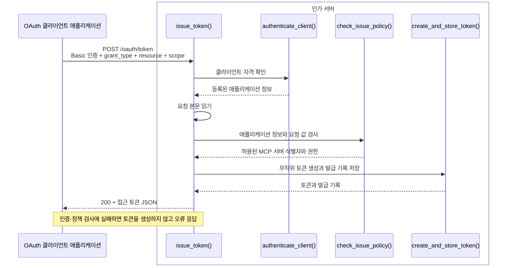
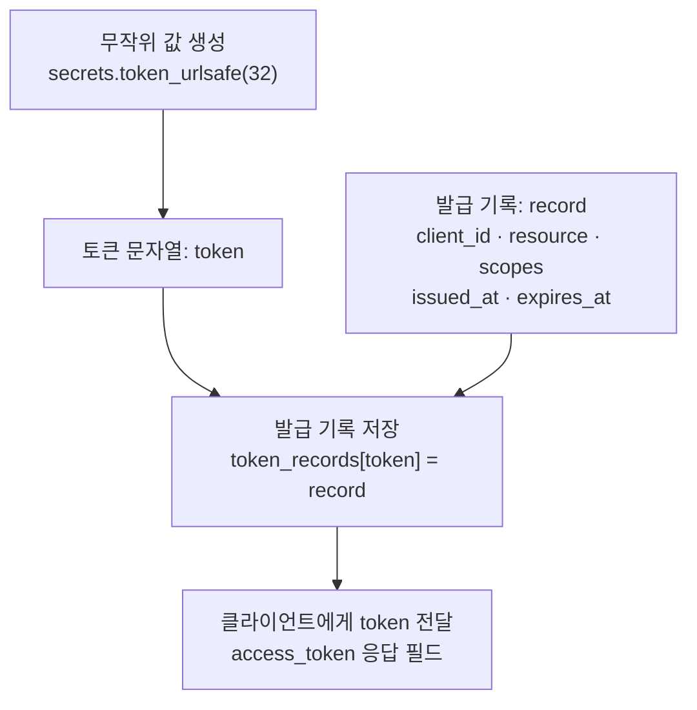

# Client Credentials 방식의 토큰 발급

이 노트는 **인가 서버**(Authorization Server)가 Client Credentials 요청을 받아 클라이언트를 인증하고, 허용한 권한의 토큰을 발급하는 과정을 설명한다. 토큰을 요청하는 애플리케이션은 **OAuth 클라이언트**(OAuth Client) 역할을 맡는다. MCP 서버와 통신하는 **MCP 클라이언트**(MCP Client)는 **호스트**(Host) 안의 구성요소다.

인가 서버의 토큰 요청 주소는 `https://login.example.com/oauth/token`이다. 애플리케이션은 `report-reader`로 인증하고, `https://reports.example.com/mcp`에서 사용할 `reports:read` 권한의 토큰을 요청한다. 앞뒤 MCP 흐름은 [Client Credentials 흐름과 구현 예제](mcp-client-credentials-example.md)를 참고한다.

## 1. 토큰 발급의 전체 흐름

**클라이언트 자격 증명**(Client Credentials) 방식에서는 애플리케이션의 자격과 사전에 허용된 권한을 근거로 토큰을 발급한다. 이 방식은 비밀 자격을 안전하게 보관할 수 있는 **기밀 클라이언트**(Confidential Client)에 사용한다. 대화형 사용자 인가는 거치지 않는다. MCP에서는 [OAuth Client Credentials 확장](https://modelcontextprotocol.io/extensions/auth/oauth-client-credentials)을 별도로 채택한다.

다음 그림의 `issue_token()`과 호출하는 함수들은 같은 인가 서버 프로그램에 있다. 요청을 받은 `issue_token()`이 각 함수를 호출하고 HTTP 응답을 반환한다.



이 예제는 **불투명 토큰**(Opaque Token)을 발급한다. 토큰은 권한 정보를 직접 담는 대신, 인가 서버의 발급 기록을 가리키는 무작위 문자열이다. 클라이언트는 받은 값을 **접근 토큰**(Access Token)으로 사용한다.

## 2. 인가 서버에 등록된 애플리케이션 정보

**클라이언트 식별자**(Client Identifier)인 `client_id`는 등록된 애플리케이션을 가리킨다. **클라이언트 비밀값**(Client Secret)은 그 애플리케이션의 자격을 확인하는 데 쓴다. `client_id` 자체가 비밀값이나 접근 권한은 아니다.

| 등록 정보              | 예제 값과 용도                              |
| ---------------------- | ------------------------------------------- |
| `client_id`          | `report-reader`, 인증할 애플리케이션 식별 |
| 비밀값의 해시          | 요청에서 받은 비밀값의 해시와 비교          |
| 허용된 발급 방식       | `client_credentials`                      |
| 허용된 MCP 서버 식별자 | `https://reports.example.com/mcp`         |
| 허용된 권한 범위       | `reports:read`                            |

전체 코드는 [client_credentials_authorization_server.py](examples/client_credentials_authorization_server.py)에 있다. 아래 코드는 등록 정보와 처리 흐름의 필요한 부분을 발췌한 것이다. import·클래스·함수의 전체 정의는 파일에서 확인할 수 있다. 비밀값 `example-only-secret`은 설명용 가상 값이며, 코드에는 그 해시를 등록한다.

```python
ISSUER = "https://login.example.com"
RESOURCE = "https://reports.example.com/mcp"
TOKEN_LIFETIME = 300

applications = {
    "report-reader": RegisteredApplication(
        client_id="report-reader",
        secret_digest=hashlib.sha256(b"example-only-secret").digest(),
        grant_types=frozenset({"client_credentials"}),
        resources=frozenset({RESOURCE}),
        scopes=frozenset({"reports:read"}),
    )
}
```

`RESOURCE`는 OAuth로 접근을 제한하는 MCP 서버의 **리소스 식별자**(Resource Identifier)다. 토큰 요청의 `resource` 파라미터에 이 문자열을 보내면, 인가 서버는 어느 MCP 서버용 토큰을 요청하는지 알 수 있다. `ISSUER`는 토큰을 발급한 인가 서버를 식별하는 값이다.

## 3. 발급 요청을 받고 검사하기

클라이언트는 **클라이언트 인증**(Client Authentication) 방식으로 `client_secret_basic`을 사용한다. 인가 서버는 `Authorization` 헤더에서 자격을 확인하고, 본문의 발급 요청을 검사한다.

| 용어 | 의미 |
|---|---|
| **HTTP Basic 인증** | ID와 비밀번호를 `Authorization: Basic ...` 헤더로 전달하는 일반적인 HTTP 인증 방식 |
| **`client_secret_basic`** | OAuth에서 `client_id`와 `client_secret`을 HTTP Basic 방식으로 전달하여 애플리케이션을 인증하는 방식 |

```http
POST /oauth/token HTTP/1.1
Host: login.example.com
Authorization: Basic <client_id:client_secret>
Content-Type: application/x-www-form-urlencoded

grant_type=client_credentials&resource=https%3A%2F%2Freports.example.com%2Fmcp&scope=reports%3Aread
```

### 요청 처리 함수

`Request`는 Starlette가 전달하는 HTTP 요청 객체다. `issue_token()`은 인증 → 본문 읽기 → 정책 검사 → 토큰 생성·저장 순서로 각 함수를 호출한다. 아래에는 `issue_token()` 전체를 보여주고, 이후에는 호출되는 함수의 핵심 부분만 발췌한다. 전체 정의는 [예제 파일](examples/client_credentials_authorization_server.py)에 있다.

```python
async def issue_token(request: Request) -> JSONResponse:
    try:
        application = authenticate_client(request)
        form = await read_token_form(request)
        resource, scopes = check_issue_policy(application, form)
        token, record = create_and_store_token(application, resource, scopes)
    except OAuthError as error:
        return error_response(error)
    return success_response(token, record)
```

### Basic 인증값 디코딩과 클라이언트 인증

OAuth의 Basic 인증에서는 `client_id`와 비밀값을 **각각** `application/x-www-form-urlencoded` 방식으로 인코딩한다. 두 값을 콜론으로 연결한 뒤 Base64로 인코딩한다. 인가 서버는 역순으로 디코딩한다.

1. Base64로 인코딩된 값을 디코딩한다.
2. 첫 콜론을 기준으로 두 값을 나눈다.
3. 각 값의 `%XX`와 `+`를 원래 문자로 디코딩한다.
4. 등록된 애플리케이션을 찾고 비밀값의 해시를 비교한다.

```python
# authenticate_client()의 인증값 디코딩 부분
# 인증 헤더·인코딩 오류 검사와 오류 응답 변환은 전체 함수에 있다.
headers = request.headers.getlist("authorization")
scheme, encoded = (headers[0] if headers else "").split()
decoded = base64.b64decode(encoded, validate=True).decode("ascii")
client_part, separator, secret_part = decoded.partition(":")
client_id = unquote_plus(client_part, encoding="utf-8", errors="strict")
secret = unquote_plus(secret_part, encoding="utf-8", errors="strict")

application = applications.get(client_id)
supplied_digest = hashlib.sha256(secret.encode("utf-8")).digest()
if application is None or not hmac.compare_digest(
    supplied_digest, application.secret_digest
):
    raise OAuthError("invalid_client", 401)
```

Base64를 디코딩한 문자열은 아직 원래 비밀값이 아니다. 예를 들어 원래 비밀값의 `+`는 `%2B`로 인코딩되어 있으므로, 각 값에 `unquote_plus()`를 적용해야 되돌릴 수 있다. 이 순서는 [RFC 6749 §2.3.1](https://www.rfc-editor.org/rfc/rfc6749.html#section-2.3.1)에 따른다.

### 요청 본문 읽기

`read_token_form()`은 URL 인코딩된 본문을 읽는다. 같은 파라미터의 반복을 검사하되, 여러 값을 허용하는 `resource`는 정책 함수에서 확인한다. 이 예제는 Basic 방식만 받아들이므로 본문에 별도 클라이언트 자격을 함께 보내면 거부한다.

```python
# read_token_form()의 본문 파싱 부분
body = (await request.body()).decode("utf-8")
form = parse_qs(
    body, keep_blank_values=True, strict_parsing=True,
    encoding="utf-8", errors="strict",
)
# Content-Type, 잘못된 인코딩, 중복 파라미터와 추가 자격 검사는 전체 함수에 있다.
```

### 발급 정책 검사

**권한 범위**(Scope)는 토큰으로 요청하는 작업 권한이다. 일반 OAuth에서 `scope`는 선택 파라미터다. 이 예제의 인가 서버는 기본 권한을 자동 부여하지 않고, `reports:read`를 명시적으로 요청해야 한다는 정책을 선택했다. 누락·빈 값도 `invalid_scope`로 거부한다.

발급 방식과 필수 입력 검사를 통과한 뒤에는 다음과 같이 MCP 서버 식별자와 권한을 비교한다.

```python
# check_issue_policy()의 서버·권한 검사 부분
resources = form.get("resource", [])
if len(resources) != 1 or resources[0] not in application.resources:
    raise OAuthError("invalid_target")

scopes = frozenset(form.get("scope", [""])[0].split(" "))
if "" in scopes or not scopes <= application.scopes:
    raise OAuthError("invalid_scope")
return resources[0], scopes
```

인가 서버는 요청한 MCP 서버 식별자와 권한이 인증된 애플리케이션의 허용 범위에 속하는지 확인한다. 이 예제는 하나의 MCP 서버용 토큰만 발급하므로 `resource`가 여러 개여도 `invalid_target`으로 거부한다. 요청을 받았다는 사실이나 인증 성공만으로 원하는 권한을 허용하지 않는다. [RFC 6749 §4.4](https://www.rfc-editor.org/rfc/rfc6749.html#section-4.4), [RFC 8707의 resource와 오류](https://www.rfc-editor.org/rfc/rfc8707.html#section-2)

## 4. 토큰을 생성하고 발급 정보를 저장하기

`create_and_store_token()`은 검사를 통과한 값으로 **발급 기록**을 만든다. 토큰의 무작위 문자열과 기록은 별개다. `token_records[token]`이 그 문자열에 해당하는 기록을 연결한다.



```python
# create_and_store_token()의 생성·저장 부분
token = secrets.token_urlsafe(32)
issued_at = int(time.time())
record = IssuedToken(
    client_id=application.client_id,
    issuer=ISSUER,
    resource=resource,
    scopes=scopes,
    issued_at=issued_at,
    expires_at=issued_at + TOKEN_LIFETIME,
)
token_records[token] = record
return token, record
```

`secrets.token_urlsafe(32)`는 32바이트의 무작위 값을 URL에 안전한 문자열로 만든다. 이 값은 `client_id`, 서버 주소, 권한을 이어 붙인 문자열이 아니다. 클라이언트가 문자열을 해독해서 권한을 읽는 방식도 아니다.

| 발급 기록                     | 저장하는 의미                                            |
| ----------------------------- | -------------------------------------------------------- |
| `client_id`                 | 어떤 애플리케이션에 발급했는가?                          |
| `issuer`                    | 어느 인가 서버가 발급했는가?                             |
| `resource`                  | 어느 MCP 서버에서 사용할 토큰인가? 그 서버의 식별자 저장 |
| `scopes`                    | 실제 허용한 권한                                         |
| `issued_at`, `expires_at` | 발급 시각과 만료 시각                                    |

예제의 등록 정보와 발급 기록은 메모리에 보관하므로 프로그램이 종료되면 사라진다. 저장을 마친 뒤에야 `issue_token()`이 성공 응답을 만든다. 기록을 나중에 조회하는 Token Introspection이나 MCP 서버의 검증 코드는 여기서 다루지 않는다. 무작위 값 생성은 Python의 [secrets](https://docs.python.org/3/library/secrets.html)를 사용한다.

## 5. 토큰 발급의 성공 응답과 오류 응답

`JSONResponse`는 상태 코드·헤더·JSON 본문으로 HTTP 응답을 구성하는 Starlette 클래스다. `success_response()`는 토큰과 실제 허용 범위를 반환한다. `error_response()`는 토큰을 포함하지 않고 OAuth 오류 코드만 반환한다. 아래는 응답 본문·인증 오류 헤더·요청 경로 연결을 발췌한 것이다.

```python
# success_response()가 JSONResponse에 전달하는 본문
{
    "access_token": token,
    "token_type": "Bearer",
    "expires_in": max(0, record.expires_at - int(time.time())),
    "scope": " ".join(sorted(record.scopes)),
}

# error_response()에서 invalid_client일 때 추가하는 헤더
headers["WWW-Authenticate"] = 'Basic realm="token"'

# /oauth/token의 POST 요청을 issue_token()에 연결하는 경로 정의
token_route = Route("/oauth/token", issue_token, methods=["POST"])
```

`Route`는 `/oauth/token`의 POST 요청을 `issue_token()`에 연결한다. `issue_token()`은 인증 → 정책 검사 → 생성·저장을 끝내면 `success_response()`를 호출하고, 그 전에 `OAuthError`를 만나면 `error_response()`를 호출한다.

성공 응답의 예시는 다음과 같다. 토큰 값은 자리 표시자이고, `300`은 발급 직후 남은 유효 시간의 예시다.

```http
HTTP/1.1 200 OK
Content-Type: application/json
Cache-Control: no-store
Pragma: no-cache

{
  "access_token": "<발급된 불투명 토큰>",
  "token_type": "Bearer",
  "expires_in": 300,
  "scope": "reports:read"
}
```

| 검사 실패                                                   | HTTP 상태와 OAuth 오류                                                 |
| ----------------------------------------------------------- | ---------------------------------------------------------------------- |
| Basic 값이 잘못되었거나 클라이언트 자격이 유효하지 않음     | `401`, `invalid_client`, `WWW-Authenticate: Basic realm="token"` |
| 본문 형식 오류·필수 입력 누락·허용하지 않는 파라미터 반복 | `400`, `invalid_request`                                           |
| 서버가 지원하지 않는 발급 방식                              | `400`, `unsupported_grant_type`                                    |
| 인증한 애플리케이션에 발급 방식이 허용되지 않음             | `400`, `unauthorized_client`                                       |
| 예제 정책에서 허용하지 않은 MCP 서버 식별자                 | `400`, `invalid_target`                                            |
| 권한 요청이 누락·비어 있거나 허용 범위를 벗어남            | `400`, `invalid_scope`                                             |

예를 들어 Basic 인증에 실패하면 응답 본문은 `{"error": "invalid_client"}`다. 인증에 성공했더라도 `scope=reports:write`를 요청하면 `{"error": "invalid_scope"}`로 거부하고 토큰을 만들지 않는다.

오류 응답은 [RFC 6749 §5.2](https://www.rfc-editor.org/rfc/rfc6749.html#section-5.2), 성공 JSON과 캐시 방지 헤더는 [RFC 6749 §5.1](https://www.rfc-editor.org/rfc/rfc6749.html#section-5.1)에 따른다. Client Credentials 응답에는 Refresh Token을 포함하지 않았다.

### 참고 자료

- [RFC 6749 §2.3.1 — 클라이언트 Basic 인증](https://www.rfc-editor.org/rfc/rfc6749.html#section-2.3.1), [§4.4 — Client Credentials](https://www.rfc-editor.org/rfc/rfc6749.html#section-4.4), [§5.1·5.2 — 응답](https://www.rfc-editor.org/rfc/rfc6749.html#section-5)
- [RFC 8707 — Resource Indicators](https://www.rfc-editor.org/rfc/rfc8707.html), [MCP OAuth Client Credentials 확장](https://modelcontextprotocol.io/extensions/auth/oauth-client-credentials)
- Starlette: [Request](https://starlette.dev/requests/), [Route](https://starlette.dev/routing/), [JSONResponse](https://starlette.dev/responses/#jsonresponse)
