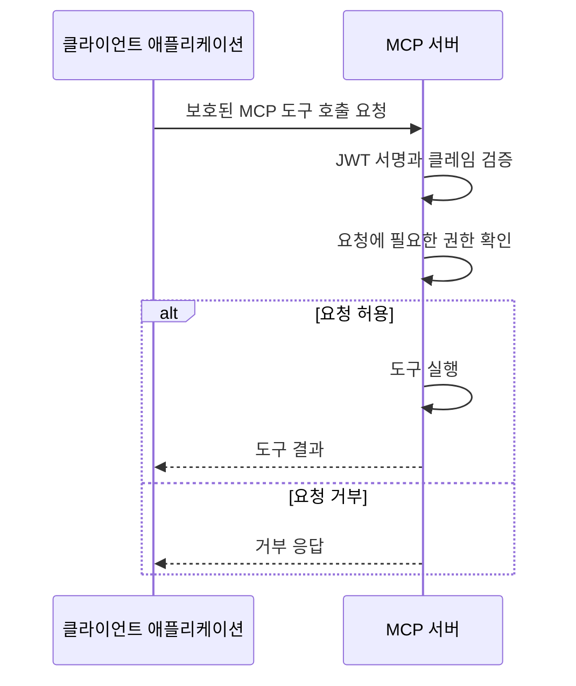
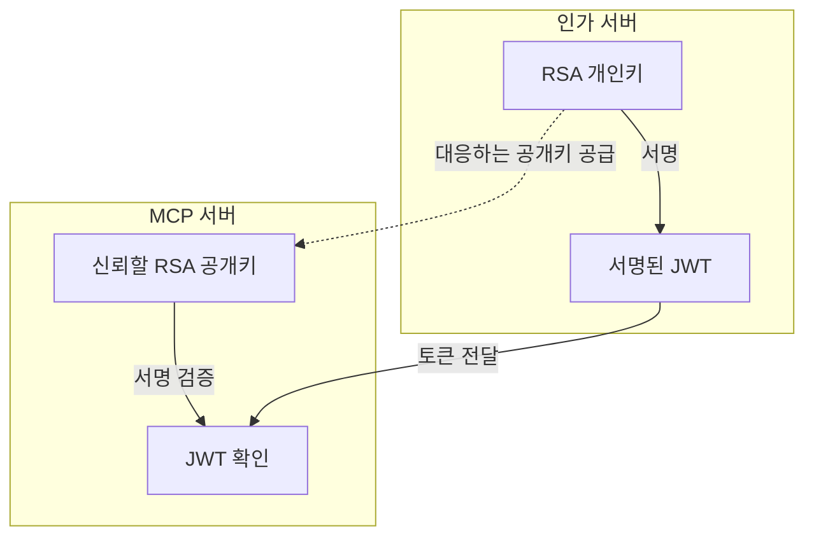
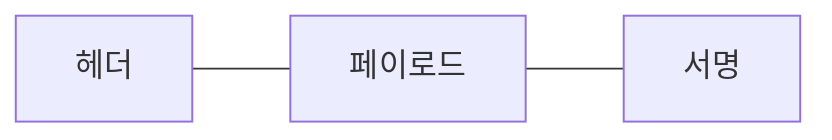
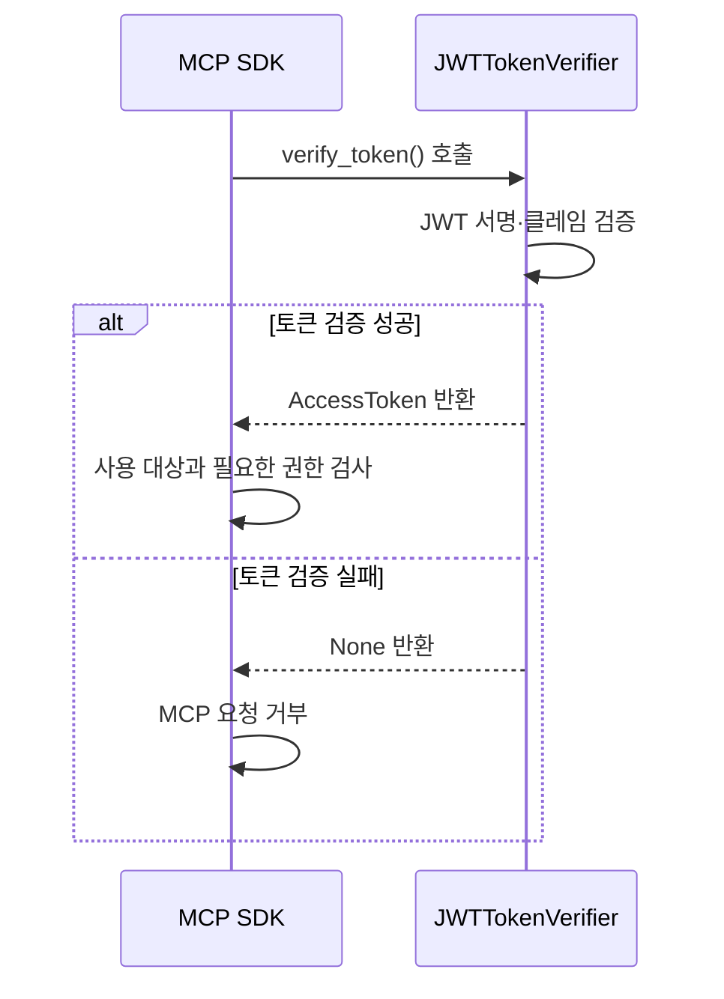
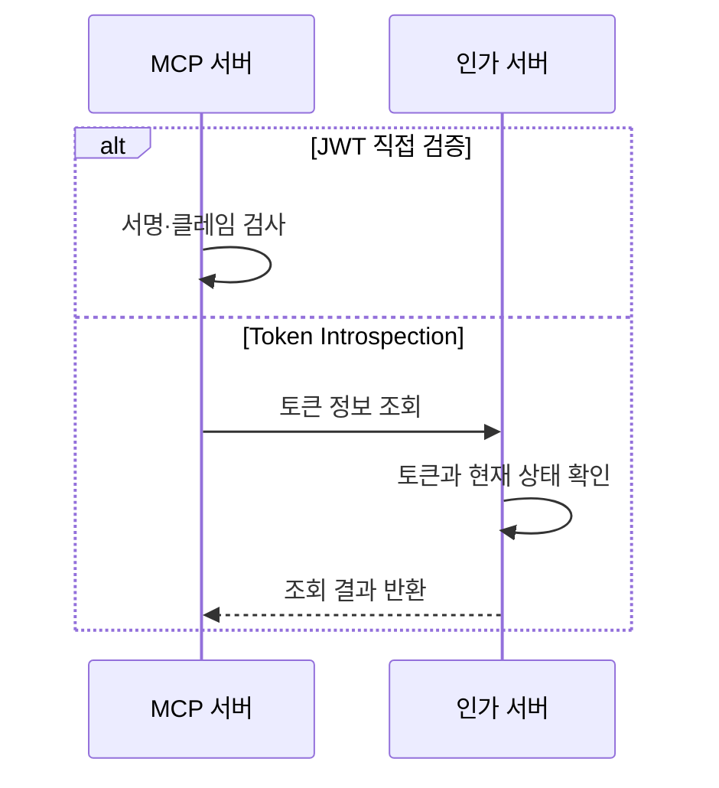

# MCP 서버의 JWT 접근 토큰 직접 검증

이 노트는 이미 발급된 **JSON 웹 토큰**(JSON Web Token, JWT) 형식의 **접근 토큰**(Access Token)을 MCP 서버가 직접 검증하는 과정을 설명한다. 인가 서버에 토큰 정보를 조회하는 대신, 신뢰할 공개키와 발급자·사용 대상 등의 조건으로 요청을 판단한다.

이 노트는 MCP 서버의 JWT 직접 검증을 [토큰 정보를 조회하는 방식](token-introspection-jwt.md)과 비교한다. 전체 Python 예제는 [jwt_verification_mcp_server.py](examples/jwt_verification_mcp_server.py)에 있고, 본문에는 핵심 부분만 발췌한다. 두 예제는 같은 `RS256`, `reports:read`, `report_summary()`를 사용한다.

## 1. JWT를 받은 MCP 서버의 처리 흐름

**호스트**(Host)는 클라이언트 애플리케이션 전체다. 그 안의 **MCP 클라이언트**(MCP Client)가 JWT를 첨부한 HTTP 요청을 전달한다. **리소스 서버**(Resource Server) 역할의 MCP 서버는 토큰을 검증하고, 요청에 필요한 권한이 있는지 확인한다.



클라이언트는 보호된 HTTP 요청마다 `Authorization: Bearer <JWT>` 헤더로 토큰을 보낸다. MCP 서버는 JWT가 제시되었다는 사실만으로 도구를 실행하지 않는다. 토큰 검증과 권한 검사가 모두 성공해야 한다.

예제의 `JWTTokenVerifier.verify_token()`은 JWT를 검증하고 SDK에 토큰 정보를 반환한다. SDK의 검사도 통과하면 `report_summary()`가 집계 결과를 반환한다.

## 2. 검증에 필요한 정보 준비하기

**인가 서버**(Authorization Server)는 RSA **개인키**(Private Key)로 JWT에 서명한다. MCP 서버는 그 키와 대응하는 **공개키**(Public Key)로 서명을 검증한다. 검증을 위해 MCP 서버에 개인키를 전달할 필요는 없다.

`RS256`은 RSA 서명과 SHA-256 해시를 사용하는 알고리즘의 이름이다.



그림의 공개키는 인가 서버의 개인키와 대응하며, MCP 서버가 신뢰하는 설정으로 공급받은 키다. 수신한 JWT가 지정한 주소나 키를 그대로 신뢰해서 사용하는 것이 아니다.

### 공개키와 검증 기준 설정하기

`JWTVerificationConfig`는 공개키와 기대하는 식별자를 보관한다. **발급자 식별자**(Issuer Identifier)는 어느 인가 서버의 토큰을 인정할지 정하는 값이다. **리소스 식별자**(Resource Identifier)는 토큰을 사용할 MCP 서버를 가리키는 URI다.

| 검증 정보 | 예제 값 | 확인할 대상 |
|---|---|---|
| RSA 공개키 | 외부 설정으로 공급한 `public_key` | JWT 서명 |
| 허용 알고리즘 | `["RS256"]` | 허용한 방식으로 서명했는가 |
| `ISSUER` | `"https://login.example.com/"` | JWT의 `iss`와 정확히 일치하는가 |
| `RESOURCE` | `"http://127.0.0.1:8101/mcp"` | JWT의 `aud`에 이 서버가 포함되는가 |
| `REQUIRED_SCOPES` | `["reports:read"]` | 요청에 필요한 **권한 범위**(Scope)가 있는가 |

공개키·발급자·사용 대상은 토큰을 받기 전에 정한다. 예제는 환경에서 공급한 공개키를 로드하고, RSA 공개키와 URL 설정이 유효하지 않으면 서버 구성 단계에서 오류를 알린다. HTTP 서버 주소는 로컬 loopback 학습용이다.

### JWKS로 공개키를 제공하는 경우

**JSON 웹 키 집합**(JSON Web Key Set, JWKS)은 공개키 등을 JSON 문서로 제공하는 형식이다. 인가 서버는 메타데이터의 `jwks_uri`로 검증 키를 제공할 수 있다. MCP 서버는 신뢰할 인가 서버의 메타데이터를 바탕으로 키를 얻는다. 이 예제는 공개키를 설정으로 받으며 JWKS 조회·키 교체를 구현하지 않는다. [RFC 9068 §4](https://www.rfc-editor.org/rfc/rfc9068.html#section-4)

## 3. JWT의 서명과 클레임 검증하기

**클레임**(Claim)은 JWT에 담긴 이름과 값이다. 내용을 디코딩해서 읽는 것과, 그 정보를 믿어도 되는지 검증하는 것은 다르다.

| 동작 | 알아내는 것 |
|---|---|
| 디코딩 | 헤더와 페이로드에 어떤 값이 들어 있는가 |
| 검증 | 신뢰하는 서명·발급자·사용 대상·시간 등의 조건을 만족하는가 |

### 서명된 JWT의 구조

예제의 서명된 JWT는 인코딩한 세 부분을 점(`.`)으로 연결한다. 각 부분의 내용과 검사 목적은 다음과 같다.



| 부분 | 내용 |
|---|---|
| **헤더**(Header) | 서명 알고리즘 `alg`, 토큰 유형 `typ` 등의 정보 |
| **페이로드**(Payload) | `iss`, `aud`, `exp` 등의 클레임 |
| **서명**(Signature) | 헤더·페이로드에 대한 서명; 공개키로 검증 |

검증기는 JWT의 헤더나 클레임을 검증 전에 신뢰하지 않는다. 토큰의 `alg`에 맞춰 허용 알고리즘을 바꾸지 않고, 설정한 공개키와 `RS256`만 사용한다.

### 서명·발급자·사용 대상 확인하기

다음은 `verify_token()`의 `jwt.decode()` 호출 부분이다. 서명과 `iss`·`aud`, 필수 클레임의 존재를 확인한다. 시간은 정수 형식을 확인한 뒤 예제 함수에서 별도로 검사하므로, 이 호출에서는 시간 검사 옵션을 끈다.

```python
claims = jwt.decode(
    token,
    self.config.public_key,
    algorithms=["RS256"],
    issuer=self.config.issuer,
    audience=self.config.resource,
    options={
        "require": REQUIRED_CLAIMS,
        "verify_exp": False,
        "verify_iat": False,
        "verify_nbf": False,
    },
)
```

서명 검사를 마친 뒤 헤더의 `typ`가 `at+jwt` 또는 `application/at+jwt`인지 확인한다. 이 값은 JWT 접근 토큰임을 나타낸다. `iss`는 설정한 발급자와 정확히 같아야 하고, `aud`는 이 MCP 서버의 식별자를 포함해야 한다. [RFC 9068 §4](https://www.rfc-editor.org/rfc/rfc9068.html#section-4), [PyJWT의 decode](https://pyjwt.readthedocs.io/en/stable/api.html#jwt.decode)

### 시간과 필드 형식 확인하기

RFC 9068의 필수 클레임은 `iss`, `sub`, `aud`, `exp`, `iat`, `jti`, `client_id`다. 예제의 `REQUIRED_CLAIMS`도 이 목록을 사용한다. 이는 JWT 접근 토큰 프로파일의 요구이며, 모든 JWT가 이 프로파일을 따르는 것은 아니다. [RFC 9068 §2.2](https://www.rfc-editor.org/rfc/rfc9068.html#section-2.2)

| 필드 | 의미와 예제의 검사 |
|---|---|
| `exp` | 만료 시각; 현재 시각보다 뒤여야 함 |
| `nbf` | 이 시각 전에는 사용하지 않음; 있으면 현재 시각이 도달했는지 확인 |
| `iat` | 발급 시각; 예제는 미래 시각을 거부 |
| `sub` | 토큰의 **주체**(Subject); 비어 있지 않은 문자열 |
| `client_id` | 토큰을 발급받은 애플리케이션; 비어 있지 않은 문자열 |
| `jti` | 개별 JWT 식별자; 비어 있지 않은 문자열 |
| `scope` | 공백으로 구분한 권한 문자열; 누락·빈 값은 권한 없음 |

JWT의 시간 형식인 `NumericDate`는 유닉스 시간의 초 단위 숫자다. 정수가 아닌 숫자도 표현할 수 있지만, 이 예제는 `exp`·`iat`·존재하는 `nbf`에 정수만 허용한다. 형식 검사를 통과한 뒤 다음과 같이 시각을 비교한다. [RFC 7519 §2](https://www.rfc-editor.org/rfc/rfc7519.html#section-2)

```python
now = int(time.time())
if claims["exp"] <= now or claims["iat"] > now:
    return None
if "nbf" in claims and claims["nbf"] > now:
    return None
```

`scope`는 모든 JWT에 반드시 있어야 하는 클레임이 아니다. 예제는 누락·빈 값을 빈 권한 목록으로 처리한다. 문자열 형식이 잘못되면 토큰을 거부하지만, 형식이 유효하고 필요한 권한만 부족하면 SDK의 권한 검사에서 판단한다. [RFC 9068 §2.2.3](https://www.rfc-editor.org/rfc/rfc9068.html#section-2.2.3)

## 4. 검증 결과를 MCP SDK에 연결하기

`TokenVerifier`는 SDK가 호출할 토큰 검증기의 공개 인터페이스다. SDK는 보호된 HTTP 요청에서 받은 토큰을 검증기의 `verify_token()`에 전달한다. 예제는 `JWTTokenVerifier`가 이 인터페이스를 구현한다. SDK와 검증기는 같은 MCP 서버 프로그램에 있다.



### 검사한 토큰 정보 반환하기

검증기는 토큰과 검사한 정보를 `AccessToken`에 담는다. 새 토큰을 발급하는 것이 아니다. `aud`가 목록이면 이 MCP 서버와 정확히 일치하는 값만 `resource`로 선택하고, 해당 값이 없으면 거부한다.

```python
return AccessToken(
    token=token,
    client_id=claims["client_id"],
    scopes=scopes,
    expires_at=claims["exp"],
    resource=resource,
    subject=claims["sub"],
    claims=claims,
)
```

`token`은 받은 JWT, `subject`는 `sub`, `claims`는 검증한 클레임이다. `scope` 문자열은 목록인 `scopes`로 바꾼다. 필요한 권한이 없다는 이유만으로 검증기가 `None`을 반환하지는 않는다.

### 서버의 요청 권한 설정하기

`build_server()`는 검증기와 SDK의 인가 설정을 연결한다. `required_scopes`는 이 서버에 필요한 권한이며, `validate_token_resource=True`는 반환한 토큰의 `resource`를 서버 식별자와 대조하도록 한다.

```python
server = MCPServer(
    "JWT 검증 보고서",
    token_verifier=verifier,
    auth=AuthSettings(
        issuer_url=AnyHttpUrl(verifier.config.issuer),
        resource_server_url=AnyHttpUrl(verifier.config.resource),
        required_scopes=REQUIRED_SCOPES,
        validate_token_resource=True,
    ),
)
```

`REQUIRED_SCOPES`는 `["reports:read"]`다. 서명·클레임 검사는 검증기가 구현하고, SDK는 반환한 토큰 정보와 서버의 권한 조건으로 요청을 처리한다. `AuthSettings`를 선언하는 것만으로 JWT 검증 전체가 구현되지는 않는다.

```python
@server.tool()
def report_summary() -> dict[str, int]:
    """토큰 검증과 권한 검사를 통과하면 예제 집계 결과를 반환한다."""
    return {"completed": 9, "queued": 3}
```

SDK의 검사까지 통과한 요청에서만 `report_summary()`가 실행된다. 예제는 MCP SDK `2.3.0`과 PyJWT `2.15.1`을 기준으로 한다. [Python SDK Authorization](https://py.sdk.modelcontextprotocol.io/run/authorization/)

## 5. 검증 실패와 권한 부족 구분하기

토큰을 인정할 수 없는 경우와, 토큰은 유효하지만 요청에 필요한 권한이 없는 경우는 다른 응답으로 처리한다.

| 받은 토큰의 문제 | 처리 | MCP HTTP 응답 | 도구 실행 |
|---|---|---|---|
| 변조·다른 서명키·허용하지 않은 알고리즘·잘못된 `typ` | 검증기가 `None` 반환 | `401` | 안 함 |
| 만료·아직 도달하지 않은 `nbf` | 검증기가 `None` 반환 | `401` | 안 함 |
| 다른 발급자 또는 이 MCP 서버가 없는 `aud` | 검증기가 `None` 반환 | `401` | 안 함 |
| 필수 클레임 누락·예제의 시간/필드 형식 오류 | 검증기가 `None` 반환 | `401` | 안 함 |
| `scope`의 타입·권한 문자열 형식 오류 | 검증기가 `None` 반환 | `401` | 안 함 |
| 나머지는 유효하지만 `reports:read`가 없음 | `AccessToken` 반환 후 SDK가 권한 검사에서 거부 | `403` | 안 함 |

`401`은 토큰을 인정하지 못한 응답이고, `403`은 인정한 토큰의 권한이 부족한 응답이다. `scope`가 없거나 비어 있어도 다른 검사를 통과했다면, 예제에서는 권한 부족으로 처리한다. [RFC 6750 §3.1](https://www.rfc-editor.org/rfc/rfc6750.html#section-3.1)

설정 오류는 요청의 토큰 오류와 구분한다. 잘못된 공개키나 발급자·서버 주소는 서버 구성 단계에서 오류를 알린다. 검증기는 `jwt.InvalidTokenError`만 토큰 거부로 처리하며, 모든 예외를 잡아 설정·프로그램 오류까지 `None`으로 숨기지 않는다. 토큰과 키는 로그나 콘솔에 출력하지 않는다.

## 6. Introspection과 비교하기

두 방법은 JWT의 형식을 바꾸는 것이 아니라, 토큰을 어디에서 어떤 정보로 확인하는지가 다르다. 다음 그림은 확인 위치를 비교한다.



| 비교할 항목 | 직접 검증 예제 | Introspection 예제 |
|---|---|---|
| JWT를 검사하는 곳 | MCP 서버 | 인가 서버 |
| MCP 서버에 필요한 정보 | 신뢰할 RSA 공개키와 기대하는 클레임 조건 | 조회용 자격과 기대하는 조회 응답 조건 |
| 요청 중 인가 서버 통신 | 없음 | Introspection 요청 |
| 현재 폐기 상태 | 이 예제는 폐기 기록을 조회하지 않음 | 인가 서버가 확인한 현재 상태를 `active`에 반영 가능 |
| MCP 요청의 권한 검사 | 검증한 `scopes`와 SDK 설정으로 판단 | 조회한 `scopes`와 SDK 설정으로 판단 |

직접 검증은 서명과 만료가 유효하다는 것을 확인해도, 인가 서버에서 이후 토큰을 폐기했는지 자동으로 알 수 없다. 조회 방식은 인가 서버가 확인하는 상태에 따라 판단하지만, 무엇을 검사하는지는 그 인가 서버의 구현에 달려 있다. 비교한 전체 예제는 [JWT를 사용한 Token Introspection](token-introspection-jwt.md)에 있다.

### 참고 자료

- [RFC 9068 §2·4 — JWT 접근 토큰과 검증](https://www.rfc-editor.org/rfc/rfc9068.html), [RFC 7519 §2 — NumericDate](https://www.rfc-editor.org/rfc/rfc7519.html#section-2)
- [RFC 6750 §3.1 — 토큰 오류와 권한 부족](https://www.rfc-editor.org/rfc/rfc6750.html#section-3.1), [Python SDK Authorization](https://py.sdk.modelcontextprotocol.io/run/authorization/)
- [PyJWT의 decode와 예외](https://pyjwt.readthedocs.io/en/stable/api.html)
