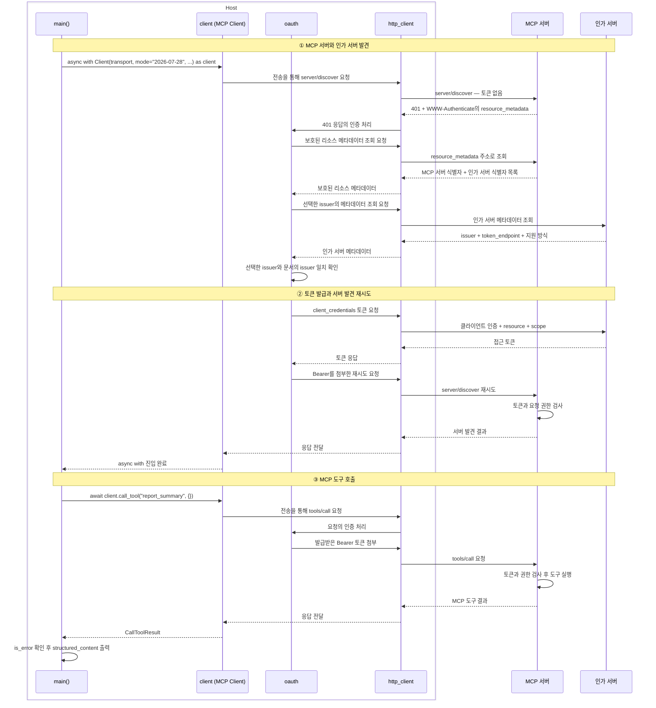
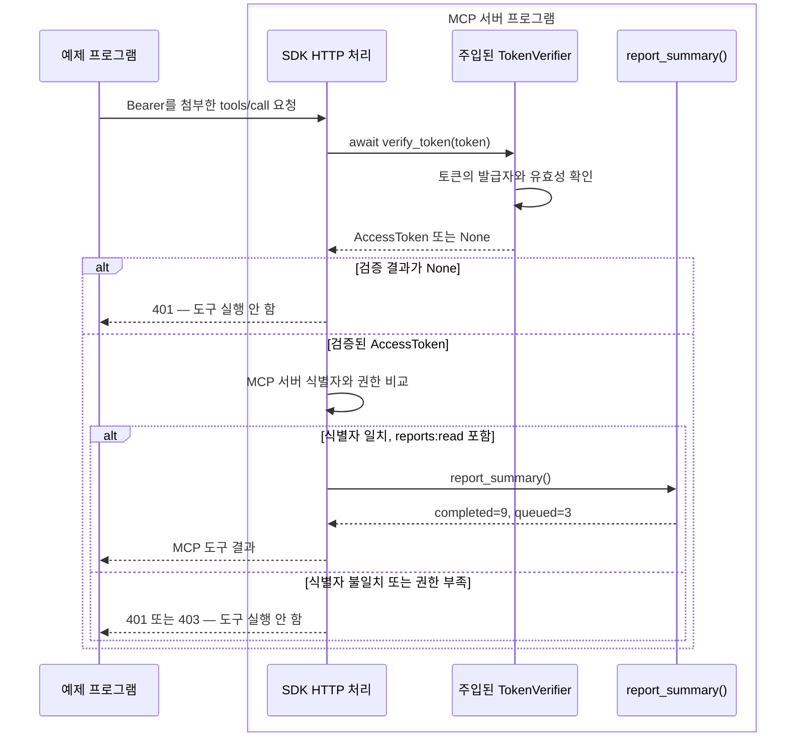

# 클라이언트 자격 증명(Client Credentials) 흐름과 구현 예제

**클라이언트 자격 증명**(Client Credentials)은 애플리케이션이 자신의 자격으로 토큰을 발급받는 방식이다. 이 예제는 MCP의 OAuth Client Credentials 확장을 사용하여, Python 프로그램이 토큰을 발급받아 `report_summary` 도구를 호출하는 과정을 보여준다. 사용자 로그인이나 동의 화면은 거치지 않는다.

공통 역할과 개념은 [MCP OAuth2의 전체 구조와 접근 흐름](mcp-oauth2-flow.md)을 참고한다.

## 1. 예제 프로그램의 실행 순서

`main()`은 인증 설정을 만들고 MCP 서버에 연결한 뒤 도구를 호출한다. **접근 토큰**(Access Token)은 인가 서버가 발급한 접근 권한의 값이다. 예제에서는 **베어러**(Bearer) 방식으로 HTTP 요청의 `Authorization` 헤더에 토큰을 첨부한다.

**호스트**(Host)는 MCP Client를 생성하고 관리하는 애플리케이션이다. 이 Python 프로그램은 Host의 연결·도구 호출 부분을 보여주는 예제이며, 모델·대화 관리 기능은 포함하지 않는다.

**MCP 클라이언트**(MCP Client)는 Host 안에서 MCP 서버와 통신하는 구성요소다. 예제의 `client` 객체가 이 역할을 맡는다. 같은 프로그램이 인가 서버에 토큰을 요청할 때는 **OAuth 클라이언트**(OAuth Client) 역할을 수행한다. 이는 같은 프로그램을 OAuth의 역할에 따라 부르는 이름이다.

그림의 `main()`, `client`, `oauth`, `http_client`는 모두 이 예제 프로그램 안에 있다.

| 예제 객체 | 담당하는 일 |
| --- | --- |
| `main()` | Host 쪽 실행 코드: 객체를 구성하고 MCP Client로 도구 호출 |
| `client` (`Client`) | MCP Client: 서버 발견과 MCP 도구 호출 |
| `oauth` (`ClientCredentialsOAuthProvider`) | HTTP 인증 처리, 인가 서버 발견과 토큰 발급 |
| `http_client` (`httpx2.AsyncClient`) | HTTP 요청 전송과 응답 수신 |

**인가 서버**(Authorization Server)는 토큰을 발급하는 원격 서버다. MCP 서버는 요청의 토큰을 검사하는 **리소스 서버**(Resource Server) 역할을 맡는다.



그림은 토큰 저장소가 비어 있고, 토큰 발급과 요청 검사가 성공하는 경우다.

1. **서버·인가 서버 발견:** `async with Client(...) as client`에 진입하면 `server/discover`가 전송된다. `401` 응답을 받은 뒤 `oauth`가 MCP 서버와 인가 서버의 메타데이터를 조회한다.
2. **토큰 발급과 재시도:** `oauth`가 토큰을 발급받아 Bearer를 첨부한다. 서버 발견 재시도가 성공하면 `async with` 진입이 완료된다.
3. **도구 호출:** 본문의 `await client.call_tool(...)`이 실행되고, 결과의 `is_error`와 `structured_content`를 확인한다.

`auth=oauth`와 `http_client=http_client`로 객체를 연결하는 코드는 4절에 있다. 서버 발견 재시도와 도구 호출은 각각 Bearer 토큰을 전달하고 검사를 받는다.

## 2. 인가 서버와 토큰 발급 주소 조회

**보호된 리소스**(Protected Resource)는 OAuth로 접근을 제한하는 대상이다. 이 예제에서는 MCP 서버다. 그 서버를 가리키는 **리소스 식별자**(Resource Identifier)는 `https://reports.example.com/mcp`다.

`oauth`는 MCP 서버의 `401` 응답에서 **보호된 리소스 메타데이터**(Protected Resource Metadata)의 위치를 얻는다. 이 문서는 MCP 서버 식별자와 연결된 인가 서버의 목록을 담는다.

```http
HTTP/1.1 401 Unauthorized
WWW-Authenticate: Bearer resource_metadata="https://reports.example.com/.well-known/oauth-protected-resource/mcp"
```

`WWW-Authenticate`는 접근 요건을 안내하는 응답 헤더다. `resource_metadata`의 주소를 조회하면 다음 정보를 받는다. JSON은 필요한 필드만 발췌했다.

```json
{
  "resource": "https://reports.example.com/mcp",
  "authorization_servers": ["https://login.example.com"],
  "scopes_supported": ["reports:read"]
}
```

- `resource` **필드**는 MCP 서버의 식별자를 담는다.
- `authorization_servers`는 **인가 서버**(Authorization Server)의 **발급자 식별자**(Issuer Identifier) 목록이다. 여기서는 `https://login.example.com` 하나가 있다.
- `scopes_supported`는 MCP 서버에서 사용하는 **권한 범위**(Scope)의 목록이다. `reports:read`의 발급을 자동으로 허용한다는 뜻은 아니다.

`oauth`는 인가 서버 식별자를 선택하고, 표준 **잘 알려진 URI**(Well-Known URI) 규칙으로 **인가 서버 메타데이터**(Authorization Server Metadata)의 조회 주소를 찾는다. 이 예제의 조회 주소는 `https://login.example.com/.well-known/oauth-authorization-server`다.

조회 요청은 `http_client`를 통해 보낸다.

```json
{
  "issuer": "https://login.example.com",
  "token_endpoint": "https://login.example.com/oauth/token",
  "grant_types_supported": ["client_credentials"],
  "token_endpoint_auth_methods_supported": ["client_secret_basic"]
}
```

| 필드 | `oauth`가 확인할 내용 |
| --- | --- |
| `issuer` | 선택한 인가 서버 식별자와 정확히 일치하는가? |
| `token_endpoint` | 토큰 요청을 어느 주소로 보낼 것인가? |
| `grant_types_supported` | `client_credentials`를 지원하는가? |
| `token_endpoint_auth_methods_supported` | 어떤 클라이언트 인증 방식을 사용할 수 있는가? |

예제 프로그램에는 자격을 발급한 인가 서버의 식별자가 `issuer`로 설정되어 있다. `oauth`는 발견한 인가 서버가 그 식별자와 맞고, 해당 MCP 서버에 적절한지 확인한다. `issuer`는 서버 식별자이고 `token_endpoint`는 토큰 요청 주소다. 서로 대체하지 않는다.

토큰 없는 첫 MCP 요청의 HTTP `401` 응답에서 `WWW-Authenticate` 헤더에 `resource_metadata`가 없으면, `oauth`는 MCP 서버 식별자를 바탕으로 표준 well-known 위치를 조회한다. 상세 규칙은 [MCP 인가 서버 발견](https://modelcontextprotocol.io/specification/2026-07-28/basic/authorization/authorization-server-discovery)에 따른다.

## 3. Client Credentials 토큰 발급

인가 서버에 토큰을 요청하는 **OAuth 클라이언트**(OAuth Client)는 이 예제 프로그램이다. `oauth`가 발급 요청을 구성하고, `http_client`가 `token_endpoint`로 전송한다.

예제는 **클라이언트 인증**(Client Authentication)에 `client_secret_basic`을 사용한다. 인가 서버는 등록된 애플리케이션의 자격을 확인한다. 클라이언트 ID와 **클라이언트 비밀값**(Client Secret)의 인증 정보가 Basic 헤더에 들어간다. 인증값과 토큰은 아래에서 자리 표시자로만 표시한다.

```http
POST /oauth/token HTTP/1.1
Host: login.example.com
Authorization: Basic <클라이언트 인증값>
Content-Type: application/x-www-form-urlencoded

grant_type=client_credentials&resource=https%3A%2F%2Freports.example.com%2Fmcp&scope=reports%3Aread
```

`grant_type=client_credentials`는 클라이언트 자격을 **인가 그랜트**(Authorization Grant), 즉 토큰 발급 근거로 사용하는 방식이다.

- `resource` **파라미터**에는 앞서 읽은 서버 식별자 `https://reports.example.com/mcp`를 넣는다. 인가 서버에 **어느 MCP 서버에서 사용할 토큰인지** 알려준다.
- `scope`는 요청하는 **권한 범위**(Scope)다. 예제에서는 `reports:read`를 요청한다.

요청을 받은 **인가 서버**(Authorization Server)는 클라이언트를 인증한 뒤 발급 정책을 검사한다. 예제에서는 다음 조건을 허용한다.

| 인가 서버의 검사 | 예제 조건 |
| --- | --- |
| 클라이언트 인증 | `report-reader`의 자격 증명이 유효함 |
| 발급 방식 | `grant_type`이 `client_credentials` |
| 토큰 사용 서버 | `resource`가 `https://reports.example.com/mcp` |
| 요청 권한 | `scope`에 허용된 `reports:read`만 요청함 |

클라이언트 인증과 발급 정책 판단은 모두 인가 서버의 책임이다. 인증에 성공해도 요청한 서버나 권한이 허용되지 않으면 토큰 발급을 거부한다.

인가 서버가 발급을 허용하면 다음과 같은 **접근 토큰**(Access Token) 응답을 보낸다.

```http
HTTP/1.1 200 OK
Content-Type: application/json
Cache-Control: no-store
Pragma: no-cache

{
  "access_token": "<발급된 접근 토큰>",
  "token_type": "Bearer",
  "expires_in": 300,
  "scope": "reports:read"
}
```

`expires_in=300`은 토큰이 발급 후 300초 동안 유효하다는 예제 설정이다. 발급된 토큰은 지정한 MCP 서버에서 허용된 권한으로 사용할 수 있어야 한다. 토큰에 모든 정보가 읽을 수 있는 형태로 담긴다고 가정하지 않는다.

발급 요청과 응답은 [RFC 6749 §4.4](https://www.rfc-editor.org/rfc/rfc6749.html#section-4.4), MCP 서버 식별자의 전달은 [MCP Resource Indicator 요구사항](https://modelcontextprotocol.io/specification/2026-07-28/basic/authorization#resource-parameter-implementation)에 따른다.

## 4. Python 프로그램의 MCP 도구 호출

전체 코드는 [client_credentials_client.py](examples/client_credentials_client.py)에 있다. 실제 인가 서버와 MCP 서버, 사전에 허용된 OAuth 클라이언트 자격이 필요하다. 예제 주소를 실제 서비스 주소로 바꾸고 환경 변수 `REPORT_CLIENT_SECRET`을 제공해야 한다.

`ClientCredentialsOAuthProvider`는 **인증 제공 객체**(Auth Provider)다. HTTP 요청의 발견·토큰 발급·Bearer 첨부를 처리한다. `MemoryStorage`는 실행 중 토큰과 클라이언트 정보를 보관하는 **토큰 저장소**(Token Storage)이며, 전체 코드에 정의되어 있다.

```python
oauth = ClientCredentialsOAuthProvider(
    server_url=mcp_url,
    storage=MemoryStorage(),
    client_id="report-reader",
    client_secret=os.environ["REPORT_CLIENT_SECRET"],
    token_endpoint_auth_method="client_secret_basic",
    scope="reports:read",
    issuer=as_issuer,
)
```

`server_url`은 MCP 서버 주소이고, `issuer`는 자격을 발급한 인가 서버의 식별자다. 예제에서는 각각 `https://reports.example.com/mcp`, `https://login.example.com`이다. `scope` 인자는 공백으로 구분한 권한 문자열을 받는다.

인증 제공 객체는 `httpx2.AsyncClient`에 붙인다. `streamable_http_client(...)`는 이 HTTP 클라이언트로 통신할 **전송**(Transport)을 구성한다.

`Client`로 만든 `client`는 **MCP 클라이언트**(MCP Client) 객체이며, 그 전송으로 MCP 요청을 보낸다. 다음은 `main()`의 호출 부분이다.

```python
async with httpx2.AsyncClient(
    auth=oauth,
    timeout=httpx2.Timeout(30.0, read=300.0),
) as http_client:
    transport = streamable_http_client(mcp_url, http_client=http_client)
    async with Client(
        transport,
        mode="2026-07-28",
        extensions=[
            advertise("io.modelcontextprotocol/oauth-client-credentials")
        ],
    ) as client:
        result = await client.call_tool("report_summary", {})
        if result.is_error:
            raise RuntimeError("보고 도구 업무 실패")
        print(result.structured_content)
```

`advertise(...)`는 Client Credentials **확장 지원 선언**(Extension Capability Advertisement)이다. 토큰 발급 호출이 아니며, SDK가 MCP 요청의 메타데이터에 이 선언을 포함한다.

`call_tool("report_summary", {})`은 인자 없는 도구 호출을 요청하고 `CallToolResult`를 받는다. `is_error`로 업무 실패 여부를 확인한 뒤 `structured_content`를 읽는다. 토큰과 비밀값은 출력하지 않는다.

1절의 `async with Client(...)`에서 인증을 거친 서버 발견이 끝난 뒤 이 도구 호출이 실행된다. 공개 연결 방식은 [SDK OAuth clients](https://py.sdk.modelcontextprotocol.io/client/oauth-clients/#machine-to-machine)와 [Client transports](https://py.sdk.modelcontextprotocol.io/client/transports/#bring-your-own-httpx2asyncclient)를 따른다.

## 5. MCP 서버의 토큰·권한 검사

서버 구성 코드는 [protected_mcp_server.py](examples/protected_mcp_server.py)의 `build_server(verifier)`에 있다. 이 함수는 실제 **토큰 검증기**(Token Verifier)를 인자로 받는다. 검증기 구현과 HTTP 서비스 시작 코드는 포함하지 않는다.

아래는 검증기와 보호 조건을 연결하는 부분이다. `issuer_url`에는 인가 서버 식별자를, `resource_server_url`에는 MCP 서버 식별자를 지정한다.

```python
server = MCPServer(
    "보고 요약",
    token_verifier=verifier,
    auth=AuthSettings(
        issuer_url=AnyHttpUrl("https://login.example.com"),
        resource_server_url=AnyHttpUrl("https://reports.example.com/mcp"),
        required_scopes=["reports:read"],
        validate_token_resource=True,
    ),
)

@server.tool()
def report_summary() -> dict[str, int]:
    """예제 보고서 집계 값을 반환한다."""
    return {"completed": 9, "queued": 3}
```

객체 구성과 `@server.tool()`의 도구 등록은 요청 처리가 아니다. Bearer 토큰이 있는 HTTP 요청을 받으면 SDK는 주입된 검증기의 공개 메서드 `verify_token(token)`을 호출한다. 유효하면 서버가 검사에 사용할 `AccessToken` 객체, 무효하면 `None`을 받는다.

다음 그림에서 예제 프로그램은 HTTP 요청을 보낸다. SDK, 검증기, 도구 함수는 **같은 MCP 서버 프로그램 안의 구성요소**다. 그림은 토큰 검증 결과에 따라 서버가 요청을 거부하거나 도구를 실행하는 흐름을 보여준다.



검증기는 발급자·만료·무효화 등을 확인하고, 토큰의 **사용 대상**(Audience)이 어느 MCP 서버인지 확인한다. 그 서버를 가리키는 리소스 식별자를 `AccessToken.resource`에 담는다.

`validate_token_resource=True`는 검증 결과의 `AccessToken.resource`와 서버 설정의 `resource_server_url`을 비교한다. `required_scopes=["reports:read"]`는 요청에 필요한 **권한 범위**(Scope)를 지정한다. 서버 설정만으로 토큰 검증이 완성되는 것은 아니다.

| 요청 상태 | 응답과 도구 실행 |
| --- | --- |
| 토큰 없음·무효·다른 MCP 서버용 | `401`, 도구 실행 안 함 |
| 토큰은 유효하지만 `reports:read` 부족 | `403`, 도구 실행 안 함 |
| 토큰과 권한 검사 통과 | 도구 실행 후 `{"completed": 9, "queued": 3}` 반환 |

JWT 서명 검증과 토큰 인트로스펙션(Token Introspection)은 검증기를 구현하는 방법이며 이 예제에는 포함하지 않는다. 접근이 허용되어도 실제 도구 업무는 실패할 수 있다. 검증기의 공개 계약은 [SDK Authorization](https://py.sdk.modelcontextprotocol.io/run/authorization/#a-token-verifier)에 설명되어 있다.

## 6. 참고 자료

예제의 공개 API는 Python SDK `mcp==2.3.0`을, 프로토콜은 OAuth 2.1 초안 기반의 MCP `2026-07-28`을 기준으로 한다.

- [MCP Authorization](https://modelcontextprotocol.io/specification/2026-07-28/basic/authorization), [Authorization Server Discovery](https://modelcontextprotocol.io/specification/2026-07-28/basic/authorization/authorization-server-discovery)
- [MCP OAuth Client Credentials 확장](https://modelcontextprotocol.io/extensions/auth/oauth-client-credentials)
- [MCP 구조 — Host·Client·Server](https://modelcontextprotocol.io/docs/2026-07-28/learn/architecture#participants)
- [RFC 9728 — Protected Resource Metadata](https://www.rfc-editor.org/rfc/rfc9728.html#section-2), [RFC 8414 — Authorization Server Metadata](https://www.rfc-editor.org/rfc/rfc8414.html#section-2)
- [RFC 6749 §4.4 — Client Credentials](https://www.rfc-editor.org/rfc/rfc6749.html#section-4.4), [RFC 8707 — Resource Indicators](https://www.rfc-editor.org/rfc/rfc8707.html)
- Python SDK: [OAuth clients](https://py.sdk.modelcontextprotocol.io/client/oauth-clients/), [Client transports](https://py.sdk.modelcontextprotocol.io/client/transports/), [Authorization](https://py.sdk.modelcontextprotocol.io/run/authorization/), [The Client](https://py.sdk.modelcontextprotocol.io/client/), [Extensions](https://py.sdk.modelcontextprotocol.io/advanced/extensions/)
