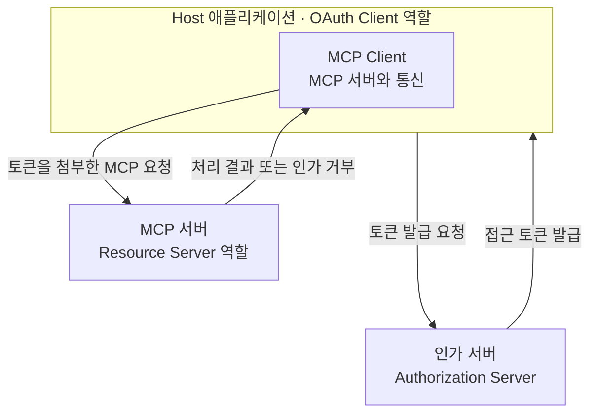
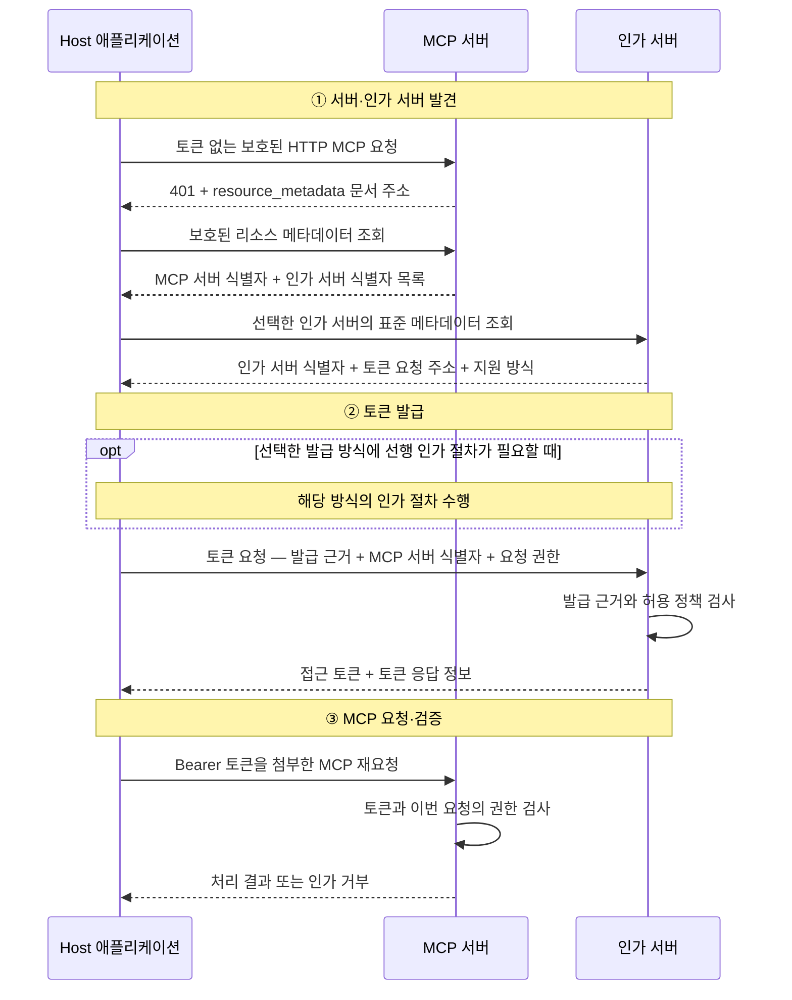
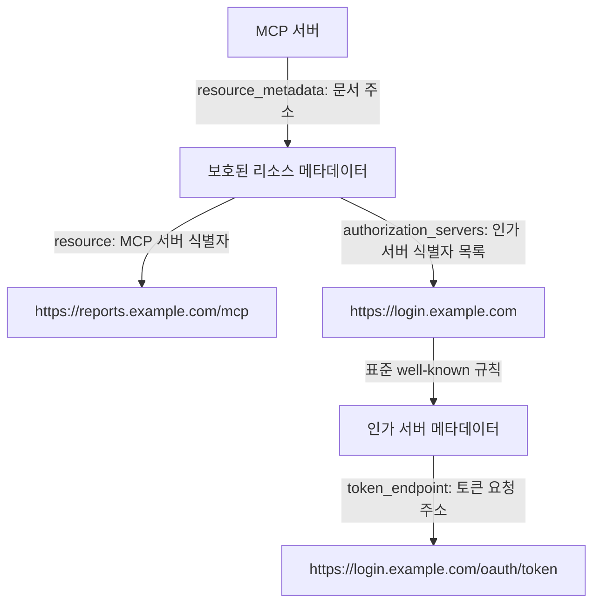
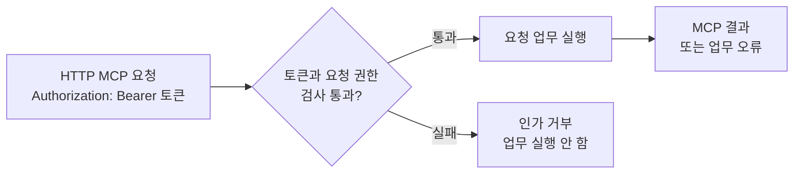

# MCP OAuth2의 전체 구조와 접근 흐름

**모델 컨텍스트 프로토콜**(Model Context Protocol, MCP)은 애플리케이션과 서버 사이의 도구·데이터 상호작용을 위한 프로토콜이다. 이 노트는 아직 **접근 토큰**(Access Token)이 없는 애플리케이션이 OAuth로 보호된 HTTP MCP 서버에 처음 접근하는 흐름을 설명한다. 접근 토큰은 인가 서버가 발급하는 접근 권한의 값이다.

OAuth는 제한된 접근 권한을 부여하는 **인가 프레임워크**(Authorization Framework)다. **인증**(Authentication)은 사용자나 애플리케이션이 누구인지 확인한다. **인가**(Authorization)는 어떤 서버에 어떤 작업을 허용할지 판단한다. 로그인이나 클라이언트 인증에 성공해도 모든 작업이 허용되는 것은 아니다.

기준은 MCP `2026-07-28`이다. 이 명세는 OAuth 2.1 초안과 관련 OAuth 표준의 일부 기능을 채택하며, 제목의 OAuth2는 OAuth 2 계열을 뜻한다.

## 1. 구성 요소와 역할

**호스트**(Host)는 MCP Client를 생성하고 관리하는 애플리케이션이다. **MCP 클라이언트**(MCP Client)는 Host 안에서 MCP 서버와 통신하는 구성요소다.

같은 애플리케이션이 인가 서버에 토큰을 요청할 때는 **OAuth 클라이언트**(OAuth Client) 역할을 수행한다. MCP Client는 MCP의 통신 구성요소를 가리키고, OAuth Client는 토큰을 요청·사용하는 애플리케이션의 OAuth 역할을 가리킨다.

**인가 서버**(Authorization Server)는 토큰을 발급한다. **MCP 서버**(MCP Server)는 토큰과 요청 권한을 검사하는 **리소스 서버**(Resource Server) 역할을 맡는다.



Host는 토큰을 발급받고, 내부 MCP Client를 통해 그 토큰을 첨부한 MCP 요청을 보낸다. 그림은 역할의 관계를 보여준다. 메시지의 시간순서는 2절에서 읽는다.

| 역할 | 맡는 일 |
| --- | --- |
| Host | MCP Client를 관리하고 애플리케이션의 작업을 진행 |
| MCP Client | Host 안에서 MCP 서버에 요청을 보내고 응답을 수신 |
| OAuth Client | 애플리케이션이 토큰을 요청하고 사용하는 OAuth 역할 |
| 인가 서버 | 토큰 발급 여부와 허용할 서버·권한 범위를 판단 |
| MCP 서버 / Resource Server | 제출된 토큰으로 지금 요청을 허용할지 판단하고, 허용된 업무를 실행 |

사용자 위임 방식에는 **리소스 소유자**(Resource Owner)도 참여한다. 보호된 리소스의 접근을 허용할 수 있는 주체이며, 사람이면 보통 최종 사용자다.

인가 서버와 MCP 서버는 같은 프로그램에 배치될 수도 있고 다른 서비스일 수도 있다. 배치가 같아도 발급 판단과 요청 허용 판단은 구분한다. 역할 정의는 [MCP 구조](https://modelcontextprotocol.io/docs/2026-07-28/learn/architecture#participants)와 [OAuth 역할](https://www.rfc-editor.org/rfc/rfc6749.html#section-1.1)을 참고한다.

## 2. 전체 접근 흐름

다음 시퀀스의 왼쪽 참여자는 **Host 애플리케이션 전체**다. MCP 서버에 보내는 요청은 내부 MCP Client를 통해 진행하고, 인가 서버와의 토큰 발급 흐름에서는 애플리케이션이 OAuth Client 역할을 맡는다.

그림의 **메타데이터**(Metadata)는 통신에 필요한 주소와 지원 방식을 안내하는 문서다. **베어러**(Bearer)는 토큰을 소지한 쪽이 그 토큰을 제시하는 방식이다.

이 그림은 첫 HTTP `401` 응답의 `WWW-Authenticate` 헤더에 `resource_metadata` 문서 주소가 제공되는 대표 경로다. 모든 접근 경로에서 토큰 없는 첫 요청을 거쳐야 하는 것은 아니다.



1. **발견:** MCP 서버 식별자와 토큰 요청 주소·지원 방식을 얻는다. 아직 접근 토큰을 받은 것은 아니다.
2. **발급:** 선택한 방식의 절차를 거쳐 발급 근거와 요청 권한을 제출한다.
3. **MCP 요청·검증:** 발급받은 토큰을 요청에 첨부한다. MCP 서버가 검사한 뒤 요청을 실행하거나 거부한다.

발견 결과가 토큰 요청의 입력이 되고, 발급 결과인 토큰이 MCP 요청의 입력이 된다. [MCP 인가 흐름](https://modelcontextprotocol.io/specification/2026-07-28/basic/authorization)에 정의된 연결이다.

## 3. 인가 서버와 토큰 발급 주소 조회

**보호된 리소스**(Protected Resource)는 OAuth로 접근을 제한하는 대상이다. 여기서는 MCP 서버다. 그 서버를 가리키는 **리소스 식별자**(Resource Identifier)는 URI 값이며, 예제에서는 `https://reports.example.com/mcp`를 사용한다.

애플리케이션은 **보호된 리소스 메타데이터**(Protected Resource Metadata)에서 MCP 서버 식별자와 연결된 인가 서버의 목록을 얻는다. **발급자 식별자**(Issuer Identifier)는 어느 인가 서버인지 구분하는 값이다. 예제의 인가 서버 식별자는 `https://login.example.com`이다.

선택한 인가 서버의 **인가 서버 메타데이터**(Authorization Server Metadata)에는 토큰 요청 주소와 지원 방식이 들어 있다.



두 문서는 서로 다른 정보를 준다. 첫 문서에서 **어느 MCP 서버의 토큰을 요청할지** 정하고, 두 번째 문서에서 **그 요청을 어디로 보낼지** 찾는다.

### 메타데이터 문서 조회

토큰 없는 MCP 요청의 HTTP `401` 응답에서 `WWW-Authenticate` 헤더의 `resource_metadata`가 문서 주소를 알려준다. 애플리케이션은 그 주소로 보호된 리소스 메타데이터를 조회한다.

이 필드가 없으면 MCP 서버 식별자를 바탕으로 표준 **잘 알려진 URI**(Well-Known URI) 위치를 찾아 조회한다. **URI**(Uniform Resource Identifier)는 서버나 문서를 식별하는 문자열이다. MCP의 발견 흐름은 두 방식을 모두 지원하며, 헤더에 문서 주소가 있으면 이를 사용한다.

인가 서버 식별자를 선택한 뒤에는 well-known 규칙으로 인가 서버 메타데이터의 조회 주소를 찾는다. 예제의 조회 주소는 `https://login.example.com/.well-known/oauth-authorization-server`다. 인가 서버 식별자 URL 자체에 바로 GET한다는 뜻은 아니다. 상세 규칙은 [MCP 인가 서버 발견](https://modelcontextprotocol.io/specification/2026-07-28/basic/authorization/authorization-server-discovery)에 따른다.

### 메타데이터 값으로 토큰 요청 구성하기

#### 보호된 리소스 메타데이터(Protected Resource Metadata)

| 필드 | 예제 값 또는 내용 | 다음 단계의 사용 |
| --- | --- | --- |
| `resource` | `https://reports.example.com/mcp` | 토큰 요청의 `resource` 파라미터에 전달 |
| `authorization_servers` | `https://login.example.com`을 포함한 목록 | 인가 서버 선택과 메타데이터 조회 |

#### 인가 서버 메타데이터(Authorization Server Metadata)

| 필드 | 예제 값 또는 내용 | 다음 단계의 사용 |
| --- | --- | --- |
| `issuer` | `https://login.example.com` | 선택한 인가 서버 식별자와 정확히 일치하는지 확인 |
| `token_endpoint` | `https://login.example.com/oauth/token` | 토큰 요청을 보낼 목적지 |
| 지원 방식 정보 | 지원하는 발급·클라이언트 인증 방식 | 사용할 발급 절차 선택 |

`resource`는 메타데이터에서 MCP 서버 식별자를 담는 **필드**다. 토큰 발급 요청에서는 그 식별자를 전달하는 **파라미터**로 쓰인다. 서버 자체와 서버를 가리키는 값, 그 값을 담는 필드를 구분한다.

애플리케이션은 조회한 문서가 이 MCP 서버를 설명하는지, 선택한 인가 서버가 그 서버에 적절한지 확인한다. 인가 서버 메타데이터의 `issuer`가 선택한 식별자와 정확히 일치하지 않으면 그 문서를 사용하지 않는다. 필드 정의와 검사는 [RFC 9728](https://www.rfc-editor.org/rfc/rfc9728.html#section-2), [RFC 8414의 issuer 검사](https://www.rfc-editor.org/rfc/rfc8414.html#section-3.3)에 설명되어 있다.

## 4. 토큰 발급 요청과 발급 방식

**인가 그랜트**(Authorization Grant)는 접근 토큰을 발급받기 위해 제시하는 근거다. 근거를 얻고 제출하는 방식이 **그랜트 유형**(Grant Type)이며, 선택한 유형은 `grant_type`으로 나타낸다.

애플리케이션은 OAuth Client 역할로 `token_endpoint`에 토큰을 요청한다. 인가 서버가 받을 정보와 판단할 내용을 구분하면 다음과 같다.

| 토큰 요청에 필요한 정보 | 뜻 |
| --- | --- |
| 클라이언트 정보와 필요한 인증 근거 | 어느 애플리케이션이 요청하는가? |
| 선택한 grant의 발급 근거 | 무엇을 근거로 토큰을 발급받는가? |
| `resource` 파라미터 | 어느 MCP 서버에서 사용할 토큰인가? 예제 값은 `https://reports.example.com/mcp` |
| `scope` 파라미터 | 어떤 권한 범위를 요청하는가? |

**클라이언트 식별자**(Client Identifier)인 `client_id`는 애플리케이션을 식별하는 값이다. 그 값 자체가 권한이나 비밀 증명은 아니다. 모든 OAuth 클라이언트에 `client_secret`이라는 비밀값이 필요한 것도 아니다.

인가 서버는 발급 근거가 유효한지 확인하고, 요청한 MCP 서버와 권한의 발급을 허용할지 판단한다. **권한 범위**(Scope)를 담는 `scope`는 요청이지 허용 결과가 아니다. 인가 서버는 더 좁은 범위를 허용하거나 요청을 거부할 수 있다. [OAuth scope 처리](https://www.rfc-editor.org/rfc/rfc6749.html#section-3.3)

MCP에서는 `resource`를 토큰 요청에 포함한다. 선택한 방식에 **인가 요청**(Authorization Request)이 있으면 그 요청에도 포함한다. 인가 요청은 토큰 교환 전에 접근 허용을 요청하는 절차다. 이렇게 지정한 MCP 서버는 이후 토큰의 사용 대상을 검사할 때 기준이 된다. [MCP Resource Indicator 요구사항](https://modelcontextprotocol.io/specification/2026-07-28/basic/authorization#resource-parameter-implementation)

### 발급 방식 비교

| 방식 | 발급 근거와 절차 |
| --- | --- |
| **인가 코드**(Authorization Code) + PKCE | 사용자 위임 인가 후 받은 코드를 토큰으로 교환 |
| **클라이언트 자격 증명**(Client Credentials) | 애플리케이션 자격과 사전에 허용된 권한을 근거로 직접 토큰 요청. 대화형 사용자 승인은 거치지 않음 |

**PKCE**(Proof Key for Code Exchange)는 인가 요청을 시작한 애플리케이션과 코드 교환을 연결하여, 가로챈 코드의 악용을 막는 장치다. [PKCE 표준](https://www.rfc-editor.org/rfc/rfc7636.html#section-1)

Client Credentials는 MCP에서 별도로 채택하는 [OAuth Client Credentials 확장](https://modelcontextprotocol.io/extensions/auth/oauth-client-credentials)이다. 모든 MCP 애플리케이션의 기본 발급 방식은 아니다. 어느 방식을 선택하든 발급받은 접근 토큰을 보호된 MCP 요청에 사용한다.

## 5. 토큰을 첨부한 MCP 요청과 서버 검사

애플리케이션은 내부 MCP Client를 통해 보호된 HTTP MCP 요청을 보낼 때 `Authorization` 헤더에 토큰을 첨부한다. 헤더는 요청·응답과 함께 전달하는 부가 정보다.

```http
Authorization: Bearer <access-token>
```

토큰은 보호된 **각 HTTP MCP 요청**에 첨부한다. 이전 요청의 성공이 이후 요청의 인가를 대신하지 않는다. [MCP 접근 토큰 사용](https://modelcontextprotocol.io/specification/2026-07-28/basic/authorization#access-token-usage)



MCP 서버는 업무를 실행하기 전에 다음을 확인한다.

- **유효성**(Validity): 만료 여부 등을 확인했을 때 현재 사용할 수 있는 토큰인가?
- **발급자**(Issuer): 이 MCP 서버가 받아들이는 인가 서버에서 발급했는가?
- **사용 대상**(Audience): 이 MCP 서버를 위해 발급한 토큰인가?
- **권한 범위**(Scope): 이번 요청을 수행할 권한이 있는가?

토큰 발급 요청의 `resource`로 지정한 MCP 서버에서 사용할 수 있는지 검사한다. 다른 서버를 위해 발급한 토큰을 이 서버에서 받아들이지 않는다. 검사에 실패하면 요청 업무를 실행하지 않는다. [MCP 토큰 검증 요구사항](https://modelcontextprotocol.io/specification/2026-07-28/basic/authorization#token-handling)

### 검증 방법

| 방법 | 서버가 확인하는 것 |
| --- | --- |
| **JSON 웹 토큰**(JSON Web Token, JWT) 검증 | JWT 접근 토큰의 서명과 토큰 정보 |
| **토큰 인트로스펙션**(Token Introspection) | 인가 서버에 조회한 토큰의 활성 상태와 관련 정보 |

검증 방법은 토큰 형식과 서버 구성에 따라 달라진다. 모든 토큰이 JWT이거나 애플리케이션이 토큰 내용을 전부 읽을 수 있는 것은 아니다. 모든 MCP 요청마다 Introspection을 호출해야 하는 것도 아니다. 어느 방법이든 얻은 근거로 토큰의 사용 대상과 권한을 판단한다. [JWT 접근 토큰 검증](https://www.rfc-editor.org/rfc/rfc9068.html#section-4), [Introspection](https://www.rfc-editor.org/rfc/rfc7662.html#section-2)

## 6. 응답과 용어 구분

### 인가 거부와 도구 업무 실패

**인가 거부**(Authorization Denial)는 토큰이나 권한 검사에 실패하여 업무 전에 요청을 거절하는 것이다. **도구 실행 오류**(Tool Execution Error)는 허용된 도구 호출을 처리하는 과정에서 발생한 오류다.

| 상황 | 응답과 처리 |
| --- | --- |
| 토큰 없음·무효·만료·다른 MCP 서버용 토큰 | `401 Unauthorized`, 요청 업무 실행 안 함 |
| 유효한 토큰이지만 필요한 `scope` 부족 | `403 Forbidden`, 요청 업무 실행 안 함 |
| 인가 검사 통과 후 도구 업무 실패 | 접근은 허용되었지만 실제 작업은 실패할 수 있음 |

`401`의 HTTP 상태 이름이 Unauthorized라고 해서 인증과 인가를 같은 개념으로 읽지는 않는다. 표의 `401`과 `403`은 유효한 토큰이 없는 경우와 유효한 토큰의 권한이 부족한 경우를 구분한다. [Bearer 오류 응답](https://www.rfc-editor.org/rfc/rfc6750.html#section-3.1)

도구의 업무 오류는 MCP 도구 결과의 `isError`로 전달될 수 있다. 예를 들어 허용된 조회를 실행했지만 찾는 항목이 없거나 외부 API가 실패하면 업무 오류가 될 수 있다. 접근 허용은 작업 성공을 보장하지 않는다. [MCP 도구 오류 처리](https://modelcontextprotocol.io/specification/2026-07-28/server/tools#error-handling)

### OAuth resource와 MCP Resource

**MCP 리소스**(Resource)는 파일·문서 등의 데이터를 제공하는 MCP 기능이다. OAuth의 **보호된 리소스**(Protected Resource)는 이 흐름에서 접근을 제한하는 MCP 서버를 뜻한다.

| 표현 | 의미 |
| --- | --- |
| OAuth의 Protected Resource | OAuth로 접근을 제한하는 MCP 서버 |
| OAuth `resource` | 메타데이터에서는 MCP 서버 식별자를 담는 필드, 토큰 요청에서는 그 식별자를 전달하는 파라미터 |
| MCP Resource | `resources/read` 같은 요청으로 데이터를 제공하는 MCP 기능 |

OAuth `resource`가 MCP Resource 기능만 보호한다는 뜻은 아니다. **도구**(Tool), 즉 이름과 인자로 호출하여 작업을 수행하는 MCP 기능에도 같은 접근 흐름이 적용된다. [Resource Indicator](https://www.rfc-editor.org/rfc/rfc8707.html#section-2), [MCP Resources](https://modelcontextprotocol.io/specification/2026-07-28/server/resources)

개별 데이터 소유권 정책, 프롬프트 인젝션(Prompt Injection), 감사 기록(Audit), MCP 서버의 외부 API 자격 증명은 다른 Security 노트에서 다룬다.

## 7. 참고 자료

- MCP: [Authorization](https://modelcontextprotocol.io/specification/2026-07-28/basic/authorization), [Authorization Server Discovery](https://modelcontextprotocol.io/specification/2026-07-28/basic/authorization/authorization-server-discovery), [OAuth Client Credentials 확장](https://modelcontextprotocol.io/extensions/auth/oauth-client-credentials)
- 역할·발급: [MCP 구조](https://modelcontextprotocol.io/docs/2026-07-28/learn/architecture#participants), [RFC 6749 — OAuth 2.0](https://www.rfc-editor.org/rfc/rfc6749.html), [MCP가 인용하는 OAuth 2.1 초안](https://datatracker.ietf.org/doc/html/draft-ietf-oauth-v2-1-13), [RFC 7636 — PKCE](https://www.rfc-editor.org/rfc/rfc7636.html)
- 발견·식별자: [RFC 9728 — Protected Resource Metadata](https://www.rfc-editor.org/rfc/rfc9728.html), [RFC 8414 — Authorization Server Metadata](https://www.rfc-editor.org/rfc/rfc8414.html), [RFC 8707 — Resource Indicators](https://www.rfc-editor.org/rfc/rfc8707.html)
- 토큰 사용·검증: [RFC 6750 — Bearer Token Usage](https://www.rfc-editor.org/rfc/rfc6750.html), [RFC 9068 — JWT Access Tokens](https://www.rfc-editor.org/rfc/rfc9068.html), [RFC 7662 — Token Introspection](https://www.rfc-editor.org/rfc/rfc7662.html)
