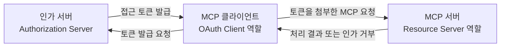
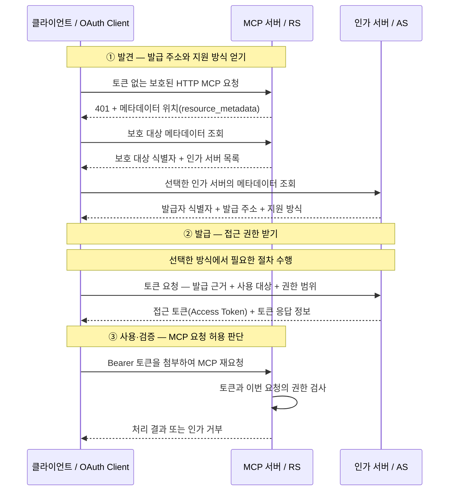
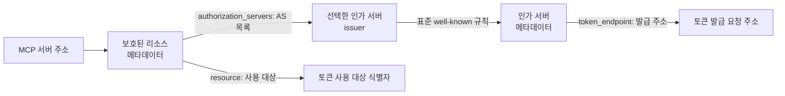
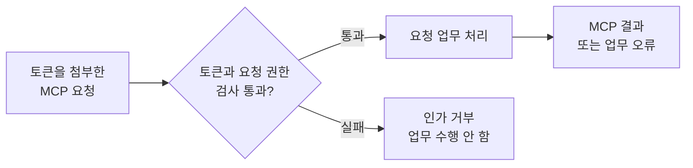

# MCP OAuth2의 전체 구조와 접근 흐름

## 1. 이 노트의 목적과 전제

**목표: 토큰이 없는 첫 접근에서, 역할과 메시지 흐름이 어떻게 이어지는지 이해한다.**

- **모델 컨텍스트 프로토콜**(Model Context Protocol, MCP): 애플리케이션과 서버 사이의 도구·데이터 상호작용을 위한 프로토콜.
- **HTTP**(Hypertext Transfer Protocol): 요청과 응답을 전달하는 통신 프로토콜.
- **클라이언트**(Client): 요청을 보내는 애플리케이션 쪽 구성요소. **MCP 서버**(MCP Server)는 그 MCP 요청을 받아 처리한다.
- **접근 토큰**(Access Token): 토큰 발급을 맡는 인가 서버(Authorization Server)가 발급하는 접근 권한의 값.

### OAuth가 맡는 일

OAuth는 애플리케이션에 제한된 접근 권한을 부여하는 **인가 프레임워크**(Authorization Framework)다.

| 구분 | 답하는 질문 |
| --- | --- |
| 인증(Authentication) | 사용자나 애플리케이션이 누구인가? |
| 인가(Authorization) | 어떤 대상에 어떤 작업을 허용할 것인가? |

사용자 로그인이나 클라이언트 인증이 발급 과정에 포함될 수 있다. **신원을 확인했다는 사실만으로 모든 접근이 허용되지는 않는다.** [OAuth 역할과 기본 흐름](https://www.rfc-editor.org/rfc/rfc6749.html#section-1)

### 이 노트의 기준 상황

> 아직 접근 토큰이 없는 클라이언트가 **OAuth로 보호된 HTTP MCP 서버**에 처음 접근한다.

- MCP `2026-07-28` 명세를 기준으로 한다. 이 명세는 OAuth 2.1 **초안**(draft)과 관련 OAuth 표준의 일부 기능을 채택한다. 제목의 OAuth2는 OAuth 2 계열을 뜻한다.
- 클라이언트 식별 정보는 선택한 인가 서버에 맞게 등록 등의 방법으로 준비된다고 전제한다.
- 등록 상세와 구현 방법은 별도 노트에서 다룬다.

> **적용 범위:** 이 HTTP 흐름이 OAuth를 사용하지 않는 MCP 구현이나 표준 입출력(stdio) 전송에도 필수라는 뜻은 아니다. 또한 모든 접근 경로에서 토큰 없는 첫 요청을 반드시 거쳐야 하는 것은 아니다.

근거: [MCP 인가의 범위와 표준](https://modelcontextprotocol.io/specification/2026-07-28/basic/authorization#protocol-requirements)

## 2. 구성요소와 책임

**클라이언트는 토큰을 받아 사용하고, 인가 서버는 발급하며, MCP 서버는 요청을 검사한다.**

**접근 토큰**(Access Token)은 발급받은 접근 권한을 나타내는 값이다. 그림의 세 역할은 다음과 같다.

- **MCP 클라이언트**(MCP Client) / **OAuth 클라이언트**(OAuth Client): MCP 요청을 보내며, 이 흐름에서는 토큰을 받아 사용하는 역할도 맡는다.
- **인가 서버**(Authorization Server, AS): 발급 근거와 정책을 확인하여 토큰을 발급한다.
- **MCP 서버**(MCP Server) / **리소스 서버**(Resource Server, RS): 보호된 요청의 토큰과 권한을 검사하고, 허용된 요청을 처리한다.



클라이언트는 **인가 서버에서 받은 토큰을 MCP 서버에 사용한다.** 두 서버는 서로 다른 질문에 답한다.

### 두 서버의 판단은 다르다

| 역할 | 판단하는 내용 |
| --- | --- |
| 인가 서버 / AS | 토큰을 발급해도 되는가? 어떤 대상·권한 범위로 발급할 것인가? |
| MCP 서버 / RS | 제출된 토큰으로 **지금 이 요청**을 허용해도 되는가? |

> **사용자 위임의 추가 주체:** 리소스 소유자(Resource Owner)는 보호된 대상에 대한 접근을 허용할 수 있는 주체다. 사람이면 보통 최종 사용자이며, 사용자 위임 방식의 인가 절차에 참여한다.

> **역할과 배치:** AS와 RS는 같은 프로그램에 함께 있거나 다른 서비스로 배치될 수 있다. 위 그림은 책임과 관계를 보여주며, 메시지의 시간순서는 다음 절에서 읽는다.

근거: [OAuth 역할 정의](https://www.rfc-editor.org/rfc/rfc6749.html#section-1.1)

## 3. 전체 접근 흐름: 발견 → 발급 → 사용·검증

**발견으로 발급 주소·방법을 얻고, 발급받은 토큰을 MCP 요청에 사용한다.**

그림에 등장하는 세 역할은 다음과 같다.

- **클라이언트**(Client): 요청을 보낸다.
- **인가 서버**(Authorization Server, AS): 토큰을 발급한다.
- **MCP 서버**: **리소스 서버**(Resource Server, RS)로서 보호된 요청을 검사·처리한다.

그림을 읽는 데 필요한 용어는 세 가지다.

- **메타데이터**(Metadata): 서버 주소와 지원 기능을 안내하는 문서.
- **접근 토큰**(Access Token): 발급받은 접근 권한을 나타내는 값.
- **베어러**(Bearer): 토큰을 소지한 쪽이 제시하여 접근하는 방식.

> **대표 사례:** 첫 `401` 응답의 `WWW-Authenticate` 헤더에 메타데이터 문서 위치인 `resource_metadata`가 제공되고, 토큰 발급에 성공한다. 헤더(Header)는 HTTP 요청·응답에 함께 전달하는 부가 정보다.



**①의 정보가 ②의 요청을 만들고, ②의 토큰이 ③의 요청에 첨부된다.** 아래 블록에서 각 구간이 무엇을 얻는지 확인한다.

### ① 발견: 두 메타데이터 문서를 차례로 읽는다

| 문서 | 알려주는 것 |
| --- | --- |
| 보호된 리소스 메타데이터(Protected Resource Metadata) | MCP 보호 대상과 연결된 인가 서버 목록 |
| 인가 서버 메타데이터(Authorization Server Metadata) | 선택한 인가 서버의 발급 주소와 지원 방식 |

**발급자 식별자**(Issuer Identifier)는 인가 서버를 식별하는 값이다. 클라이언트는 목록에서 사용할 issuer를 선택한 뒤, 표준 위치인 **잘 알려진 URI**(Well-Known URI)에서 AS 메타데이터를 조회한다.

- AS 메타데이터의 `issuer`는 **선택한 issuer와 정확히 일치**해야 한다.
- 첫 헤더에 `resource_metadata`가 없으면 보호 대상의 표준 well-known 위치로 발견한다.
- 발견된 보호 대상과 인가 서버의 대응·신뢰도 확인한다.

> **발견의 끝:** 발급 주소와 방법을 알게 되었을 뿐, 아직 접근 토큰을 받은 것은 아니다. 주소·필드의 연결은 4절에서 확대한다.

근거: [MCP 발견 흐름](https://modelcontextprotocol.io/specification/2026-07-28/basic/authorization/authorization-server-discovery)

### ② 발급: 근거와 요청 범위를 제출한다

**인가 그랜트**(Authorization Grant)는 토큰을 발급받기 위해 제시하는 근거다. 이 근거를 얻고 제출하는 방식이 **그랜트 유형**(Grant Type)이며, 유형에 따라 선행 절차가 달라진다. 사용자 위임 방식의 인가 절차도 이 구간에 포함된다.

| 정보 | 뜻 |
| --- | --- |
| `token_endpoint` | 토큰 요청을 **보낼 목적지** |
| `resource` | 토큰을 **사용할 보호 대상** |
| `scope` | 요청하는 **권한 범위**(Scope) |

인가 서버는 다음을 판단한다.

- 선택한 방식의 발급 근거가 유효한가?
- 요청한 대상과 권한이 정책상 허용되는가?

> **권한 요청 ≠ 권한 획득:** 요청은 거부되거나 더 좁은 권한으로 허용될 수 있다.

인가 코드(Authorization Code) + PKCE와 클라이언트 자격 증명(Client Credentials)의 차이는 5절에서 비교한다. **PKCE**(Proof Key for Code Exchange)는 인가 요청을 시작한 클라이언트와 코드 교환을 연결하는 보호 장치이며, Client Credentials는 MCP의 **별도 확장**이다.

근거: [OAuth 발급 흐름](https://www.rfc-editor.org/rfc/rfc6749.html#section-1.2), [PKCE](https://www.rfc-editor.org/rfc/rfc7636.html#section-1), [MCP Client Credentials 확장](https://modelcontextprotocol.io/extensions/auth/oauth-client-credentials)

### ③ 사용·검증: 토큰을 제시하고 이번 요청의 허용을 받는다

클라이언트는 접근 권한의 값인 **접근 토큰**(Access Token)을 **Bearer** 방식으로 HTTP `Authorization` 헤더에 첨부한다.

```http
Authorization: Bearer <access-token>
```

MCP 서버는 업무를 시작하기 전에 검사한다.

- 토큰의 **유효성**(Validity): 현재 사용할 수 있는가?
- **발급자**(Issuer): 받아들이는 인가 서버가 발급했는가?
- **사용 대상**(Audience): 이 MCP 서버용인가?
- **권한 범위**(Scope): 이번 요청에 필요한 권한이 있는가?

| 검사 결과 | 이후 처리 |
| --- | --- |
| 토큰 없음·무효·다른 대상용 | `401`, 요청 업무를 수행하지 않음 |
| 유효한 토큰이지만 권한 부족 | `403`, 요청 업무를 수행하지 않음 |
| 토큰과 권한 검사 통과 | 요청 업무 수행, MCP 결과 또는 업무 오류 반환 |

> **접근 허용 ≠ 작업 성공:** 인가를 통과해도 실제 도구 업무는 실패할 수 있다. 토큰 사용 조건은 6절, 오류와 동명 용어의 구분은 7절에서 읽는다.

근거: [MCP 토큰 사용·검증](https://modelcontextprotocol.io/specification/2026-07-28/basic/authorization#access-token-usage), [Bearer 오류 응답](https://www.rfc-editor.org/rfc/rfc6750.html#section-3.1)

## 4. 인가 서버와 발급 주소를 발견하는 이유

**MCP 주소에서 시작해, 토큰을 요청할 주소와 사용 대상을 각각 얻는다.**

**발견**(Discovery)은 요청을 보내는 **클라이언트**(Client)가 토큰 발급 서버인 **인가 서버**(Authorization Server, AS)와 그 설정을 찾는 과정이다. **메타데이터**(Metadata)는 이 설정을 안내하는 문서다.

- **보호된 리소스 메타데이터**(Protected Resource Metadata): 보호 대상과 연결된 인가 서버를 설명한다.
- **인가 서버 메타데이터**(Authorization Server Metadata): 발급 주소와 지원 방식을 설명한다.

그림의 `issuer`는 **발급자 식별자**(Issuer Identifier), 즉 인가 서버를 식별하는 값이다. **잘 알려진 URI**(Well-Known URI)는 메타데이터의 표준 위치다.



인가 서버 메타데이터로 이어지는 경로에서는 **발급 요청을 보낼 곳**을 찾는다. 보호된 리소스 메타데이터의 `resource`는 **발급받을 토큰의 사용 대상**을 지정한다. 두 정보가 토큰 요청에서 함께 사용된다.

### 보호 대상 문서로 들어가는 두 경로

보호 대상 문서를 찾는 경로는 다음과 같다.

| 발견 경로 | 클라이언트의 행동 |
| --- | --- |
| `401`의 `WWW-Authenticate`에 `resource_metadata`가 있음 | 헤더가 알려준 문서 주소를 조회 |
| 헤더에 문서 주소가 없음 | 보호 대상의 표준 well-known 위치를 조회 |

`WWW-Authenticate`는 접근 요건을 안내하는 HTTP 응답 헤더다. **URI**(Uniform Resource Identifier)는 대상을 식별하는 문자열이며, well-known 규칙으로 메타데이터 문서의 위치를 찾는다.

> MCP 클라이언트는 두 발견 방식을 모두 지원해야 하며, 헤더의 문서 주소가 있으면 이를 사용한다.

근거: [MCP 보호 대상 메타데이터 발견](https://modelcontextprotocol.io/specification/2026-07-28/basic/authorization/authorization-server-discovery#protected-resource-metadata-discovery-requirements)

### 필드가 다음 단계로 전달하는 정보

| 문서·필드 | 의미와 다음 사용 |
| --- | --- |
| 보호 대상 문서의 `resource` | MCP 보호 대상의 식별자 → 토큰 요청의 사용 대상 |
| 보호 대상 문서의 `authorization_servers` | 연결된 인가 서버의 issuer 목록 → 선택과 AS 메타데이터 발견 |
| AS 문서의 `issuer` | 문서가 설명하는 인가 서버 → 선택한 issuer와 일치 검사 |
| AS 문서의 `token_endpoint` | 토큰 요청을 받는 엔드포인트(endpoint), 즉 목적지 주소 → 발급 요청 전송 |
| AS 문서의 지원 방식 정보 | 지원하는 발급·클라이언트 인증 방식 → 사용할 절차 결정 |

`authorization_servers`의 값은 issuer 식별자다. **선택한 issuer에서 표준 well-known 규칙으로 메타데이터 주소를 찾는다.** issuer URL 자체에 바로 GET하여 토큰 주소를 얻는다는 뜻이 아니다.

근거: [Protected Resource Metadata 필드](https://www.rfc-editor.org/rfc/rfc9728.html#section-2), [AS Metadata](https://www.rfc-editor.org/rfc/rfc8414.html#section-2)

### 주소 발견과 신뢰 판단을 함께 확인한다

- 보호 대상에 맞는 메타데이터인지 확인한다.
- 선택한 인가 서버가 그 대상에 적절한지 확인한다.
- AS 문서의 `issuer`가 선택한 issuer와 **정확히 일치하지 않으면 문서를 사용하지 않는다.**

> **정보 연결:** 토큰 요청은 `token_endpoint` 주소로 보내고, 토큰을 사용할 대상은 `resource`로 지정한다. 같은 인가 서버가 여러 대상의 토큰을 발급할 수 있으므로 두 값을 구분한다.

근거: [issuer 일치 검사](https://www.rfc-editor.org/rfc/rfc8414.html#section-3.3), [보호 대상과 인가 서버의 대응](https://www.rfc-editor.org/rfc/rfc9728.html#section-7.6), [Resource Indicator](https://www.rfc-editor.org/rfc/rfc8707.html#section-2)

## 5. 접근 토큰을 발급받는 근거

**클라이언트 식별, 발급 근거, 사용 대상, 원하는 권한을 함께 제시한다.**

**접근 토큰**(Access Token)은 발급받아 MCP 서버에 제시할 접근 권한의 값이다. **클라이언트**(Client)는 이 토큰을 받아 요청에 사용하는 쪽이다.

**인가 그랜트**(Authorization Grant)는 발급을 요청할 근거이고, **그랜트 유형**(Grant Type)은 그 근거를 얻고 제출하는 방식이다. 선택한 유형은 `grant_type`으로 나타낸다.

### 발급 요청이 답해야 할 네 가지 질문

| 질문 | 전달하는 정보 |
| --- | --- |
| 어떤 클라이언트가 요청하는가? | 클라이언트 정보와, 해당 방식이 요구하는 인증 근거 |
| 무엇을 근거로 발급받는가? | 선택한 grant에 필요한 발급 근거 |
| 어디에서 사용할 토큰인가? | `resource`: 보호된 리소스(Protected Resource), 즉 접근을 보호하는 MCP 대상의 식별자 |
| 어떤 작업 권한을 원하는가? | `scope`: 요청하는 권한 범위(Scope) |

**클라이언트 식별자**(Client Identifier)인 `client_id`는 어떤 클라이언트인지 알려준다. 그 값 자체가 접근 권한이나 비밀 증명은 아니며, 모든 클라이언트에 `client_secret`이라는 비밀값이 필요한 것도 아니다.

근거: [OAuth 2.1 초안의 grant](https://datatracker.ietf.org/doc/html/draft-ietf-oauth-v2-1-13#section-1.3), [클라이언트 식별자 정의](https://www.rfc-editor.org/rfc/rfc6749.html#section-2.2)

### 대상과 범위는 허용 판단의 입력이다

- MCP에서는 `resource`를 **토큰 요청**에 포함한다.
- 해당 방식에 **인가 요청**(Authorization Request)이 있으면 그 요청에도 포함한다.
- 서버가 이후 검사할 **사용 대상**(Audience)은 토큰이 쓰이도록 의도된 대상이다. `resource`는 그 MCP 대상을 지정한다.

> **`scope`는 요청이다:** 인가 서버는 정책과 허용 근거에 따라 더 좁은 범위를 허용하거나 요청을 거부할 수 있다. 권한 이름을 적었다고 자동으로 얻지는 않는다.

근거: [MCP Resource Indicator 요구사항](https://modelcontextprotocol.io/specification/2026-07-28/basic/authorization#resource-parameter-implementation), [OAuth scope 처리](https://www.rfc-editor.org/rfc/rfc6749.html#section-3.3)

### 두 방식은 발급 근거가 다르다

| 방식 | 발급 근거와 흐름 |
| --- | --- |
| 인가 코드(Authorization Code) + PKCE | 사용자 위임 인가 후 받은 코드를 토큰으로 교환한다. |
| 클라이언트 자격 증명(Client Credentials) | 애플리케이션의 자격 증명과 사전에 허용된 권한을 근거로 직접 토큰을 요청한다. 대화형 사용자 승인을 거치지 않는다. |

**PKCE**(Proof Key for Code Exchange)는 인가 요청을 시작한 클라이언트와 코드 교환을 연결하여, 가로챈 코드의 악용을 막는 장치다.

> **MCP 확장 구분:** Client Credentials는 별도로 채택하는 **OAuth Client Credentials 확장**이다. 모든 MCP 클라이언트의 기본 방식은 아니다.

두 방식 모두 발급받은 토큰을 보호된 MCP 요청에 사용한다. 코드 교환·PKCE 계산과 토큰 요청의 구체적인 인증 방법은 별도 노트에서 다룬다.

근거: [PKCE 표준](https://www.rfc-editor.org/rfc/rfc7636.html#section-1), [MCP Client Credentials 확장](https://modelcontextprotocol.io/extensions/auth/oauth-client-credentials)

## 6. 토큰 사용과 MCP 요청 처리

**보호된 각 HTTP 요청에 토큰을 첨부하고, 서버의 인가 검사 후 업무를 시작한다.**

**접근 토큰**(Access Token)은 보호된 요청에 제시하는 권한 증명이다. **베어러**(Bearer)는 토큰을 소지한 쪽이 제시하는 방식이며, **클라이언트**(Client)는 요청을 보내는 쪽이다.

### 토큰은 요청마다 전달한다

HTTP `Authorization` 헤더는 요청에 접근 증명을 첨부하는 필드다.

```http
Authorization: Bearer <access-token>
```

> **요청별 조건:** 이전 요청의 성공이 이후 요청의 인가를 대신하지 않는다. 클라이언트는 보호된 **각 HTTP MCP 요청**에 토큰을 첨부한다.

근거: [MCP 접근 토큰 사용](https://modelcontextprotocol.io/specification/2026-07-28/basic/authorization#access-token-usage)

### 검사와 업무 처리 사이에 경계가 있다

**인가**(Authorization)는 지금 요청의 접근 허용을 판단하는 것이다. 검사 실패에 따른 인가 거부는 업무 처리 전에 일어난다.



업무가 시작되기 전 다음 조건을 확인한다. 목록은 확인할 항목이며, 특정 구현의 실행 순서를 정하지 않는다.

- **유효성**(Validity): 만료 여부 등을 확인했을 때, 현재 사용할 수 있는 토큰인가?
- **발급자**(Issuer): 이 대상이 받아들이는 인가 서버가 발급했는가?
- **사용 대상**(Audience): 이 MCP 서버를 위해 발급된 토큰인가?
- **권한 범위**(Scope): 이번 요청을 수행할 권한이 있는가?

발급 때 지정한 `resource`는 토큰의 사용 대상 제한으로 이어진다. **발급받은 토큰이라고 모든 MCP 서버에 사용할 수 있는 것은 아니다.**

근거: [MCP 토큰 검증 요구사항](https://modelcontextprotocol.io/specification/2026-07-28/basic/authorization#token-handling)

### 검증 방법은 토큰 형식과 서버 구성에 따라 달라진다

| 방법 | 검증 단계에서 하는 일 |
| --- | --- |
| JSON 웹 토큰(JSON Web Token, JWT) 검증 | 정보를 구조화해 담는 JWT 접근 토큰의 서명과 토큰 정보를 검증 |
| 토큰 인트로스펙션(Token Introspection) | 인가 서버에 토큰의 활성 상태와 관련 정보를 조회 |

두 방법은 공통 흐름의 **서버 검증 구간을 구체화하는 방법**이다. 얻은 근거로 대상과 권한을 판단해야 한다.

> **형식을 가정하지 않는다:** 모든 접근 토큰이 JWT이거나 클라이언트가 모든 내용을 읽을 수 있는 것은 아니다. 모든 MCP 요청마다 인가 서버에 Introspection을 호출해야 하는 것도 아니다.

근거: [JWT 접근 토큰 검증](https://www.rfc-editor.org/rfc/rfc9068.html#section-4), [Introspection 표준](https://www.rfc-editor.org/rfc/rfc7662.html#section-2)

## 7. 혼동하기 쉬운 구분

**거부된 이유, 업무의 성공 여부, 같은 이름의 개념을 각각 구분한다.**

### `401`, `403`, 도구 업무 실패

**인가 거부**(Authorization Denial)는 권한 등의 검사에 실패하여 업무 처리 전에 요청을 거절하는 것이다. **도구 실행 오류**(Tool Execution Error)는 도구 호출을 처리하는 과정에서 발생하는 오류이며, 외부 API 실패 등 업무 오류를 포함한다.

아래 표의 **권한 범위**(Scope)는 토큰으로 허용되는 작업 범위를 뜻한다.

| 상황 | 의미와 결과 |
| --- | --- |
| 토큰 없음, 무효·만료, 다른 대상용 토큰 | `401 Unauthorized` → 사용할 수 있는 토큰이 없으므로 업무 수행 안 함 |
| 유효한 토큰이지만 필요한 `scope` 부족 | `403 Forbidden` → 이번 작업의 권한이 부족하므로 업무 수행 안 함 |
| 인가 검사는 통과했지만 도구 업무 실패 | 접근은 허용됨 → 실제 작업은 실패할 수 있음 |

> **HTTP 상태 이름과 개념:** `401`의 이름이 Unauthorized여도 인증(Authentication: 신원 확인)과 인가(Authorization: 접근 허용 판단)를 같은 것으로 읽지 않는다.

도구의 업무 오류는 인가 거부와 달리 MCP 도구 결과의 `isError`로 전달될 수 있다. 예를 들어 허용된 조회를 수행했지만 대상 항목이 없는 경우는 업무 오류가 될 수 있다.

근거: [Bearer 오류 응답](https://www.rfc-editor.org/rfc/rfc6750.html#section-3.1), [MCP 도구 오류 처리](https://modelcontextprotocol.io/specification/2026-07-28/server/tools#error-handling)

### OAuth의 대상과 MCP Resource 기능

**OAuth의 보호된 리소스**(Protected Resource)는 접근을 보호하는 대상이다. **MCP 리소스**(Resource)는 파일·문서 등의 데이터를 제공하는 MCP 기능이다.

| 표현 | 의미 |
| --- | --- |
| OAuth `resource` | **토큰 사용 대상의 식별자**. 이 흐름에서는 MCP 서버에 접근할 토큰의 대상 지정에 사용 |
| MCP Resource | **MCP의 데이터 제공 기능**. `resources/read` 같은 요청으로 이용 |

OAuth `resource`는 MCP Resource 기능만 보호한다는 뜻이 아니다. 보호된 MCP 서버의 **도구**(Tool), 즉 호출하여 작업을 수행하는 기능에도 이 접근 흐름이 적용된다.

근거: [OAuth Resource Indicator](https://www.rfc-editor.org/rfc/rfc8707.html#section-2), [MCP Resources](https://modelcontextprotocol.io/specification/2026-07-28/server/resources)

> **다른 Security 노트의 범위:** 개별 데이터 소유권 정책, 프롬프트 인젝션(Prompt Injection), 감사 기록(Audit), MCP 서버가 외부 API에 사용할 자격 증명은 여기서 확장하지 않는다.

## 8. 공식 참고 자료

기준 확인일: 2026-10-13. MCP는 `2026-07-28` 명세를 기준으로 읽는다.

| 읽을 내용 | 공식 자료 |
| --- | --- |
| MCP 인가와 발견 | [Authorization](https://modelcontextprotocol.io/specification/2026-07-28/basic/authorization), [Authorization Server Discovery](https://modelcontextprotocol.io/specification/2026-07-28/basic/authorization/authorization-server-discovery), [OAuth Client Credentials 확장](https://modelcontextprotocol.io/extensions/auth/oauth-client-credentials) |
| 역할과 발급 근거 | [RFC 6749 — OAuth 2.0](https://www.rfc-editor.org/rfc/rfc6749.html), [MCP가 인용하는 OAuth 2.1 초안](https://datatracker.ietf.org/doc/html/draft-ietf-oauth-v2-1-13), [RFC 7636 — PKCE](https://www.rfc-editor.org/rfc/rfc7636.html) |
| 발견과 대상 지정 | [RFC 9728 — Protected Resource Metadata](https://www.rfc-editor.org/rfc/rfc9728.html), [RFC 8414 — AS Metadata](https://www.rfc-editor.org/rfc/rfc8414.html), [RFC 8707 — Resource Indicators](https://www.rfc-editor.org/rfc/rfc8707.html) |
| 사용과 검증 | [RFC 6750 — Bearer Token Usage](https://www.rfc-editor.org/rfc/rfc6750.html), [RFC 9068 — JWT Access Tokens](https://www.rfc-editor.org/rfc/rfc9068.html), [RFC 7662 — Token Introspection](https://www.rfc-editor.org/rfc/rfc7662.html) |
