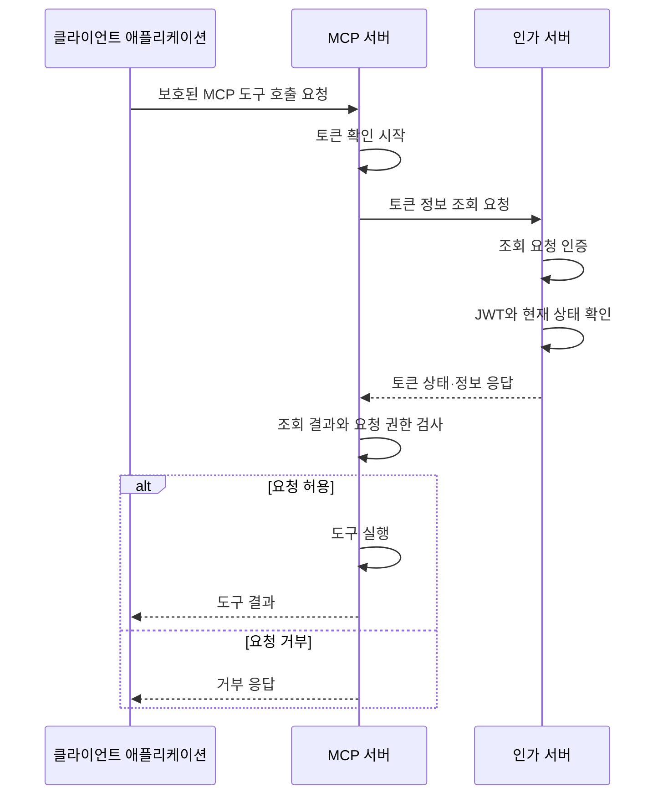

# JWT를 사용한 Token Introspection

이 노트는 이미 발급된 **접근 토큰**(Access Token)을 받은 MCP 서버가 인가 서버에 토큰 정보를 조회하고, 그 결과로 요청을 허용하거나 거부하는 과정을 설명한다. 토큰은 서명된 **JSON 웹 토큰**(JSON Web Token, JWT) 형식이다.

**토큰 인트로스펙션**(Token Introspection)은 토큰의 현재 활성 상태와 권한 정보를 인가 서버에 묻는 절차다. JWT는 토큰의 형식이고, 직접 검증과 Introspection은 토큰을 확인하는 방법이다. JWT도 Introspection으로 조회할 수 있다. [RFC 7662 §1](https://www.rfc-editor.org/rfc/rfc7662.html#section-1)

전체 코드는 [인가 서버](examples/jwt_introspection_authorization_server.py)와 [MCP 서버](examples/jwt_introspection_mcp_server.py)에 있다. 본문에는 핵심 부분만 발췌한다. 토큰 발급 과정은 [Authorization Code + PKCE 방식의 토큰 발급](authorization-code-pkce-token-issuance.md)을 참고한다.

## 1. JWT를 받은 MCP 서버의 확인 흐름

클라이언트 애플리케이션은 토큰을 첨부해 MCP 도구를 호출한다. MCP 서버는 토큰을 확인하고 필요한 권한이 있는지 판단한 뒤 도구를 실행한다.

| 참여자 | 이 흐름에서의 역할 |
|---|---|
| 클라이언트 애플리케이션 | **호스트**(Host) 안의 **MCP 클라이언트**(MCP Client)가 토큰을 첨부한 MCP 요청을 전달 |
| MCP 서버 | **리소스 서버**(Resource Server)로서 토큰 정보를 조회하고 요청 접근 권한을 검사 |
| 인가 서버 | **인가 서버**(Authorization Server)로서 조회자를 인증하고 토큰의 활성 상태·발급 정보를 응답 |



| 전달 구간 | 토큰 또는 자격의 위치 |
|---|---|
| 애플리케이션 → MCP 서버 | `Authorization: Bearer <JWT>` |
| MCP 서버 → 인가 서버 | 조회용 자격은 `Authorization: Basic ...`, 조회할 JWT는 본문의 `token` |
| 인가 서버 → MCP 서버 | JSON 응답의 `active`와 토큰 정보 |

MCP SDK는 보호된 HTTP 요청의 토큰을 `TokenVerifier.verify_token()`에 전달한다. 예제의 `IntrospectionTokenVerifier`가 조회 요청과 응답 검사를 담당한다. 허용되면 `report_summary()`가 무해한 집계 결과를 반환한다.

| 토큰 확인 방법 | JWT를 확인하는 곳 | MCP 서버에 필요한 정보 |
|---|---|---|
| JWT 직접 검증 | MCP 서버가 서명·클레임을 검사 | 신뢰할 검증 키와 발급자·사용 대상 등의 정책 |
| Token Introspection | 인가 서버가 JWT를 검사하고 상태를 응답 | 조회 요청을 인증할 자격과 조회 응답을 확인할 정책 |

이 예제는 두 번째 방법을 사용한다. MCP 서버에 JWT 서명 검증 키를 전달하지 않는다.

## 2. MCP 서버가 토큰 정보를 조회하기

**인트로스펙션 엔드포인트**(Introspection Endpoint)는 토큰 정보를 조회할 HTTP 요청 주소다. 예제의 `ISSUER`는 JWT의 발급자를 식별하고, `INTROSPECTION_ENDPOINT`는 조회 요청의 목적지를 지정한다. 두 값의 용도는 다르다.

| 설정 또는 식별자 | 예제 값과 의미 |
|---|---|
| `ISSUER` | `https://login.example.com/`, 기대하는 **발급자 식별자**(Issuer Identifier) |
| `INTROSPECTION_ENDPOINT` | `http://127.0.0.1:9101/oauth/introspect`, 조회 요청 목적지 |
| `RESOURCE` | `http://127.0.0.1:8101/mcp`, 토큰을 사용할 MCP 서버의 **리소스 식별자**(Resource Identifier) |
| JWT의 `client_id` | `report-reader`, 토큰을 발급받은 애플리케이션 |
| 조회용 `client_id` | `reports-mcp`, 조회 요청을 보내는 MCP 서버 |

주소와 발급자 식별자는 미리 설정하며 발견 절차를 구현하지 않는다. HTTP 주소는 로컬 loopback 학습용이다. 실제 Introspection 통신은 TLS로 보호해야 한다. [RFC 7662 §2·4](https://www.rfc-editor.org/rfc/rfc7662.html#section-2)

### 조회용 자격과 조회 대상 토큰 보내기

MCP 서버는 **HTTP Basic 인증**(HTTP Basic Authentication)으로 조회 자격을 제시한다. 조회용 비밀값은 외부 설정에서 공급한다. 이 자격은 JWT를 발급받은 애플리케이션의 자격과 별개다.

```http
POST /oauth/introspect HTTP/1.1
Host: 127.0.0.1:9101
Authorization: Basic <조회용 자격을 인코딩한 값>
Content-Type: application/x-www-form-urlencoded

token=<조회할 JWT>&token_type_hint=access_token
```

| 요청 항목 | 의미 |
|---|---|
| `Authorization` 헤더 | 조회 요청을 보내는 `reports-mcp`의 ID와 비밀값 |
| 본문의 `token` | MCP 요청에서 받은 조회 대상 JWT; 필수 파라미터 |
| `token_type_hint=access_token` | 접근 토큰을 조회한다는 선택적 힌트 |

`token_type_hint`는 조회할 토큰 유형을 알려주는 힌트이며, JWT의 유효성을 증명하지 않는다. 이 인가 서버 예제는 힌트를 무시하고 JWT 접근 토큰을 검사한다. 요청 형식은 [RFC 7662 §2.1](https://www.rfc-editor.org/rfc/rfc7662.html#section-2.1)을 따른다.

`request_introspection()`은 `httpx2`를 `httpx`라는 별칭으로 가져와 다음 POST 요청을 보낸다. `data`는 URL 인코딩된 폼 본문으로 전달된다.

```python
return await http_client.post(
    self.config.endpoint,
    headers={"Authorization": oauth_basic_header(self.config.client_id, self.config.client_secret)},
    data={"token": token, "token_type_hint": "access_token"},
)
```

`oauth_basic_header()`는 조회용 ID와 비밀값을 각각 폼 인코딩한 뒤, 콜론으로 연결해 Base64로 인코딩한다. 디코딩 순서는 [Client Credentials 노트의 Basic 인증](client-credentials-token-issuance.md#basic-인증값-디코딩과-클라이언트-인증)과 같다. JWT를 Basic 자격으로 사용하지 않는다.

## 3. 인가 서버가 JWT를 확인하고 응답하기

인가 서버의 `introspect()`는 조회 요청의 자격을 먼저 확인한다. 성공한 경우에만 본문의 JWT를 읽고 `inspect_jwt()`로 검사한다.

```python
# introspect()의 핵심 호출; 오류 응답 처리는 전체 파일에 있다.
authenticate_request(request, config)
form = await read_introspection_form(request)

result = inspect_jwt(form["token"], config)
return JSONResponse(result, headers=CACHE_HEADERS)
```

### 서명과 클레임 확인하기

**클레임**(Claim)은 JWT에 담긴 이름과 값이다. JWT 내용을 디코딩해서 읽을 수 있다는 사실만으로 그 정보가 신뢰할 수 있는 것은 아니다. 인가 서버는 검증 전에 헤더와 클레임을 신뢰하지 않는다.

| JWT의 클레임 | 예제에서 나타내는 정보 |
|---|---|
| `iss` | 토큰을 발급한 인가 서버 |
| `aud` | 토큰의 **사용 대상**(Audience); 여기서는 MCP 서버 식별자 |
| `sub` | 토큰의 **주체**(Subject); 예제 사용자 `demo-user` |
| `client_id` | 토큰을 받은 애플리케이션 `report-reader` |
| `exp`, `iat` | 만료·발급 시각; 유닉스 시간의 초 단위 숫자 |
| `jti` | 개별 JWT를 식별하는 값 |
| `scope` | 실제 허용한 **권한 범위**(Scope); 예제는 `reports:read` |

예제는 `RS256`으로 서명한 JWT 접근 토큰을 사용한다. 개인키는 서명할 때 사용하고, 인가 서버는 신뢰된 설정으로 공급받은 RSA 공개키로 검사한다. JWT가 제시한 알고리즘에 맞춰 허용 알고리즘을 바꾸지 않는다.

다음은 `inspect_jwt()`에서 서명·발급자·사용 대상·시간을 검사하는 부분이다.

```python
claims = jwt.decode(
    token,
    config.public_key,
    algorithms=["RS256"],
    issuer=config.issuer,
    audience=config.resource,
    options={"require": ["iss", "sub", "aud", "exp", "iat", "jti", "client_id", "scope"]},
)
```

이어 필드 형식도 검사한다. 접근 토큰을 나타내는 헤더 `typ`는 `at+jwt` 또는 `application/at+jwt`여야 한다. 설정의 `inactive_jtis`에 지정된 JWT 식별자도 비활성으로 처리한다. 예제는 별도의 계정 상태나 폐기 정보 저장소를 구현하지 않는다. 서명된 JWT 접근 토큰의 구조와 검사는 [RFC 9068 §2·4](https://www.rfc-editor.org/rfc/rfc9068.html#section-2)를 참고한다.

### 활성 상태와 토큰 정보 응답하기

검사를 통과하면 `inspect_jwt()`는 다음 정보를 반환하고, `JSONResponse`가 JSON 응답으로 보낸다. `client_id`와 `sub`는 JWT에서 검사를 마친 값이다.

```python
return {
    "active": True,
    "client_id": claims["client_id"],
    "sub": claims["sub"],
    "iss": claims["iss"],
    "aud": audience,
    "exp": claims["exp"],
    "iat": claims["iat"],
    "scope": scope,
    "token_type": "Bearer",
}
```

`active`는 서명 검사 결과 하나를 뜻하지 않는다. 인가 서버가 토큰의 현재 활성 상태를 판단한 결과다. 토큰을 인정할 수 없으면 HTTP `200`과 다음 본문만 반환하며, 세부 원인은 보내지 않는다. [RFC 7662 §2.2](https://www.rfc-editor.org/rfc/rfc7662.html#section-2.2)

```json
{"active": false}
```

## 4. MCP 서버가 조회 결과로 접근 판단하기

`IntrospectionTokenVerifier.verify_token()`은 조회 요청의 HTTP 상태와 JSON을 확인한 뒤, `access_token_from_response()`로 응답 정보를 검사한다. `active=true`만으로 현재 MCP 요청에 필요한 권한을 모두 얻은 것은 아니다.

### 조회 응답을 확인하기

RFC 7662에서 필수인 응답 필드는 `active`다. 나머지 필드는 선택적이다. 이 예제의 MCP 서버는 요청 허용 여부를 판단하기 위해 `active`뿐 아니라 `client_id`, `sub`, `iss`, `aud`, `exp`, `scope`도 조회 응답으로 받도록 정했다.

| 확인할 값 | 예제의 수신 조건 |
|---|---|
| `active` | 문자열이나 숫자가 아닌 실제 불리언 `true` |
| `iss` | 설정한 발급자 식별자와 정확히 일치 |
| `aud` | MCP 서버의 리소스 식별자와 일치; 목록이면 해당 값을 선택 |
| `exp` | 정수이며 현재 시각보다 뒤의 만료 시각 |
| `client_id`, `sub` | 비어 있지 않은 문자열 |
| `scope` | 공백으로 권한을 구분한 문자열; 빈 문자열은 권한 없음 |

`aud` 목록에 다른 대상만 있으면 거부한다. 여러 대상 중 이 MCP 서버의 식별자가 있으면 그 값만 SDK의 `resource`로 전달한다.

### 조회 정보를 SDK에 연결하기

검사를 통과하면 검증기는 SDK의 `AccessToken`을 반환한다. 이 객체는 새로 발급한 토큰이 아니라, 받은 토큰과 검사한 정보를 MCP SDK에 전달하는 객체다.

```python
return AccessToken(
    token=token,
    client_id=client_id,
    scopes=scopes,
    expires_at=expires_at,
    resource=resource,
    subject=subject,
    claims=payload,
)
```

`token`에는 받은 JWT, `subject`에는 응답의 `sub`, `claims`에는 검사한 조회 응답을 넣는다. `scope` 문자열은 권한 목록인 `scopes`로 바꾼다.

`build_server()`는 검증기와 필요한 권한을 연결한다. `required_scopes`는 이 서버의 요청에 필요한 권한이고, `validate_token_resource=True`는 반환한 `AccessToken.resource`를 서버 식별자와 대조하도록 설정한다.

```python
server = MCPServer(
    "토큰 조회 보고서",
    token_verifier=verifier,
    auth=AuthSettings(
        issuer_url=AnyHttpUrl(verifier.config.issuer),
        resource_server_url=AnyHttpUrl(verifier.config.resource),
        required_scopes=REQUIRED_SCOPES,
        validate_token_resource=True,
    ),
)
```

`REQUIRED_SCOPES`는 `["reports:read"]`다. 검증기가 토큰의 발급자·사용 대상·응답 구조를 확인하고, SDK는 반환된 토큰 정보와 필요한 권한을 검사한다. 설정을 선언하는 것만으로 조회 응답의 모든 검사가 수행되는 것은 아니다.

```python
@server.tool()
def report_summary() -> dict[str, int]:
    """보호된 요청이 허용되면 무해한 예제 집계 결과를 반환한다."""
    return {"completed": 9, "queued": 3}
```

토큰 확인과 권한 검사를 통과한 요청에서만 `report_summary()`가 실행된다. 공개 인터페이스는 [Python SDK의 Authorization](https://py.sdk.modelcontextprotocol.io/run/authorization/)을 참고한다. 예제는 MCP SDK `2.3.0`, PyJWT `2.15.1`, `httpx2` `2.13.1`을 기준으로 작성했다.

## 5. 실패한 경우 구분하기

조회 요청의 실패와 조회 대상 토큰의 비활성 판정은 서로 다른 결과다. 먼저 인가 서버의 조회 응답을 구분한다.

### 인가 서버의 조회 응답

| 발생한 일 | 인가 서버의 HTTP 응답 | 의미 |
|---|---|---|
| 조회용 ID·비밀값이 유효하지 않음 | `401`, `{"error": "invalid_client"}`, Basic 인증 요구 헤더 | 조회 요청 자체를 인증하지 못함 |
| 조회할 `token` 누락·잘못된 본문 | `400`, `{"error": "invalid_request"}` | 조회 요청 형식이 유효하지 않음 |
| JWT 만료·변조·다른 발급자 또는 사용 대상 | `200`, `{"active": false}` | 정상적으로 조회했으나 토큰을 인정하지 않음 |
| 유효한 JWT | `200`, `active=true`와 정보 | MCP 서버가 응답과 요청 권한을 계속 검사 |

조회 인증 실패의 `401`과 비활성 토큰 조회의 `200`은 구분한다. 비활성 판정은 조회 오류 응답이 아니다. [RFC 7662 §2.3](https://www.rfc-editor.org/rfc/rfc7662.html#section-2.3)

### MCP 요청의 허용·거부

| MCP 서버가 확인한 상황 | 예제의 처리 | 애플리케이션이 받는 결과 |
|---|---|---|
| `active=false` 또는 응답의 발급자·대상·시간 불일치 | 검증기가 `None` 반환 | MCP HTTP `401`; 도구 미실행 |
| 조회용 자격 거부 또는 비정상 HTTP 응답 | 원인을 기록하고 `None` 반환 | MCP HTTP `401`; 도구 미실행 |
| 연결 실패·시간 초과·잘못된 JSON | 조회 실패로 기록하고 `None` 반환 | MCP HTTP `401`; 도구 미실행 |
| 유효한 토큰이지만 `reports:read`가 없음 | 토큰 정보는 반환하되 SDK의 권한 검사에서 거부 | MCP HTTP `403`; 도구 미실행 |

인가 서버가 MCP 서버에 보낸 `401`과, MCP 서버가 애플리케이션에 보낸 `401`은 다른 구간의 응답이다. 이 예제에서 MCP의 `401`만으로 JWT 자체가 무효라고 단정할 수 없다. 조회용 자격 실패, 서비스 장애, `active=false`는 서로 다른 원인이다.

검증기는 실패 원인을 구분해 기록하되 토큰·비밀값·키를 로그에 넣지 않는다. 조회에 실패하면 토큰 상태를 확인하지 못한 것이므로 도구 실행을 허용하지 않는다. 조회 실패를 인가 서버가 정상적으로 반환한 `active=false` 응답으로 바꾸지는 않는다. MCP의 토큰·권한 거부는 [RFC 6750 §3.1](https://www.rfc-editor.org/rfc/rfc6750.html#section-3.1)과 [MCP Authorization](https://modelcontextprotocol.io/specification/2026-07-28/basic/authorization)을 참고한다.

## 6. 불투명 토큰을 조회하는 경우와 비교하기

**불투명 토큰**(Opaque Token)은 토큰 문자열을 해석해 발급 정보를 읽는 대신, 인가 서버의 기록에 연결해 사용하는 토큰이다. 특정 문자열 형식을 정한 표준의 이름은 아니다.

| 비교할 부분 | JWT 조회 | 불투명 토큰 조회 |
|---|---|---|
| MCP 서버의 요청 | 본문 `token`에 JWT를 보냄 | 본문 `token`에 불투명 토큰을 보냄 |
| 인가 서버의 확인 | 신뢰한 키로 서명·클레임과 현재 상태 검사 | 문자열에 연결된 발급 기록과 현재 상태 확인 |
| 응답과 MCP의 판단 | `active`와 토큰 정보로 접근 판단 | 같은 조회 응답 구조로 접근 판단 |

서버 파일의 `inspect_opaque()`는 비교용 기록 조회 함수다. `records`는 응답 필드 형태로 발급 정보를 보관한 딕셔너리이며, 다음은 그 함수의 조회·활성 상태 확인 부분이다.

```python
record = records.get(token)
if record is None or record.get("active") is not True:
    return {"active": False}
```

전체 함수는 기록의 만료 시각과 사용 대상도 확인한다. 실제 예제의 `/oauth/introspect` 경로는 `inspect_jwt()`로 JWT만 검사하며, 이 비교 함수를 호출하지 않는다. 불투명 토큰의 발급 기록은 [Client Credentials 방식의 토큰 발급](client-credentials-token-issuance.md)을 참고한다.

### 참고 자료

- [RFC 7662 — 요청·응답·오류](https://www.rfc-editor.org/rfc/rfc7662.html#section-2), [RFC 9068 — JWT 접근 토큰](https://www.rfc-editor.org/rfc/rfc9068.html)
- [RFC 6750 — Bearer 토큰과 오류](https://www.rfc-editor.org/rfc/rfc6750.html), [MCP 2026-07-28 Authorization](https://modelcontextprotocol.io/specification/2026-07-28/basic/authorization)
- [Python SDK Authorization](https://py.sdk.modelcontextprotocol.io/run/authorization/), [PyJWT의 decode](https://pyjwt.readthedocs.io/en/stable/api.html#jwt.decode), [Starlette 응답](https://starlette.dev/responses/)
