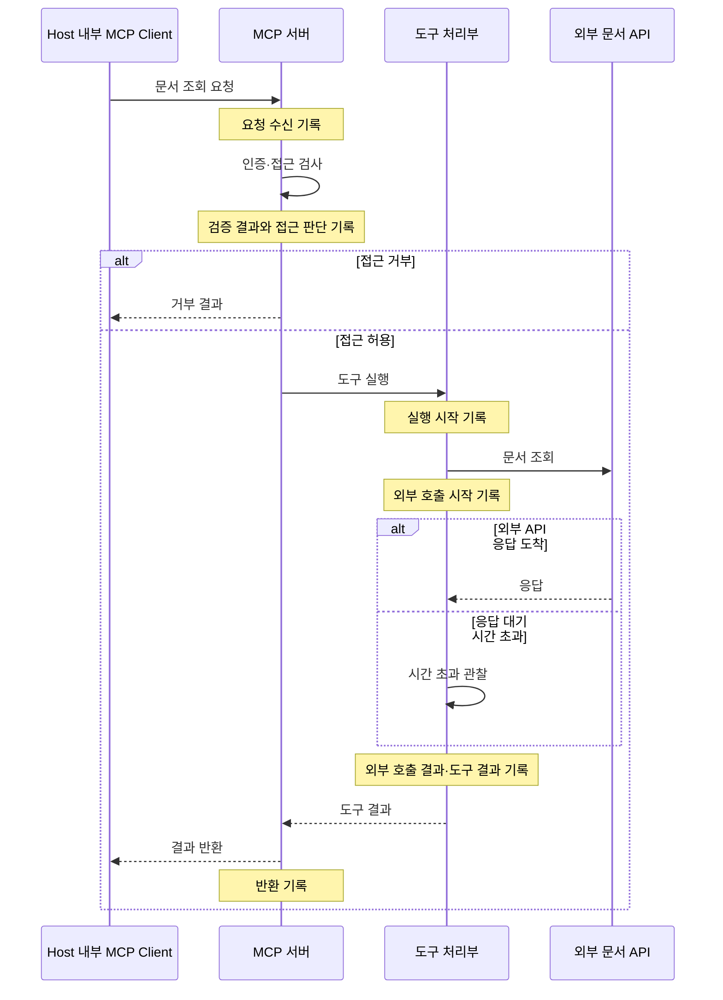

# 감사 기록과 실패 추적

문서 조회 도구가 실패했을 때 “접근이 거부됐는가?”와 “허용된 조회가 실행 중 실패했는가?”는 서로 다른 질문이다. 기록은 이 둘을 구분하고, 같은 요청에 속한 사건을 이어서 읽을 수 있게 해야 한다.

이 노트는 MCP 요청 처리 과정에서 어떤 근거를 남기고 어떻게 해석하는지 다룬다. 예제의 로그와 식별자는 설명용이며, 기록 시스템을 구축하는 실행 안내서는 아니다.

## 1. 감사 기록과 진단 기록의 역할

**감사 로그(Audit Log)**는 누가 어떤 작업을 요청했고, 접근 판단과 실제 결과가 무엇이었는지 확인하는 기록이다. **진단 로그(Diagnostic Log)**는 처리 과정과 실패 원인을 조사하기 위한 기록이다. 오류 로그(Error Log)는 진단에 쓰이는 기록의 한 종류이며, 실패 이전의 정상 단계도 원인 조사에 도움이 된다.

| 관점 | 감사 기록 | 진단 기록 |
| --- | --- | --- |
| 주된 질문 | 누가 무엇을 요청했고, 허용·거부와 작업 결과는 무엇인가? | 어느 단계에서 어떤 문제가 나타났는가? |
| 필요한 근거의 예 | 검증된 요청자, 도구와 대상, 접근 판단, 작업 결과 | 실행 단계, 외부 호출의 소요 시간, 오류 종류와 발생 위치 |
| 조사 사례 | 권한 없는 앱의 문서 조회 시도가 거부됐는지 확인 | 허용된 조회가 외부 호출 중 실패한 이유를 조사 |

하나의 사건이 두 목적에 모두 쓰일 수 있다. 예를 들어 “허용된 문서 조회가 외부 호출 시간 초과로 실패했다”는 기록은 작업 결과를 확인하는 동시에 실패 구간을 알려 준다. 목적이 다르다고 반드시 별도 파일에 저장해야 하는 것은 아니다. 어떤 질문에 답할 기록인지에 맞춰 내용을 선택한다. [OWASP 기록 목적과 설계](https://cheatsheetseries.owasp.org/cheatsheets/Logging_Cheat_Sheet.html#purpose)

## 2. 요청 처리 흐름에서 무엇을 기록하는가

**호스트(Host)**는 사용자와 상호작용하고 도구 실행을 조정하는 애플리케이션이다. 그 안의 **MCP 클라이언트(MCP Client)**가 MCP 서버에 요청을 보낸다. **인증(Authentication)**은 요청 주체를 확인하는 과정이고, **접근 통제(Access Control)**는 그 주체에게 해당 도구와 대상의 사용을 허용할지 판단하고 제한하는 과정이다.

다음은 보호된 문서 조회 요청이 외부 **애플리케이션 프로그래밍 인터페이스(API, Application Programming Interface)**를 사용하는 흐름이다. API는 다른 서비스의 기능을 호출하는 인터페이스다. 그림의 메모는 각 단계에서 남길 수 있는 기록을 나타낸다.



외부 API가 응답하지 않아도 서버의 호출 처리부는 대기 종료를 실패로 기록할 수 있다. 외부 호출 결과는 서버가 관찰한 결과이며, 외부 서비스 내부에서 실제로 무슨 일이 있었는지까지 알려 주지는 않는다.

여기서 구분할 상태는 세 가지다.

- **접근 거부:** 검사에서 거부되어 도구 실행 단계로 진행하지 않았다.
- **허용 후 실행 실패:** 접근 검사는 통과했지만 도구 실행이나 외부 호출에서 실패했다.
- **허용 후 완료:** 접근 검사를 통과했고, 요청한 작업의 완료를 확인했다.

따라서 접근 허용과 작업 완료는 각각 기록할 가치가 있다. 결과를 반환했다는 사건도 반환한 내용이 성공인지 실패인지 함께 읽어야 한다.

그림은 특정 인증 방식이나 전송 방식(Transport)을 전제하지 않는다. 전송 방식은 MCP 메시지를 전달하는 방법이다. 소지한 값을 제출해 사용하는 Bearer 토큰을 모든 MCP 전송 방식의 필수 조건으로 일반화하면 안 된다. 토큰 검증은 [JWT 직접 검증](../oauth2/jwt-access-token-verification.md), 접근 판단은 [도구별·대상별 접근 통제](mcp-access-control.md), 외부 호출의 자격 증명은 [자격 증명과 사용자 동의](external-api-credentials-and-consent.md)를 참고한다.

## 3. 같은 작업의 기록을 연결하는 방법

**상관관계 식별자(Correlation ID)**는 같은 요청이나 작업에 속한 여러 사건을 묶는 값이다. 시간순 기록에 다른 요청이 끼어 있어도 이 값을 따라 해당 작업의 흐름을 모을 수 있다. **구조화 로그(Structured Log)**는 시간이나 결과 같은 정보를 이름 있는 필드로 구분한 기록이다.

아래 JSON 배열에는 두 요청 `req-7`과 `req-8`의 사건이 섞여 있다. 앱 A의 문서 조회는 허용됐고, 앱 B의 다른 문서 조회는 거부됐다. 이후 시간 초과는 `req-7`에 속한다.

```json
[
  {
    "time": "2026-10-14T09:00:00.000Z",
    "service": "document-mcp",
    "correlation_id": "req-7",
    "verified_requester": "app-a",
    "tool": "read_document",
    "target": "doc-17",
    "stage": "access_check",
    "result": "allowed",
    "reason": "policy_matched"
  },
  {
    "time": "2026-10-14T09:00:00.010Z",
    "service": "document-mcp",
    "correlation_id": "req-8",
    "verified_requester": "app-b",
    "tool": "read_document",
    "target": "doc-22",
    "stage": "access_check",
    "result": "denied",
    "reason": "target_access_denied"
  },
  {
    "time": "2026-10-14T09:00:05.030Z",
    "service": "document-api-adapter",
    "correlation_id": "req-7",
    "stage": "external_call",
    "result": "failed",
    "reason": "timeout"
  }
]
```

`document-api-adapter`는 MCP 서버 쪽에서 외부 API 호출을 담당하는 구성요소다. 외부 서비스 자체의 기록이라는 뜻은 아니다. **필드명과 값은 이 예제의 애플리케이션이 정한 것이며 MCP 표준이 아니다.**

시간은 사건의 순서와 간격을, 서비스는 사건을 관찰한 위치를 알려 준다. 식별자는 관련 사건을 모으는 데 쓰인다. 검증된 요청자·도구·대상은 누가 무엇에 접근하려 했는지, 단계·결과·이유는 어느 판단이나 실행에서 어떤 일이 있었는지 설명한다. 기록 목적과 단계에 따라 필요한 정보가 다르므로 모든 사건에 같은 필드를 반복할 필요는 없다. [OWASP 이벤트 속성](https://cheatsheetseries.owasp.org/cheatsheets/Logging_Cheat_Sheet.html#event-attributes)

인증 전에 호출자가 주장한 이름은 검증된 신원이 아니다. 필요한 경우 그 주장을 기록하더라도 출처와 미검증 상태를 분명히 하고, `verified_requester`처럼 검증을 뜻하는 필드에 넣지 않는다. 요청자가 사람인지 애플리케이션인지도 구분한다.

**JSON-RPC 요청 식별자(Request ID)**는 요청·응답 메시지 형식인 JSON-RPC에서 요청과 응답을 대응시키는 `id` 값이다. 이 값만으로 여러 서버의 기록이 자동 연결되지는 않는다. 애플리케이션이 관련 식별자를 다음 구성요소에 전달하거나, 각 구성요소의 식별자 사이 연결을 기록해야 한다. 위 예제도 그런 연결이 이루어졌다고 가정한다. 서로 다른 시스템의 시계가 어긋날 수 있으므로 시각만으로 세밀한 선후 관계를 단정하지 않는다.

## 4. 기록을 읽으며 실패 지점 좁히기

**시간 초과(Timeout)**는 정해진 대기 시간 안에 필요한 응답이나 완료를 얻지 못한 상태다. 이는 관찰한 증상이며, 그 자체가 외부 서버 장애라는 원인 확정은 아니다.

앞의 `req-7`에 시작과 종료 기록을 더해 읽어 보자. 아래 시각은 같은 서버 쪽에서 관찰한 사건이며, `Z`는 협정 세계시(UTC, Coordinated Universal Time)를 뜻한다.

```text
1. 09:00:00.000Z  req-7  접근 검사     allowed
2. 09:00:00.020Z  req-7  도구 실행     started
3. 09:00:00.030Z  req-7  외부 API 호출 started
4. 09:00:05.030Z  req-7  외부 API 호출 failed  reason=timeout
5. 09:00:05.031Z  req-7  도구 실행     failed  reason=external_call_timeout
6. 09:00:05.040Z  req-7  결과 반환     sent    outcome=tool_failure
```

이 기록에서 **확인할 수 있는 사실**은 접근 검사가 통과했고, 도구와 외부 호출이 시작됐으며, 외부 호출의 대기가 시간 초과로 끝났다는 것이다. 도구 처리부는 그 실패를 작업 실패로 처리해 반환했다.

**실패 구간**은 외부 API 호출 단계로 좁혀진다. 접근 거부가 원인은 아니다. 하지만 **아직 확인하지 못한 원인**에는 서버에서 외부 서비스까지의 연결 지연, 외부 서비스의 느린 처리, 응답 전달 문제, 지나치게 짧은 대기 시간 등이 있다.

다음 조사는 해당 시간대의 연결 오류와 대기 시간 설정을 확인하고, 가능하다면 외부 서비스의 대응 기록과 연결하는 것이다. 기록에 없는 원인을 사실처럼 채워 넣지 않는다.

`started`는 완료의 증거가 아니다. 종료 기록이 없을 때도 “실행되지 않았다”고 바로 결론 내릴 수 없다. 처리 중단뿐 아니라 기록 수집 실패나 기록 지연도 살펴야 한다. 변경 작업에서 시간 초과가 났다면 외부 시스템에 변경이 반영됐는지도 별도로 확인해야 한다.

**HTTP 상태 코드(HTTP Status Code)**는 HTTP 요청·응답 처리 상태를 나타내는 값이다. 이를 실제 도구 작업 결과와 함께 읽어야 한다. 예를 들어 HTTP `200` 응답 안에 도구 실패 결과가 담길 수 있다. HTTP 처리 성공, 접근 허용, 실제 작업 성공은 각각 다른 단계의 판단이다. 위 기록의 `sent` 역시 실패 결과를 보냈다는 뜻이지 문서 조회가 성공했다는 뜻이 아니다.

## 5. 조사에 필요한 정보를 안전하게 남기기

**비밀값(Secret)**은 토큰이나 비밀번호처럼 노출되면 다른 사람이 접근 권한을 얻을 수 있는 정보다. **민감정보(Sensitive Data)**에는 개인 문서 본문이나 개인정보처럼 공개를 제한해야 하는 내용도 포함된다. 조사에 유용하다는 이유만으로 요청과 응답 전체를 저장하지 않는다.

같은 실패라도 사용자 안내와 내부 기록의 역할은 다르다.

| 전달 위치 | 예시 | 목적 |
| --- | --- | --- |
| 사용자 오류 안내 | “문서를 가져오지 못했습니다. 문의 시 참조 번호 `req-7`을 알려 주세요.” | 사용자가 결과를 이해하고 문의할 수 있게 한다. |
| 내부 기록 | `req-7`, 외부 호출 단계, `timeout`, 대기 시간, 도구 실패 | 담당자가 관련 사건을 찾고 실패 구간을 조사한다. |

내부 기록에서도 토큰, 비밀번호, 연결 문자열(Connection String)은 제외한다. 연결 문자열은 데이터베이스 등의 접속 정보를 담으며 비밀번호를 포함할 수 있다. 민감한 본문 대신 필요한 대상 식별자와 오류 분류만 선별하고, 식별자 자체가 민감하면 가명 처리 등으로 노출을 줄인다.

**스택 추적(Stack Trace)**은 오류까지 이어진 함수 호출 경로이고, 예외 원문은 프로그램이 보고한 오류 내용이다. 둘에도 URL의 토큰이나 접속 정보가 들어갈 수 있으므로 그대로 남긴다고 안전한 것은 아니다. [OWASP 제외할 데이터](https://cheatsheetseries.owasp.org/cheatsheets/Logging_Cheat_Sheet.html#data-to-exclude)

**로그 인젝션(Log Injection)**은 외부 입력이 기록의 구조를 바꾸어 가짜 사건처럼 보이게 만드는 공격이다. 문서 제목에 줄바꿈과 “관리자 작업 성공”이라는 문장이 들어 있으면, 이를 텍스트 로그에 그대로 붙일 때 별도 사건처럼 보일 수 있다.

외부 값은 기록 형식에 맞게 안전하게 인코딩하고, 줄바꿈·구분자가 사건의 경계를 바꾸지 않도록 처리한다. 형식이 잘못된 값은 생략하거나 안전한 값으로 대체하되, 필요한 실패 사건 자체를 버리지 않는다. 외부 값의 신뢰 경계는 [외부 데이터와 작업 지시](external-data-instruction-trust-boundaries.md)에서도 다루며, 여기서는 기록 형식에 미치는 영향을 살핀다. [OWASP 이벤트 수집](https://cheatsheetseries.owasp.org/cheatsheets/Logging_Cheat_Sheet.html#event-collection)

기록을 읽을 수 있는 권한과 수정·삭제할 수 있는 권한을 제한하고, 전송·보관 중 변조와 노출을 막아야 한다. 조사 목적과 필요한 기간에 맞춰 보관 기간(Retention Period)을 정하고 만료된 기록을 처리한다. 저장 공간 부족이나 수집 연결 끊김 때문에 기록이 중단되는지도 확인해야 한다. [OWASP 기록 보호](https://cheatsheetseries.owasp.org/cheatsheets/Logging_Cheat_Sheet.html#protection), [보관·폐기](https://cheatsheetseries.owasp.org/cheatsheets/Logging_Cheat_Sheet.html#disposal-of-logs)

로그는 사고를 조사할 근거를 제공한다. 로그를 남긴다는 사실만으로 사고가 예방되거나 기록의 정확성·완전성이 보장되지는 않는다. 기록을 해석할 때는 누가 어느 단계에서 관찰했는지, 빠졌거나 변조됐을 가능성이 있는지도 함께 판단한다.
