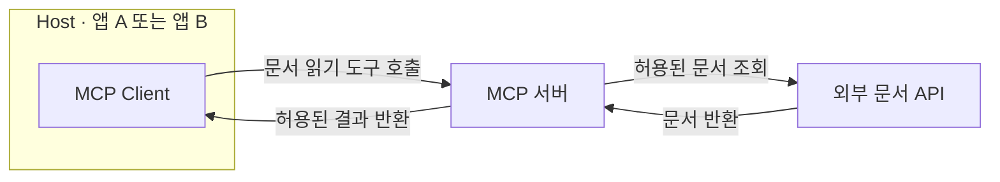
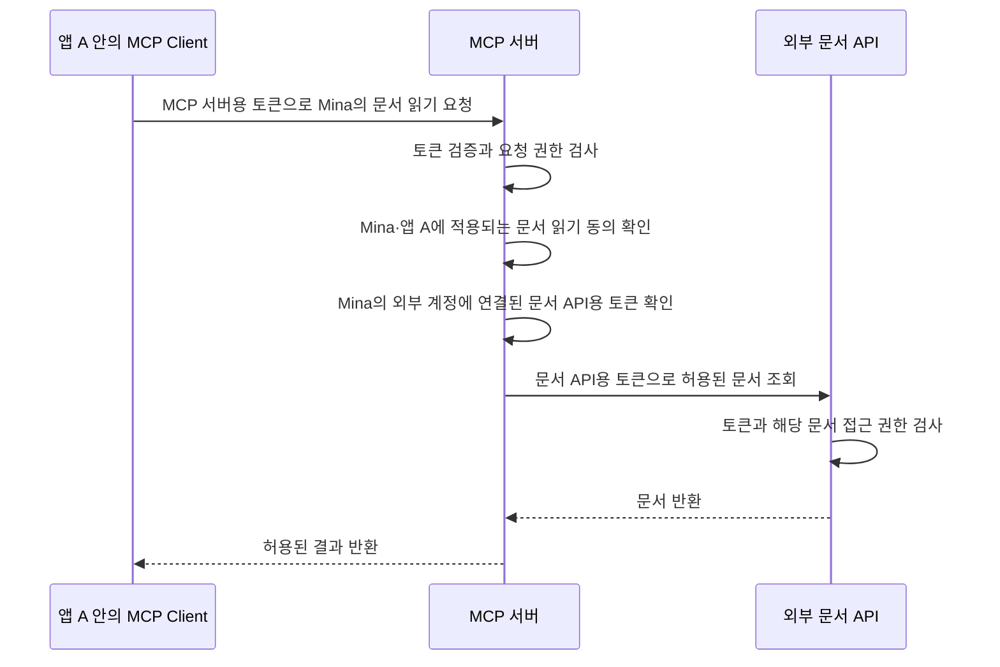
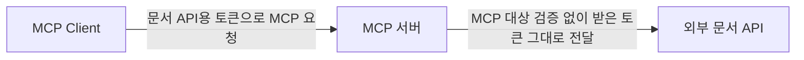
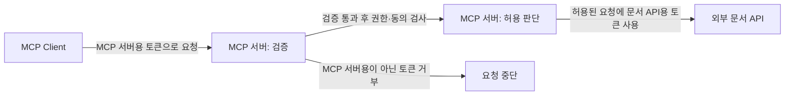
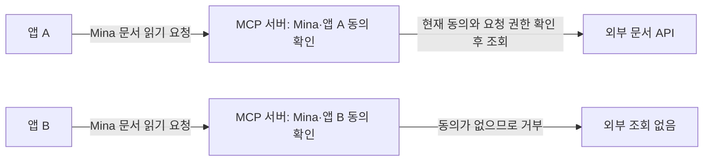
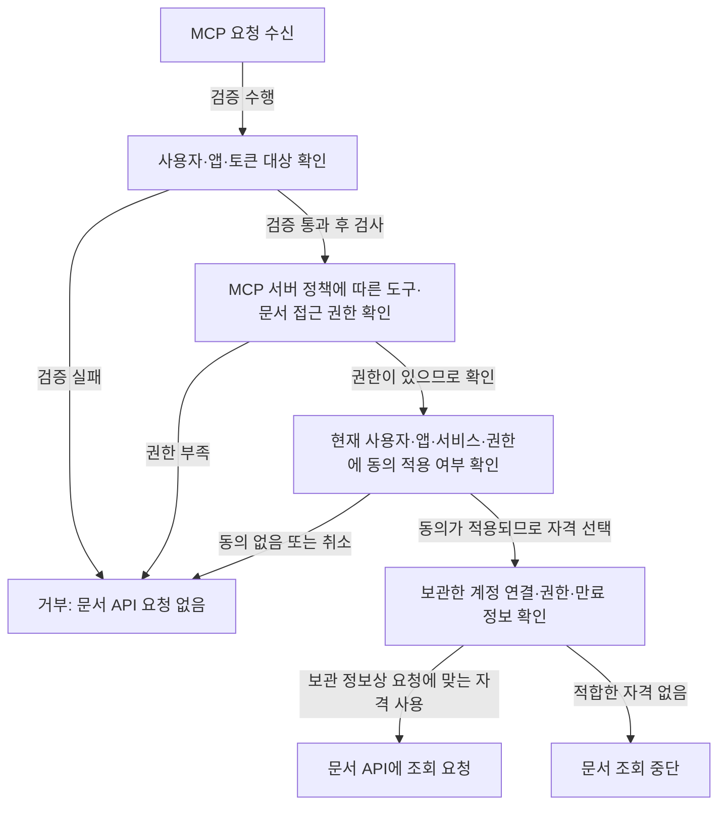

# 외부 API 호출의 자격 증명과 사용자 동의

사용자 **Mina**가 외부 문서 서비스에 개인 문서를 보관하고 있다고 하자. 앱 A와 앱 B는 같은 MCP 서버를 통해 그 문서를 읽으려 한다. Mina는 **앱 A의 문서 읽기에 동의했고, 앱 B에는 동의하지 않았다**.

MCP 서버에 접근할 수 있다는 사실만으로 Mina의 문서를 읽어도 되는 것은 아니다. 서버는 **MCP 요청의 자격 증명**과 **문서 API 호출의 자격 증명**을 구분하고, 현재 사용자 동의가 **요청한 앱**에 적용되는지 확인해야 한다. 자격 증명(Credential)은 접근할 자격을 증명하는 값이며, 여기서는 접근 토큰(Access Token)을 사용한다.

이 노트는 개인 문서를 읽는 **사용자 위임**(User Delegation) 상황을 다룬다. 사용자가 자기 문서에 대한 제한된 접근을 애플리케이션에 허용하는 경우다. 공개 API나 서비스 자체 권한으로 수행하는 모든 외부 호출에 같은 사용자 동의가 필요하다는 뜻은 아니다.

## 1. MCP 요청과 외부 API 호출의 전체 구조

먼저 **어느 구성요소가 누구에게 요청하는지** 구분한다. 호스트(Host)는 사용자와 상호작용하는 애플리케이션이고, MCP 클라이언트(MCP Client)는 그 안에서 MCP 서버와 통신하는 구성요소다. 여기서 앱 A와 앱 B는 각각 Host 애플리케이션이다.



**리소스 서버**(Resource Server, RS)는 보호된 데이터를 제공하며 요청의 접근 권한을 검사한다. **OAuth 클라이언트**(OAuth Client)는 토큰 발급 절차에 참여하고 그 토큰으로 리소스 서버에 요청하는 애플리케이션이다. 같은 MCP 서버라도 통신 구간에 따라 역할이 달라진다.

| 구성요소 | 이 구조에서의 역할 |
| --- | --- |
| 앱 A 또는 앱 B | 내부 MCP Client를 통해 요청하며, MCP 서버용 토큰을 사용하는 OAuth Client |
| MCP 서버: 요청을 받는 쪽 | MCP 서버용 토큰과 요청 권한을 검사하는 RS |
| MCP 서버: 외부 서비스를 사용하는 쪽 | Mina가 위임한 권한으로 문서 API용 토큰을 사용하는 OAuth Client |
| 외부 문서 API | 문서 API용 토큰과 문서 접근 권한을 검사하는 RS |

다음은 앱 A의 동의와 문서 API용 토큰이 이미 있는 정상 요청이다. 이 그림은 토큰 발급 이후 문서를 읽는 흐름이다. 토큰을 발급받는 절차는 아래 링크에서 별도로 다룬다.



MCP 서버용 토큰을 얻는 기본 흐름은 [MCP OAuth2의 전체 구조와 접근 흐름](../oauth2/mcp-oauth2-flow.md)을 참고한다. 사용자 동의부터 토큰 발급까지의 OAuth 절차는 [Authorization Code + PKCE 노트](../oauth2/authorization-code-pkce-token-issuance.md)에 있다.

## 2. 두 통신 구간의 자격 증명 구분하기

이 절에서는 **토큰이 허용하는 대상과 행동**을 구분한다. 토큰의 대상(Audience)은 그 토큰을 받아 접근 권한을 판단할 서버다. 권한 범위(Scope)는 허용된 행동의 범위를 나타낸다.

| 구분 | MCP 서버용 토큰 | 문서 API용 토큰 |
| --- | --- | --- |
| 사용하는 쪽 → 받는 쪽 | 앱의 MCP Client → MCP 서버 | MCP 서버 → 외부 문서 API |
| 대상 | MCP 서버 | 외부 문서 API |
| 권한의 의미 | MCP 서버의 문서 읽기 도구를 요청할 권한 | Mina의 외부 문서를 읽을 위임 권한 |
| 예제의 권한 이름 | `documents:read` | `documents.read` |
| 보관·관리하는 쪽 | 해당 앱이 관리하고 MCP 요청에 첨부 | MCP 서버가 외부 계정 연결과 함께 관리 |

권한 이름은 설명용이며 MCP 표준 이름이 아니다. 토큰 발급자가 같더라도 대상과 용도별 자격은 구분한다. 두 구간에 반드시 서로 다른 인가 서버(Authorization Server)가 있어야 한다는 뜻은 아니다.

두 요청 모두 `Authorization` 헤더를 쓰지만, 첨부하는 값은 다르다. 다음은 차이를 보여주는 헤더 발췌이며 실제 토큰 값이 아니다.

MCP Client → MCP 서버:

```http
Authorization: Bearer <MCP 서버용 토큰>
```

MCP 서버 → 외부 문서 API:

```http
Authorization: Bearer <문서 API용 토큰>
```

문서 API가 성공 응답을 보냈다는 것은 **전달받은 문서 API용 토큰과 해당 문서의 접근 조건을 검사해 요청을 허용했다**는 뜻이다. 그 결과가 MCP 서버의 요청 권한 검사나 앱별 동의 검사를 대신하지 않는다. 외부 API는 MCP 서버 뒤에서 어느 앱이 요청했는지 알지 못할 수 있다.

토큰 자체의 검증 방법은 [JWT 직접 검증](../oauth2/jwt-access-token-verification.md)과 [토큰 인트로스펙션](../oauth2/token-introspection-jwt.md)을 참고한다. 인트로스펙션(Introspection)은 인가 서버에 토큰의 유효성과 관련 정보를 질의하는 방식이다.

## 3. 받은 토큰을 그대로 전달하면 생기는 문제

**토큰 그대로 전달**(Token Passthrough)은 MCP 서버용으로 발급됐는지 확인하지 않은 토큰을 받아 외부 API에 그대로 넘기는 잘못된 방식이다. 외부 API용 토큰이 그 API에서 유효하더라도 MCP 서버에 접근할 자격의 증거가 되지는 않는다. [공식 Token Passthrough 지침](https://modelcontextprotocol.io/docs/2026-07-28/tutorials/security/security_best_practices#token-passthrough)

잘못된 전달은 다음과 같다.



이 흐름에서는 “문서 API가 받아 주는 토큰”을 “MCP 서버도 받아도 되는 토큰”으로 취급한다. MCP 서버가 호출 앱을 신뢰할 근거를 확보하지 못한 채 문서 조회를 중계할 수 있다.

올바른 구분은 다음과 같다.



MCP 서버는 자신을 대상으로 발급된 토큰만 받아야 한다. 검증한 MCP 서버용 토큰도 외부 요청에 복사하지 않는다. 외부 호출에는 해당 사용자·서비스에 연결된 별도의 자격을 사용한다. [공식 토큰 대상 검증 요구](https://modelcontextprotocol.io/docs/2026-07-28/tutorials/security/security_best_practices#token-passthrough)

## 4. 사용자 동의를 애플리케이션별로 연결하기

**혼동된 대리인 문제**(Confused Deputy)는 권한을 가진 서버가 요청자의 허용 범위를 구분하지 못해 자기 권한을 잘못 사용하는 문제다. 여기서는 MCP 서버가 문서 API용 토큰을 갖고 있다는 이유로, Mina가 허용하지 않은 앱 B의 문서 조회까지 수행하는 상황이다.

외부 문서 서비스에는 MCP 서버가 OAuth Client로 등록되어 있다. MCP 요청을 시작한 앱 A/B와는 다른 등록이다. 다음 식별자는 설명용이다.

| 식별자 | 가리키는 대상 | 판단에 쓰는 출처 |
| --- | --- | --- |
| 사용자 ID `user-mina` | 사람 Mina | 검증된 사용자 정보 |
| 요청 앱의 `client_id`: `app-a` 또는 `app-b` | MCP 요청을 시작한 앱 A 또는 앱 B | 검증된 앱 정보와 서버의 등록 정보 |
| 외부 서비스에 등록한 `client_id`: `mcp-doc-connector` | 외부 OAuth Client 역할을 맡은 MCP 서버 | MCP 서버의 외부 서비스 등록 설정 |
| Mina의 외부 계정 연결 | 외부 문서 서비스의 Mina 계정 | 서버가 확인하고 보관한 계정 연결 |

`client_id`는 애플리케이션 식별자이며 사람의 ID가 아니다. 같은 이름의 식별자가 여러 발급자나 등록 체계에 있을 수 있으므로, 서버는 신뢰하는 발급자·등록 문맥과 함께 앱을 구분한다. 요청 인자에 적힌 `user_id`, `client_id`, `consent=true`는 신원이나 동의의 증거로 쓰지 않는다.

**외부 서비스에서 Mina가 `mcp-doc-connector`에 동의했다**는 사실은 MCP 서버가 Mina의 문서를 읽을 외부 위임을 받았다는 뜻이다. 그것만으로 **모든 MCP 앱에 동의했다**고 판단하면 안 된다. MCP 서버는 Mina가 **어느 요청 앱을 통해, 어느 서비스에서, 어떤 행동을 허용했는지** 별도로 확인한다.

| 동의를 확인하는 곳 | 사용자 | 동의 대상 앱 | 동의의 의미 |
| --- | --- | --- | --- |
| 외부 서비스 | Mina | MCP 서버의 `mcp-doc-connector` | MCP 서버가 Mina의 외부 문서를 읽을 수 있음 |
| MCP 서버 | Mina | 요청 앱 `app-a` | 앱 A를 통한 외부 문서 읽기를 Mina가 허용 |
| MCP 서버 | Mina | 요청 앱 `app-b` | 동의 기록 없음: 앱 B를 통한 읽기는 허용하지 않음 |

MCP 서버가 보관하는 동의 기록을 단순화하면 다음과 같다. 이 표는 토큰 목록이 아니다.

| 사용자 | 요청 앱 | 외부 서비스 | 허용 행동 | 현재 동의 |
| --- | --- | --- | --- | --- |
| `user-mina` | `app-a` | 문서 서비스 | 문서 읽기 | 적용 가능 |
| `user-mina` | `app-b` | 문서 서비스 | 문서 읽기 | 없음 |



공식 OAuth 프록시 지침은 **외부 인가 흐름을 시작하기 전에** 사용자별로 승인된 MCP `client_id` 기록을 확인하도록 요구한다. 외부 서비스의 기존 동의 때문에 동의 화면이 생략되더라도, MCP 서버의 앱별 확인을 생략해서는 안 된다. [공식 Confused Deputy 지침](https://modelcontextprotocol.io/docs/2026-07-28/tutorials/security/security_best_practices#confused-deputy-problem)

매 호출마다 새 동의를 묻는다는 뜻은 아니다. 현재 동의가 해당 사용자·앱·서비스·권한에 적용되는지 확인한다. 동의가 없거나 취소됐다면 외부 인가 흐름이나 문서 조회를 그대로 진행하지 않는다. 새 동의를 받는 경우에는 그 승인이 확인된 뒤 필요한 외부 인가 절차로 이어간다.

## 5. 요청 조건에 따른 허용·거부 판단

최종 판단에서는 **요청 권한, 적용 가능한 동의, 외부 자격**을 함께 확인한다. 동의가 있다는 사실도 MCP 서버의 정책에 따른 도구별·문서별 접근 검사를 대신하지 않는다. 대상별 검사의 원리는 [MCP 서버의 접근 통제 노트](mcp-access-control.md)를 참고한다.

MCP 서버는 보관한 외부 계정 연결·권한·만료 정보 등을 기준으로 요청에 맞는 자격을 선택한다. 전달받은 토큰의 현재 유효성과 해당 문서 접근에 대한 최종 검사는 문서 API가 수행한다.



외부 자격이 없으면 현재 문서 요청을 보내지 않는다. 필요한 외부 인가 절차는 앞서 확인한 앱별 동의가 허용할 때 시작하며, 적합한 문서 API용 토큰을 확보한 뒤 조회한다.

| 요청 상황 | MCP 서버의 판단 | 외부 문서 API 조회 |
| --- | --- | --- |
| Mina·앱 A, 읽기 권한 있음, 현재 동의 있음, 보관 정보상 적합한 외부 자격 있음 | 조회 요청 허용 | 진행: API가 토큰과 문서 접근을 최종 검사 |
| Mina·앱 B, 읽기 권한 있음, 동의 없음, 외부 자격은 있음 | 앱 B에 대한 동의가 없어 거부 | 하지 않음 |
| Mina·앱 A, 읽기 권한 없음, 동의와 외부 자격은 있음 | 요청 권한이 없어 거부 | 하지 않음 |
| Mina·앱 A, 읽기 권한 있음, 동의 취소, 외부 자격은 남아 있음 | 현재 적용 가능한 동의가 없어 거부 | 하지 않음 |
| Mina·앱 A, 읽기 동의만 있는데 수정 요청 | 수정 권한·동의가 충족되지 않아 거부 | 하지 않음 |
| Mina·앱 A, 권한과 동의 있음, 외부 자격 없음 또는 만료 | 적합한 외부 자격 확보 전까지 조회 중단 | 아직 하지 않음 |
| Mina·앱 A 요청에 다른 사용자의 외부 자격이 연결됨 | 사용자·외부 계정 연결이 맞지 않아 거부 | 하지 않음 |
| 검증된 사용자·앱 정보 없이 요청 인자에 Mina·앱 A·동의를 기재 | 신뢰할 판단 근거가 없어 거부 | 하지 않음 |

이 예제는 자격 증명과 동의가 지켜야 하는 경계를 설명한다. OAuth 프록시 전체의 보안 구현을 제공하지 않으며, 실제 인가 절차에 필요한 추가 보호는 링크한 공식 지침에서 확인한다.
