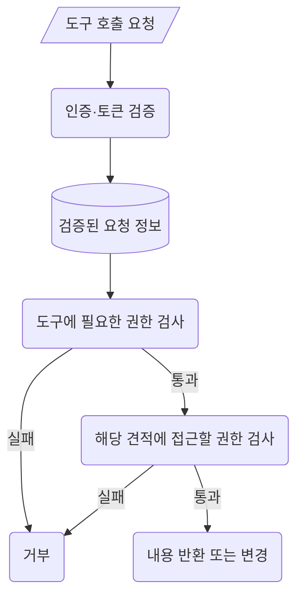
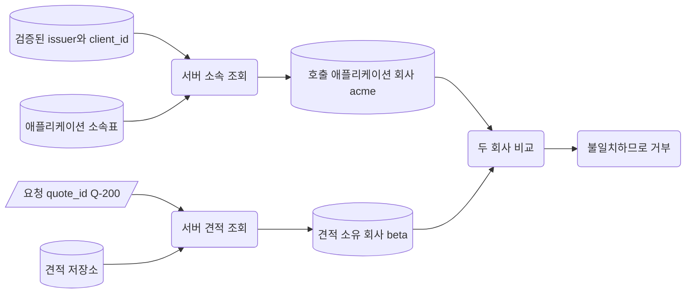
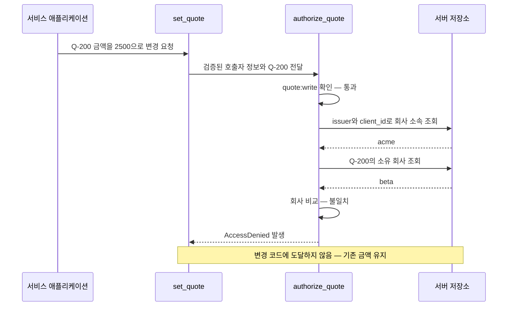

# MCP 서버의 도구별·대상별 접근 통제

서비스 애플리케이션이 MCP 서버를 통해 **자기 회사의 견적만 조회·수정**한다고 하자. 토큰이 유효하더라도, 읽기만 허용된 애플리케이션이 견적을 수정하거나 다른 회사의 견적을 열어서는 안 된다.

이 노트는 인증과 토큰 검증이 끝난 뒤의 **접근 통제**(Access Control)를 다룬다. 접근 통제는 요청 주체가 어떤 행동을 어떤 대상에 할 수 있는지 결정하고 실제로 제한하는 일이다. 이 원칙은 OAuth에만 해당하지 않는다. 서버가 신뢰할 수 있는 요청 주체와 권한 정보를 확보했다면, 인증 방식과 별개로 업무 정책을 적용해야 한다.

전체 정책 예제는 [mcp_access_control.py](examples/mcp_access_control.py)에 있다. 본문에는 핵심 코드만 발췌한다. 토큰 검증 과정은 기존 [JWT 직접 검증 노트](../oauth2/jwt-access-token-verification.md)와 [Introspection 노트](../oauth2/token-introspection-jwt.md)를 참고한다.

## 1. 토큰 검증 이후에도 필요한 접근 검사

**인증**(Authentication)은 요청 주체를 확인하는 일이고, **인가**(Authorization)는 그 주체에게 요청한 행동을 허용할지 판단하는 일이다. 유효한 토큰을 가진 요청에도 추가 인가가 필요하다.

이 예제의 요청 주체는 사람이 아닌 서비스 애플리케이션이다. `client_id`는 그 애플리케이션의 ID다. 이를 사람의 ID나 회사의 ID로 읽으면 안 된다.



그림에서 둥근 상자는 서버의 행동, 원통은 판단에 쓰는 데이터다. 이 노트는 검증된 요청 정보를 얻은 시점부터 설명한다.

서버는 두 질문에 모두 답해야 한다. **이 애플리케이션이 이 도구를 사용할 수 있는가?** 그리고 **이 견적에 그 행동을 할 수 있는가?** 어느 하나라도 실패하면 견적 내용을 반환하거나 변경하지 않는다.

필요한 권한만 허용하는 **최소 권한 원칙**(Least Privilege), 허용 근거가 없으면 거부하는 **기본 거부**(Deny by Default), 매 요청 권한 검사는 일반적인 접근 통제 원칙이다. 이전 요청의 성공을 다음 요청의 허가로 사용하지 않는다. [OWASP 접근 통제 가이드](https://cheatsheetseries.owasp.org/cheatsheets/Authorization_Cheat_Sheet.html#recommendations)

## 2. 접근 판단에 사용할 정보의 출처

호출자가 보낸 값과 서버가 신뢰하는 값은 역할이 다르다. **발급자 식별자**(Issuer Identifier)는 검증된 요청 정보가 어느 발급자에게서 왔는지 나타낸다. 예제는 `(issuer, client_id)` 쌍으로 서버에 등록된 애플리케이션 소속을 찾는다. 서로 다른 발급자의 같은 `client_id`를 같은 애플리케이션으로 취급하지 않기 위해서다.

| 정보의 출처 | 실제 예제 값 | 판단에서 맡는 역할 |
| --- | --- | --- |
| 요청 인자 | `quote_id="Q-200"`, 변경 시 `amount=2500` | 어떤 견적에 어떤 변경을 요청하는가 |
| 검증을 마친 요청 정보 | `issuer="https://login.example.com/"`, `client_id="acme-editor"`, `scopes={"quote:read", "quote:write"}` | 어떤 애플리케이션이며 어떤 권한을 전달받았는가 |
| 서버가 관리하는 소속 | 위 식별자 쌍 → `company_id="acme"` | 애플리케이션이 어느 회사에 속하는가 |
| 서버가 보관하는 견적 | `Q-200` → `company_id="beta"`, `amount=2000` | 견적이 실제로 어느 회사의 데이터인가 |

요청 인자는 **대상을 고르는 값**이지, 접근할 자격의 증거가 아니다. 호출자가 `company_id="beta"`라고 보내도 자기 회사가 `beta`라는 증거가 되지 않는다. 예제의 조회·수정 함수는 `company_id`를 인자로 받지 않는다.

파일의 `get_quote()`와 `set_quote()`는 정책을 보여주는 함수다. 요청에서 받는 업무 입력은 `quote_id`와 수정할 `amount`뿐이다. `caller`는 검증된 요청 문맥에서, `store`는 서버 내부 저장소에서 공급하며, 두 값은 MCP 도구 입력 스키마에 노출하지 않는다.



### MCP 요청의 검증 정보 연결하기

Python SDK의 `get_access_token()`은 현재 요청에서 검증기가 반환한 `AccessToken`을 가져온다. 그 객체의 `client_id`, `scopes`, `claims` 등을 도구 정책에 연결할 수 있다. 인증된 HTTP 요청 문맥 밖에서는 `None`을 반환하므로, 이 예제의 보호된 기능은 이를 거부한다. [SDK의 호출자 정보](https://py.sdk.modelcontextprotocol.io/run/authorization/#the-callers-identity)

별도 Python 파일의 `caller_from_mcp()`는 다음 부분으로 시작한다.

```python
token = get_access_token()
if token is None:
    raise AccessDenied("missing_verified_identity")
claims = token.claims
issuer = claims.get("iss") if isinstance(claims, dict) else None
```

기존 검증기는 발급자를 검증한 뒤 그 값을 `claims["iss"]`에 보존해야 한다. SDK 객체에 필드가 있다는 사실만으로 그 값이 검증되었다고 볼 수는 없다.

`caller_from_mcp()`는 원시 토큰을 다시 디코딩하지 않는다. 검증된 발급자·애플리케이션 ID·권한 정보의 필수 형식을 확인한 뒤, 정책 판단에 사용할 `VerifiedCaller` 객체로 옮긴다. 정보가 없으면 요청 인자로 채우지 않고 거부한다.

파일의 `demo_callers()`가 만드는 `VerifiedCaller`는 **정책 설명용 입력**이다. 이 객체를 직접 만드는 행위가 실제 인증을 대신하지 않는다. 실제 도구 처리 함수에서는 검증된 요청 문맥을 읽는 `caller_from_mcp()`를 사용한다.

## 3. 도구마다 필요한 권한 검사하기

**권한 범위**(Scope)는 허용된 행동을 나타내는 이름이다. 이 예제는 읽기와 쓰기를 구분한다.

```python
TOOL_SCOPES = {"get_quote": "quote:read", "set_quote": "quote:write"}
```

`get_quote`에는 `quote:read`, `set_quote`에는 `quote:write`가 필요하다. 이 이름과 대응 관계는 **예제의 업무 정책이며 MCP 표준 권한 이름이 아니다**. 쓰기 권한에 읽기 권한이 자동으로 포함된다고 가정하지도 않는다.

`require_tool_scope()`는 검증 정보의 필수 형식을 확인한 다음, 아래 조건을 검사한다.

```python
required = TOOL_SCOPES.get(tool_name)
if required is None or required not in caller.scopes:
    raise AccessDenied("tool_scope_missing")
```

등록되지 않은 도구에도 기본 거부를 적용한다. `acme-reader`는 `quote:read`만 있으므로 자기 회사 견적이라도 수정할 수 없다.

SDK의 `AuthSettings.required_scopes`는 서버 전체 요청에 적용하는 공통 조건이다. 여기에 `quote:write`를 넣으면 읽기 전용 요청도 쓰기 권한이 없다는 이유로 막힌다. 도구마다 요구가 다르면 공통 조건과 도구별 조건을 나누고, 도구 내부에서 해당 권한을 검사해야 한다. [SDK의 서버 공통 권한 설정](https://py.sdk.modelcontextprotocol.io/run/authorization/#a-token-verifier)

도구 권한을 통과했다는 사실은 모든 회사의 견적에 접근할 권한을 뜻하지 않는다. 다음으로 요청 대상을 확인한다.

## 4. 특정 견적에 접근할 권한 검사하기

**대상별 권한**(Object-level Authorization)은 같은 종류의 데이터라도 개별 대상에 접근할 자격이 있는지 확인하는 것이다. 견적 ID를 알고 있거나 추측할 수 있어도 그 견적을 열 수 있어서는 안 된다. [OWASP의 대상 식별자와 접근 검사](https://cheatsheetseries.owasp.org/cheatsheets/Authorization_Cheat_Sheet.html#ensure-lookup-ids-are-not-accessible-even-when-guessed-or-cannot-be-tampered-with)

`authorize_quote()`는 먼저 도구 권한을 확인하고, 서버의 소속표와 견적 소유 정보를 비교한다.

```python
def authorize_quote(
    caller: VerifiedCaller | None,
    tool_name: str,
    quote_id: str,
    store: QuoteStore,
) -> Quote:
    """도구 권한과 대상 소유권을 확인한 뒤 서버 내부 견적을 반환한다."""
    require_tool_scope(caller, tool_name)
    assert caller is not None  # 위 검사에서 이미 확인했다.
    company_id = store.app_companies.get((caller.issuer, caller.client_id))
    if not company_id:
        raise AccessDenied("company_membership_missing")

    quote = store.quotes.get(quote_id)
    if quote is None or not quote.company_id or quote.company_id != company_id:
        # 없는 견적과 타사 견적은 외부에 같은 거부 메시지를 준다.
        raise AccessDenied("target_unavailable")
    return quote
```

여기서 견적 조회는 서버 내부의 판단 자료를 읽는 단계다. 아직 호출자에게 내용을 반환하지 않는다. 회사가 일치한 뒤에야 `get_quote()`가 해당 견적을 반환한다.

| 호출 애플리케이션 / 소속 회사 | 도구 | 요청 견적 / 소유 회사 | 결과 |
| --- | --- | --- | --- |
| `acme-editor` / `acme` | `get_quote` | `Q-100` / `acme` | 읽기 권한과 회사 조건 모두 통과 |
| `acme-editor` / `acme` | `get_quote` | `Q-200` / `beta` | 읽기 권한은 있지만 회사가 달라 거부 |
| `beta-editor` / `beta` | `set_quote` | `Q-200` / `beta` | 쓰기 권한과 회사 조건 모두 통과 |

`acme-editor`가 `Q-200`의 수정을 요청하면 실행 순서는 다음과 같다.



## 5. 검사 순서와 거부 결과 확인하기

**견적을 반환한 뒤 검사하면** 이미 내용이 노출된다. **금액을 바꾼 뒤 검사하면** 거부된 요청도 저장소를 변경한다. 수정 후 원래 값으로 되돌리는 방식에 의존하지 말고, 접근 검사에 통과한 뒤 변경해야 한다.

이 예제의 순서는 `검증 정보 확인 → 도구 권한 확인 → 서버 소속 조회 → 견적 소유 회사 비교 → 내용 반환·변경`이다. 값 검증도 변경 전에 수행한다.

```python
def set_quote(
    caller: VerifiedCaller | None, quote_id: str, amount: int, store: QuoteStore
) -> Quote:
    """접근 검사와 값 검사가 모두 끝난 뒤 금액을 변경한다."""
    quote = authorize_quote(caller, "set_quote", quote_id, store)
    if type(amount) is not int or amount < 0:
        raise ValueError("금액은 0 이상의 정수여야 합니다.")
    updated = replace(quote, amount=amount)
    store.quotes[quote_id] = updated
    return updated
```

`Quote`는 변경할 수 없는 데이터 객체다. `replace()`는 검사한 견적을 바탕으로 새 객체를 만들며, `company_id`는 그대로 유지한다. 마지막 저장 단계에 도달해야 금액이 바뀐다. 매 호출에서 `authorize_quote()`를 다시 거치므로 이전 성공을 재사용하지 않는다.

| 요청 상황 | 기대 결과 | 확인할 상태 |
| --- | --- | --- |
| 읽기 권한으로 자기 회사 견적 조회 | 허용 | 해당 견적만 반환 |
| 읽기 권한만으로 자기 회사 견적 수정 | 도구 권한에서 거부 | 기존 금액 유지 |
| 쓰기 권한으로 다른 회사 견적 수정 | 대상별 권한에서 거부 | 다른 회사 견적의 기존 금액 유지 |
| 검증 정보가 없거나 서버 소속이 없음 | 거부 | 견적 내용 반환·변경 없음 |
| 같은 `client_id`지만 서버 소속표에 없는 발급자 | 거부 | 다른 발급자의 소속을 재사용하지 않음 |
| 존재하지 않는 견적 또는 소유 회사 정보가 없는 견적 | 거부 | 견적 내용 반환·변경 없음 |
| 쓰기 권한으로 자기 회사 견적을 올바른 금액으로 수정 | 허용 | 해당 견적의 금액만 변경 |

`AccessDenied`는 이 예제의 **정책 거부 예외**다. 이 예외를 발생시키는 것만으로 HTTP `403` 응답이나 MCP 오류가 만들어지는 것은 아니다.

실제 서버에서는 이 예외를 받아 외부 응답으로 바꾸는 처리가 별도로 필요하다. `ToolError`를 OAuth 권한 거부의 표준으로 간주하지 않는다. 이 노트와 Python 파일은 그 응답 변환 대신 허용 판단과 거부 시 상태 보존에 집중한다.

예제는 메모리에서 동기 함수로 판단하고 변경한다. 실제 데이터베이스에서는 소유 정보 검사와 변경 사이에 다른 요청이 값을 바꾸지 않도록 트랜잭션(Transaction)이나 회사 조건을 포함한 갱신 쿼리로 같은 정책을 지켜야 한다.
